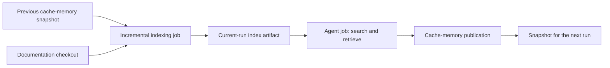

[QMD](https://github.com/tobi/qmd) (Query Markup Documents) combines BM25 keyword search, vector similarity search, and local LLM reranking. In gh-aw, the integration is a shared agentic workflow file that supplies an indexing job, cache-memory, and an MCP search server. Agents can search indexed documentation and retrieve its contents without checking out the source repository.

This page describes [QMD v2.8.3](https://github.com/tobi/qmd/releases/tag/v2.8.3), the latest upstream release at the time of writing. It requires Node.js 22 or newer and is published as `@tobilu/qmd`.

## Index/Search Pattern

Separate corpus preparation from agent execution:



The indexing job restores the previous snapshot, checks out documentation, runs `qmd update`, then runs `qmd embed`. Updating scans the corpus and reconciles added, changed, and removed documents; embedding processes content that still needs embeddings. Do not use `qmd embed --force` on every run: it discards the incremental benefit.

The agent job receives the new snapshot through an artifact and searches a working copy. The snapshot is persisted through gh-aw's cache-memory lifecycle, not by the search tool.

**The artifact is the same-run handoff; cache-memory is the cross-run handoff.** Jobs have separate filesystems. `restore-memory: true` only restores prior memory and does not publish custom-job changes. A dependency on the indexing job alone does not make its updated files available to the agent. Without an artifact download, the agent could search an older restored cache.

### Example Shared Workflow

Keep the integration in a shared workflow file and import it from the consuming agentic workflow. The following example uses a local `shared/qmd.md`; adjust the import path to the shared component used by your repository.

```aw wrap title=".github/workflows/docs-search.md"
---
on: workflow_dispatch
engine: copilot
permissions:
  contents: none
  copilot-requests: write
checkout: false
imports:
  - shared/qmd.md
---

# Documentation Search

Use QMD to find documentation about workflow permissions.
Search the docs collection, retrieve relevant passages, and summarize them
with document references. Do not update collections or regenerate embeddings.
```

The example shared component below indexes Markdown documentation with a deterministic custom job. Only that job needs `contents: read`; the consumer disables source checkout and uses QMD's search and retrieval tools.

```aw wrap title=".github/workflows/shared/qmd.md"
---
tools:
  cache-memory:
    - id: qmd
      key: qmd-docs-v2.8.3
      allowed-extensions: [".sqlite", ".yml"]

jobs:
  indexing:
    runs-on: ubuntu-latest
    permissions:
      contents: read
    restore-memory: true
    env:
      INDEX_PATH: /tmp/gh-aw/qmd-work/index.sqlite
      QMD_CONFIG_DIR: /tmp/gh-aw/qmd-work
      QMD_FORCE_CPU: "1"
      CI: ""
    steps:
      - uses: actions/checkout@v7
        with:
          persist-credentials: false
          sparse-checkout: docs
      - uses: actions/setup-node@v7
        with:
          node-version: "24"
      - name: Install QMD
        run: npm install -g @tobilu/qmd@2.8.3
      - name: Prepare index and collection
        run: |
          mkdir -p /tmp/gh-aw/qmd-work
          if [ -f /tmp/gh-aw/cache-memory-qmd/index.sqlite ]; then
            cp /tmp/gh-aw/cache-memory-qmd/index.sqlite "$INDEX_PATH"
          fi
          python3 - <<'PY'
          import json, os
          from pathlib import Path
          config = {
              "collections": {
                  "docs": {
                      "path": str(Path(os.environ["GITHUB_WORKSPACE"]) / "docs"),
                      "pattern": "**/*.md",
                  }
              }
          }
          (Path(os.environ["QMD_CONFIG_DIR"]) / "docs.yml").write_text(json.dumps(config))
          PY
      - name: Update documents and missing embeddings
        run: |
          qmd --index docs update
          qmd --index docs embed
      - name: Snapshot the index
        run: |
          python3 - <<'PY'
          import os, sqlite3
          from pathlib import Path
          root = Path("/tmp/gh-aw/cache-memory-qmd")
          root.mkdir(parents=True, exist_ok=True)
          with sqlite3.connect(os.environ["INDEX_PATH"]) as source:
              with sqlite3.connect(root / "index.sqlite") as target:
                  source.backup(target)
          PY
          cp /tmp/gh-aw/qmd-work/docs.yml /tmp/gh-aw/cache-memory-qmd/docs.yml
      - uses: actions/upload-artifact@v7
        with:
          name: qmd-index
          path: |
            /tmp/gh-aw/cache-memory-qmd/index.sqlite
            /tmp/gh-aw/cache-memory-qmd/docs.yml
          if-no-files-found: error
          retention-days: 1

  agent:
    needs: [indexing]

pre-agent-steps:
  - uses: actions/download-artifact@v8
    with:
      name: qmd-index
      path: /tmp/gh-aw/cache-memory-qmd
  - name: Prepare search working copy
    run: |
      test -s /tmp/gh-aw/cache-memory-qmd/index.sqlite
      mkdir -p /tmp/gh-aw/qmd-search
      cp /tmp/gh-aw/cache-memory-qmd/index.sqlite /tmp/gh-aw/qmd-search/index.sqlite
      cp /tmp/gh-aw/cache-memory-qmd/docs.yml /tmp/gh-aw/qmd-search/docs.yml

mcp-servers:
  qmd:
    container: node:24-bookworm
    entrypoint: npx
    entrypointArgs: ["--yes", "@tobilu/qmd@2.8.3", "--index", "docs", "mcp"]
    mounts:
      - /tmp/gh-aw/qmd-search:/tmp/gh-aw/qmd-search:rw
    env:
      INDEX_PATH: /tmp/gh-aw/qmd-search/index.sqlite
      QMD_CONFIG_DIR: /tmp/gh-aw/qmd-search
      QMD_FORCE_CPU: "1"
      CI: ""
    allowed: [query, get, multi_get, status]
---
```

The configuration file is generated from the current checkout path on each indexing run, rather than reusing a runner-specific path from an older run. JSON is valid YAML, so QMD can read the generated `docs.yml`. Explicit `--index docs` avoids automatically adopting a checked-out `.qmd/index.yml`.

SQLite's backup API produces a consistent, standalone snapshot. Keep the active database and its WAL/shared-memory sidecars outside cache-memory; the default extension policy does not allow SQLite files, so this example explicitly allows `.sqlite` and `.yml`. The MCP server gets only a disposable search copy, not the persisted snapshot or source checkout. Search can write SQLite bookkeeping without changing the next run's corpus.

`CI` is empty because QMD v2.8.3 treats any nonempty `CI` value, including `"false"`, as its test-mode switch and disables real LLM operations. `QMD_FORCE_CPU=1` selects CPU execution. For GPU indexing, choose a GPU runner on `jobs.indexing.runs-on` and remove that override from the indexing job; the search server can still run on CPU.

The Node container installs the pinned QMD package when starting. For production, use a digest-pinned image with QMD and its native dependencies preinstalled to avoid repeated installation. Embedding and reranking models are downloaded as needed; provision them ahead of time when startup latency or network restrictions matter.

### Persistence and Failure Handling

A missing cache is a cold start: generate the collection configuration, build the index, and embed it in full. A corrupt database or failed indexing command must fail the indexing job, not silently fall back to an old snapshot. A missing current-run artifact must likewise block search.

gh-aw appends the run ID to the cache save key and generates stable restore prefixes. Do not include `${{ github.run_id }}` in the configured `key`. Change the key when changing the corpus definition, embedding model, or incompatible QMD/index format. Actions caches are immutable, branch-scoped, and subject to eviction; cache-memory is an optimization, not an authoritative document store.

Publication happens after the agent job. With threat detection enabled, the generated `update_cache_memory` job publishes only after successful agent execution, detector acceptance, memory validation, and an eligible trigger. Otherwise, the normal agent-job cache action handles persistence. If publication fails, the next run starts from the last published snapshot and repeats the missing work. See [Cache access boundaries](/gh-aw/reference/cache-memory/#cache-access-boundaries).

For a separately scheduled indexing workflow, use a compatible shared cache-memory key/scope and configure the search workflow's memory entry with `restore-only: true`. That search workflow reads the latest accessible published snapshot; it cannot assume that a refresh ran for its trigger. Record the indexed source revision and indexing time in a JSON manifest, allow `.json`, and define a freshness limit and explicit cache-miss behavior. Do not reconstruct compiler-generated integrity prefixes or bypass them with a hand-written cache save.

Keep model downloads in a separate dependency cache rather than in cache-memory. QMD uses `$XDG_CACHE_HOME/qmd/models` (or `~/.cache/qmd/models`). Model files can be much larger than the document database; include the model identity, platform, and QMD version in their cache key and provide required downloads when that cache misses.

## Search and Retrieval in QMD v2.8.3

The MCP server exposes four tools:

| Tool | Purpose |
|------|---------|
| `query` | Combine typed lexical, vector, or hypothetical-document searches with reciprocal rank fusion and optional reranking |
| `get` | Retrieve a document by path or docid, optionally limiting the line range |
| `multi_get` | Retrieve multiple documents by glob, comma-separated paths, or docids |
| `status` | Inspect index health and collections |

The MCP `query` tool requires `searches`, an array of 1-10 objects. Use `lex` for BM25 keywords, `vec` for semantic questions, and `hyde` for a hypothetical passage describing the answer. The first sub-query receives twice the fusion weight.

```json
{
  "searches": [
    {"type": "lex", "query": "permissions contents"},
    {"type": "vec", "query": "How can an agent search documentation without cloning the repository?"}
  ],
  "collections": ["docs"],
  "intent": "Least-privilege agent jobs",
  "limit": 5,
  "minScore": 0.3,
  "rerank": true
}
```

`intent` supplies disambiguation context; it is not a search query. `collections` must be an array: the singular `collection` parameter is ignored by the MCP tool. `candidateLimit` controls the reranking pool (default 40); `rerank: false` skips reranking for lower latency. Unknown parameter names are silently ignored, so verify names when results appear unscoped.

Use `get` with `file`, `fromLine`, and `maxLines` to retrieve only the passages needed. Indexed contents remain retrievable without the checkout; prefer docids or `qmd://` references to runner-specific absolute file paths.

For CLI clients, `qmd search` performs keyword search, `qmd vsearch` performs vector search, and `qmd query` performs hybrid search with query expansion and reranking. Use `--format json` for structured output or `--format files` for file references.

## Release Compatibility and Security

QMD v2.8.3 uses MCP protocol revision `2026-07-28`. Stdio retains compatibility with older clients; HTTP is sessionless and supports the newer discovery and request-header contract. The workflow example uses stdio through the MCP gateway.

Project-local configuration now requires approval for update hooks, paths outside the project, and custom model URIs. Do not set `QMD_TRUST_UPDATE_HOOKS=1` or `QMD_TRUST_LOCAL_CONFIG=1` to bypass those checks for untrusted checkouts. The example generates its own collection configuration and does not execute project-defined update commands.

HTTP mode (`qmd mcp --http`) defaults to `localhost:8181`, exposes `/mcp`, `/query` (alias `/search`), and `/health`, and validates `Origin` and `Host` headers. Off-host exposure requires authentication outside QMD; do not disable the allowlists to make an unauthenticated index reachable.

## Learn More

- [Imports](/gh-aw/reference/imports/) - Reusing shared agentic workflow files
- [Custom Steps and Jobs](/gh-aw/reference/steps-jobs/) - Job dependencies, memory restoration, and pre-agent hooks
- [Cache Memory](/gh-aw/reference/cache-memory/) - Persistence, validation, branch scope, and cache access
- [Using MCPs](/gh-aw/guides/mcps/) - Custom server configuration and transport
- [QMD v2.8.3 README](https://github.com/tobi/qmd/blob/v2.8.3/README.md) - Release-specific CLI, MCP, and SDK reference
