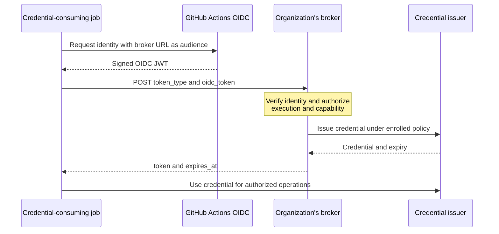
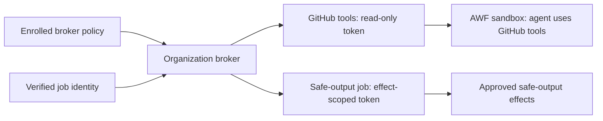
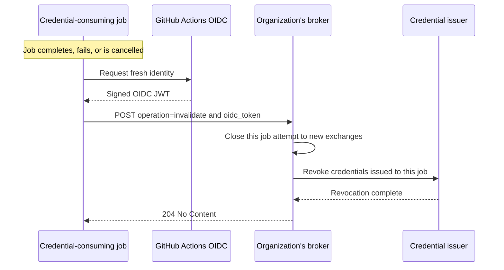

> [!WARNING]
> Token broker authentication is experimental. Its configuration and behavior may change without deprecation.

A token broker is an HTTPS service operated by your organization. It exchanges a GitHub Actions job's OpenID Connect (OIDC) identity for a short-lived credential. This lets a deployment manage authorization centrally instead of distributing GitHub App signing keys to each repository.

The broker server is not included in gh-aw. An operator must deploy and enroll a broker that implements the [token broker specification](/gh-aw/specs/token-broker-specification/). Before a broad write rollout, verify in real runs that its credentials have the intended scope, are revoked at job end, cannot be reissued after closure, and expire if cleanup cannot run.

## Choose what uses the broker

Each capability is an independent opt-in:

| Workflow setting | Broker capability | Used for |
| --- | --- | --- |
| `tools.github.token-broker` | `github-app` | GitHub tools; broker policy must issue read-only tokens. |
| `safe-outputs.token-broker` | `github-app` | Configured safe-output effects; broker policy must grant only their required permissions. |
| `token-broker.copilot-task` | `copilot-task` | Copilot coding-agent task creation and issue assignment. |
| `token-broker.copilot-request` | `copilot-request` | Copilot inference in threat-detection and evals jobs. Main-agent inference is not supported. |

For example, the following frontmatter selects the broker independently for GitHub tools and safe outputs:

```aw wrap
---
on: workflow_dispatch
tools:
  github:
    token-broker:
safe-outputs:
  token-broker:
  add-comment:
---

# Review an issue

Read the issue and add a comment with your findings.
```

In these two sections, an empty `token-broker:` means `true`; use `false` to disable it. Do not combine an enabled section's broker with that section's `github-token` or `github-app`. Handler-specific credentials can still override the safe-output default. `safe-outputs.jobs` do not inherit it. Work-queue dispatch requires an explicit dispatch credential; a brokered token does not establish the verified App identity needed for dispatch.

Configure the complete HTTPS exchange endpoint in the `GH_AW_TOKEN_BROKER_URL` Actions secret, available only to enrolled repositories. A repository secret takes precedence over an organization secret. Actions variables are not used. Enabling a capability without a usable endpoint or after a failed exchange fails the affected operation; it does not fall back to another credential.

## How an exchange works



For `copilot-request`, the request also includes the inference provider ID. GitHub App requests do **not** supply an installation, repository scope, or permissions. The broker chooses them from its enrolled policy after verifying the signed identity. The URL is the complete exchange endpoint; the client does not append a path or follow redirects.

The broker must verify the OIDC signature, issuer, audience and time claims, then authorize the repository, workflow revision, event, execution context and requested capability. A valid GitHub identity alone is not permission to issue a token. If policy needs to distinguish GitHub tools from safe outputs, the deployment must use trustworthy job-level evidence; a job name supplied by the caller is not sufficient. If the broker cannot establish the required context, it must deny the exchange rather than issue a union of permissions.

## Where credentials can be used



Each consuming job obtains its own credential. GitHub tool authentication requires the AWF sandbox, which excludes the OIDC bootstrap credentials and broker URL from the agent environment. The sandbox does not eliminate the consequences of a sandbox escape.

`id-token: write` is a **job-wide** permission, not a step-level permission. Custom steps and actions in a brokered job can use its credential authority and may request their own broker credentials. Review them whenever they change, pin third-party actions to full commit SHAs, and keep untrusted input from choosing code, actions, refs, or target repositories. Put code that does not need credentials in separate jobs without that permission.

Use GitHub-hosted runners or enrolled self-hosted runners that start clean for each job. Broker policy must approve both the caller and reusable workflow when reusable workflows are involved. App-token-authored pull requests can trigger CI; require approval for those workflows and protect target branches.

## Cleanup and failure



The cleanup step uses `always()` and does not send the issued credential. The broker must close the job attempt before revoking and prevent an exchange racing cleanup from surviving it. This is a server requirement, not a guarantee provided by gh-aw alone. Operators should also arrange broker-side revocation on job completion.

If a runner is lost, the cleanup step might not run. Downstream-enforced expiry is the remaining bound on credential use. GitHub consumers use fixed credentials for the job and do not automatically renew them. See the [enterprise configuration reference](/gh-aw/reference/enterprise-configuration/#oidc-token-broker) for deployment considerations and the [specification](/gh-aw/specs/token-broker-specification/) for the full protocol and security requirements.
