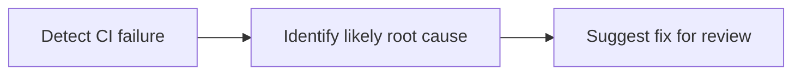

CI failure investigation with GitHub Agentic Workflows means starting an agent after a failed GitHub Actions workflow so it can inspect failed jobs and logs, correlate the failure with repository changes, and report the likely root cause with suggested next steps. The AI-generated diagnosis may be incorrect; verify it against the logs and relevant code before acting on suggested fixes.

CI Doctor is the default [quickstart](/gh-aw/setup/quick-start/). Follow that guide to choose an engine and install the evidence contract: linked log/code evidence, checks actually performed, and explicit uncertainty so a maintainer can confirm or reject the diagnosis without replaying the agent session.

To install the upstream sample without the quickstart's additional instructions, use:

```
gh aw add-wizard githubnext/agentics/ci-doctor
```



## Example output

<a href="https://github.com/github/gh-aw/issues/14295"></a>

In [github/gh-aw#14295](https://github.com/github/gh-aw/issues/14295), CI Doctor reported nondeterministic Go map iteration as the likely root cause of a failing assertion. The report identifies the failed job, explains why the output order may have varied, and recommends sorting and formatting the engine list deterministically. The issue was generated by an Agentics CI Doctor workflow and links back to the workflow run and pinned source version.

## Workflow source

<!-- agentics-workflow: ci-doctor.md -->

The agent has read-only access to Actions and repository content. Issue creation and comments are safe outputs, so gh-aw validates them before publishing.

Match `workflows: ["CI"]` to the repository's workflow display names and `branches: [main]` to trusted monitored branches. Set `checkout: false` and enable `tools.github.toolsets: [actions, repos, issues, pull_requests]` so the agent retrieves code and job logs through GitHub tools; retain the sample's read-only permissions and safe outputs. Preserve engine-specific tool settings, including Pi's `gh-proxy` and `cli-proxy` requirements.

Run `gh aw compile ci-doctor` and commit both the Markdown workflow and its generated lock file to the default branch. The sample investigates subsequent failed `workflow_run` events, not historical runs automatically, and has no manual dispatch trigger. The quickstart covers safely rerunning an existing failed CI run and checking the resulting issue or duplicate comment.

The sample is maintained in `githubnext/agentics`; installation records its upstream `source:`. Use `gh aw update ci-doctor` to merge upstream changes and review local configuration and evidence instructions afterward. Do not hand-edit the generated lock file.

## Learn More

- [CI Doctor source workflow](https://github.com/githubnext/agentics/blob/main/workflows/ci-doctor.md)
- [Workflow run triggers](/gh-aw/reference/triggers/#workflow-run-triggers-workflow_run)
- [Safe outputs](/gh-aw/reference/safe-outputs/)
- [Debugging workflows](/gh-aw/troubleshooting/debugging/)
