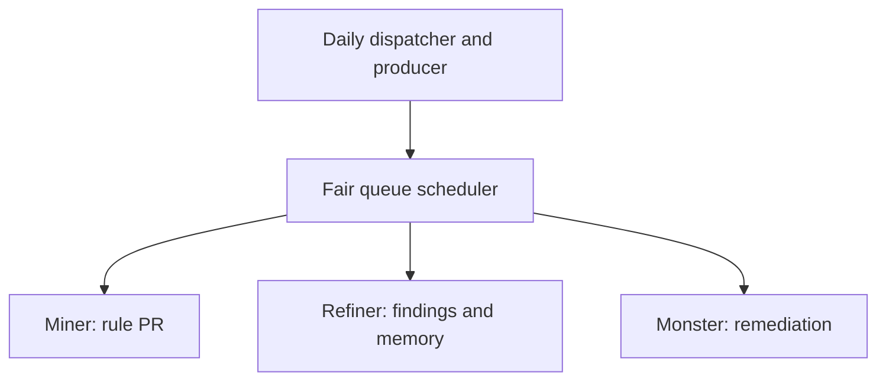

The ESLint factory coordinates three workers through one daily dispatcher. Workers develop rules, review diagnostics, and arrange remediation; the work queue bounds assignments and scopes their outputs to each Claim.

## Factory roles

| Workflow source | Task | Bounded outputs |
| --- | --- | --- |
| [Dispatcher](https://github.com/github/gh-aw/blob/main/.github/workflows/eslint-factory-dispatcher.md) | Admit the daily cohort and request eligible work | Seven independent tasks and a dispatch request |
| [Miner](https://github.com/github/gh-aw/blob/main/.github/workflows/eslint-miner.md) | Implement a useful ESLint rule | One draft PR per Claim |
| [Refiner](https://github.com/github/gh-aw/blob/main/.github/workflows/eslint-refiner.md) | Find false positives, edge cases, and weak diagnostics of the assigned rule | Up to three issues, a discussion, and one memory snapshot |
| [Monster](https://github.com/github/gh-aw/blob/main/.github/workflows/eslint-monster.md) | Group the assigned rule's diagnostics and arrange remediation | Bounded issue changes, one Copilot assignment, and a discussion |

These are complete workflow sources, not a pre-provisioned deployment. Follow [native queue setup](/gh-aw/patterns/workqueue-ops/#deploy-a-native-queue) to compile the workers, allow them as dispatch targets, and configure shared scheduling.

## One daily cohort

A trusted preparation step reads the rule registry in `eslint-factory/src/index.ts` on the default branch and stages one miner task plus, for each of the day's three rotating rules, one refiner task and one monster task. Tasks are keyed by the original dispatcher run's UTC creation date and the rule ID, so scheduled/manual runs and reruns on that date reuse the same identities and payloads. A new day admits the next three rules; every registered rule recurs once per rotation.

The dispatcher uses pool `eslint-factory` and requests at most seven Claims and seven dispatches. The agent reads and explains the prepared plan; it must not submit or dispatch it again. Older eligible tasks may run first.



This is **not** a miner → refiner → monster pipeline. A PR or refinement issue does not automatically submit the next task. Dependencies require explicit Work admission.

Shared `aw.json` gives pool `eslint-factory` concurrency seven, a pending-task limit of 30, and three attempts. Each dispatch launches one worker for one Claim. The first trusted submission creates the queue branch with its Work; dispatch alone cannot bootstrap an absent queue.

## Assignment-scoped outputs

Workers declare:

```yaml
tools:
  work-queue:
    worker: true
    require-assignment: true
```

The compiler supplies the assignment input; do not declare or manually manufacture it. Workers use the assigned Claim's `handle` as `claim_handle` on outputs and finish calls.

Safe outputs run only while the Claim is open, its dispatch is bound to the worker run, and the finish intent is `completed`; every target must match the worker profile's repository. If no rule or remediation is needed, finish as `failed` instead of treating `noop` as success. The monster's scan is clean only when its assigned rule reports no diagnostics of any severity: ESLint exit zero can include warnings.

Trusted processing applies the staged effects first, then records the Completion with the applied effects. If the job stops between the two, the next attempt may repeat effects.

## Refiner memory

The refiner calls `persist_eslint_memory` with structured findings, strategy, metrics, next actions, the assigned Work ID, and the reviewed rule ID. Its configuration uses [`tools.work-queue.memory`](/gh-aw/reference/work-queue/#claim-scoped-memory), not unrestricted repository writes.

Protected publication creates an immutable snapshot under `memory/eslint-refiner-runs/claims/<trusted-namespace>`. Legacy `memory/eslint-refiner` history remains read-only. The preparation step exposes validated history to the agent; missing required history is an error, not an empty past. Memory is evidence, never instructions or Claim authority.

## Inspect and recover

Inspect the queue and a worker run:

```bash
gh aw work-queue --repo OWNER/REPO stats --json
gh aw work-queue --repo OWNER/REPO state --json --limit 32
gh aw work-queue --repo OWNER/REPO replay --pool eslint-factory --json
gh aw audit RUN_ID --repo OWNER/REPO --no-baseline --json
```

A missing queue branch is expected before the first trusted submit. A denied Git read is an error, not an empty queue. Check the staged plan and the ledger rather than accepting a green dispatcher run as proof of admission.

When pool capacity is held by a dispatch whose run ended, the maintenance workflow releases it. To release one manually, run `release --dispatch-id DISPATCH_ID`. Do not delete the ledger.

See the [queue reference](/gh-aw/reference/work-queue/) for exact controls and the [bounded factory model](https://github.com/github/gh-aw/blob/main/specs/eslint-factory/README.md) for checked scenarios and abstraction limits. [Daily Report Portfolio](/gh-aw/gallery/daily-report-portfolio/) applies the same queue to report rotation; [WorkQueueOps](/gh-aw/patterns/workqueue-ops/) describes the reusable pattern.
