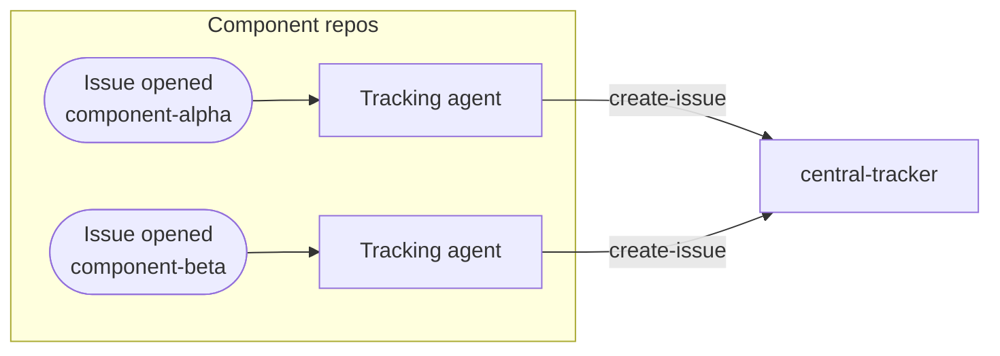
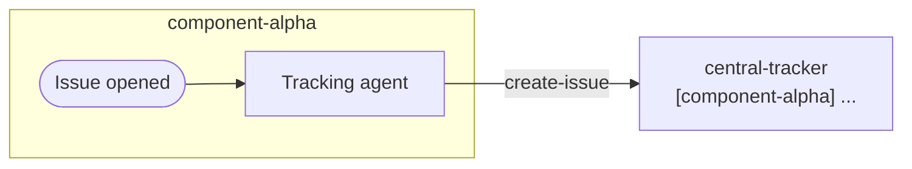
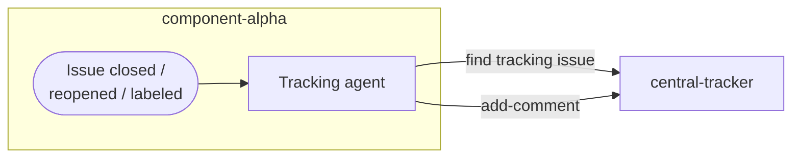
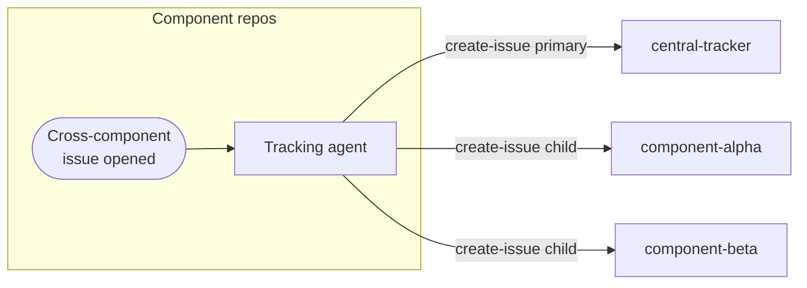
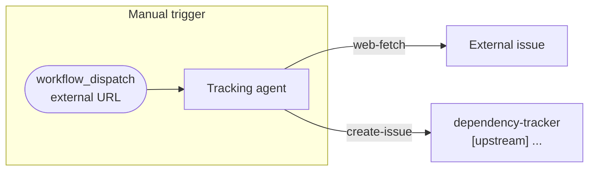
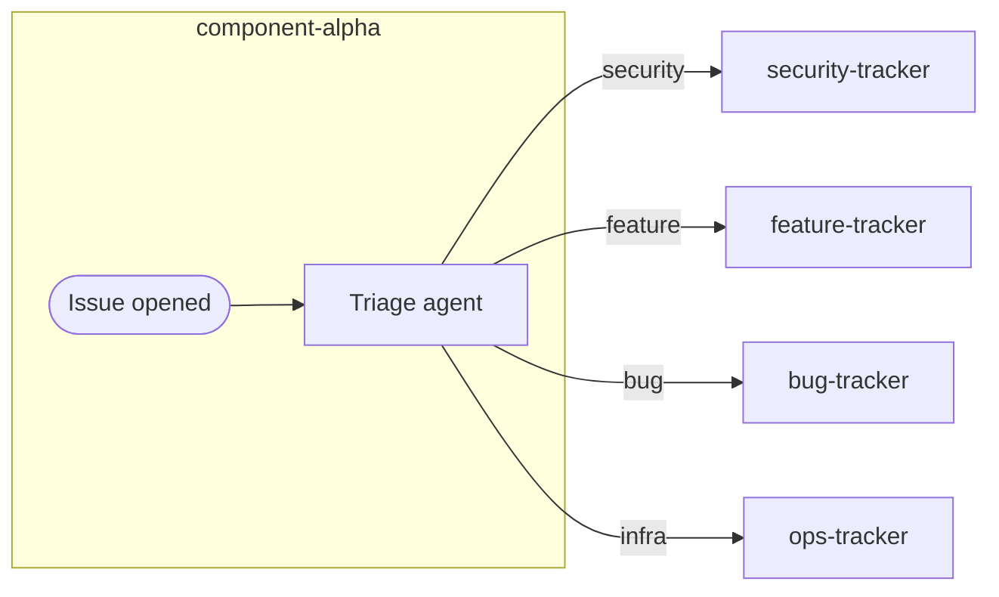
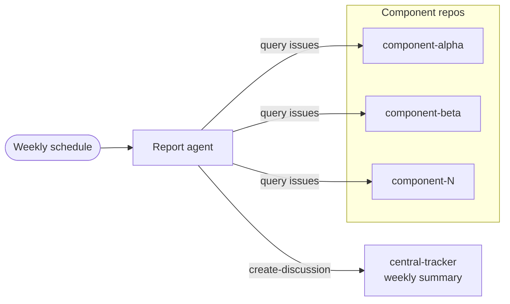
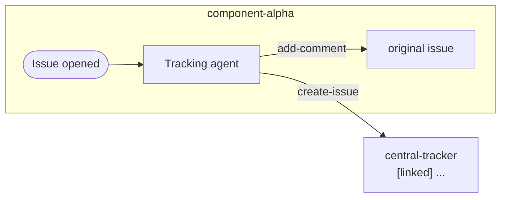
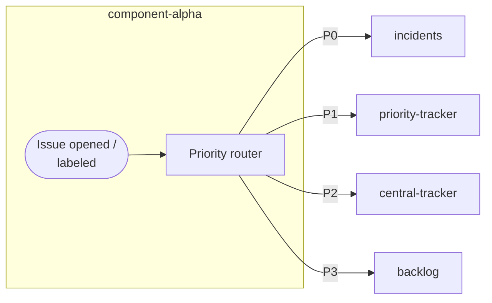

Centralize issues across component repositories without direct access to each repository.

## When to Use

Use it for component architectures, external dependencies, cross-project initiatives, or distributed metrics.

## How It Works



Component workflows update central references when local issues change.

## Basic Tracking Issue Creation



```aw wrap
---
on:
  issues:
    types: [opened]

permissions:
  contents: read
  actions: read

tools:
  github:
    toolsets: [issues]

safe-outputs:
  github-token: ${{ secrets.GH_AW_CROSS_REPO_PAT }}
  create-issue:
    target-repo: "myorg/central-tracker"
    title-prefix: "[component-alpha] "
    labels: [from-component-alpha, tracking-issue]
---

# Create Central Tracking Issue

**Original issue:** ${{ github.event.issue.html_url }}
**Issue number:** ${{ github.event.issue.number }}
**Content:** "${{ steps.sanitized.outputs.text }}"

Create a tracking issue with the original link, component identifier, summary, suggested priority, and labels `from-component-alpha` and `tracking-issue`.
```

## Status Synchronization



```aw wrap
---
on:
  issues:
    types: [closed, reopened, labeled, unlabeled]

permissions:
  contents: read
  actions: read

tools:
  github:
    toolsets: [issues]

safe-outputs:
  github-token: ${{ secrets.GH_AW_CROSS_REPO_PAT }}
  add-comment:
    target-repo: "myorg/central-tracker"
    target: "*"  # Find related tracking issue
---

# Update Central Tracking Issue Status

**Original issue:** ${{ github.event.issue.html_url }}
**Action:** ${{ github.event.action }}

Find the tracking issue in `myorg/central-tracker` and comment with the status (✅ resolved, 🔄 reopened, or 🏷️ label change), issue link, and timestamp.
```

## Multi-Component Tracking



```aw wrap
---
on:
  issues:
    types: [opened]
    # Triggered when issue has 'cross-component' label

permissions:
  contents: read
  actions: read

tools:
  github:
    toolsets: [issues]

safe-outputs:
  github-token: ${{ secrets.GH_AW_CROSS_REPO_PAT }}
  create-issue:
    max: 3  # May create issues in multiple tracking repos
    target-repo: "myorg/central-tracker"
    title-prefix: "[cross-component] "
    labels: [cross-component, needs-coordination]
---

# Track Cross-Component Issues

**Original issue:** ${{ github.event.issue.html_url }}

Identify affected components. Create a primary tracking issue in the central tracker with the component list and coordination requirements; create child issues in affected repos when needed. For high-priority issues, tag team leads and schedule coordination.
```

## External Dependency Tracking



```aw wrap
---
on:
  workflow_dispatch:
    inputs:
      external_issue_url:
        description: 'URL of external issue to track'
        required: true
        type: string

permissions:
  contents: read

engine: codex
tools:
  github:
    toolsets: [issues]
  web-fetch:

safe-outputs:
  github-token: ${{ secrets.GH_AW_CROSS_REPO_PAT }}
  create-issue:
    target-repo: "myorg/dependency-tracker"
    title-prefix: "[upstream] "
    labels: [external-dependency, upstream-issue]
---

# Track External Dependency Issue

**External issue URL:** ${{ github.event.inputs.external_issue_url }}

Fetch the external issue, identify affected internal projects, and create a tracking issue with its link, status, impact, affected repositories, and monitoring plan. Set a weekly reminder and notify affected teams.
```

## Automated Triage and Routing



```aw wrap
---
on:
  issues:
    types: [opened]

permissions:
  contents: read
  actions: read

tools:
  github:
    toolsets: [issues]

safe-outputs:
  github-token: ${{ secrets.GH_AW_CROSS_REPO_PAT }}
  create-issue:
    max: 2
    title-prefix: "[auto-triaged] "
---

# Triage and Route to Tracking Repos

**Original issue:** ${{ github.event.issue.html_url }}
**Content:** "${{ steps.sanitized.outputs.text }}"

Route security, feature, bug, and infrastructure issues to `myorg/security-tracker`, `myorg/feature-tracker`, `myorg/bug-tracker`, or `myorg/ops-tracker`. Include the original link, triage reasoning, priority, affected components, and SLA targets.
```

## Aggregated Reporting



```aw wrap
---
on: weekly on monday

permissions:
  contents: read

tools:
  github:
    toolsets: [issues]

safe-outputs:
  github-token: ${{ secrets.GH_AW_CROSS_REPO_PAT }}
  create-discussion:
    target-repo: "myorg/central-tracker"
    category: "Status Reports"
    title-prefix: "[weekly] "
---

# Weekly Cross-Repo Issue Summary

Summarize all component repositories by open count and priority, issues opened or closed this week, stale issues (>30 days), and blockers. Create a discussion with an executive summary, per-repo breakdown, trends, and markdown-table action items.
```

## Bidirectional Linking



```aw wrap
---
on:
  issues:
    types: [opened]

permissions:
  contents: read
  actions: read

tools:
  github:
    toolsets: [issues]

safe-outputs:
  github-token: ${{ secrets.GH_AW_CROSS_REPO_PAT }}
  create-issue:
    target-repo: "myorg/central-tracker"
    title-prefix: "[linked] "
  add-comment:
    max: 1
---

# Create Tracking Issue with Bidirectional Links

**Original issue:** ${{ github.event.issue.html_url }}

Create a tracking issue in `myorg/central-tracker` titled "[linked] ${{ github.event.issue.title }}" with a link to the original, then comment on the original with the tracking link to create a navigable audit trail.
```

## Priority-Based Routing



```aw wrap
---
on:
  issues:
    types: [opened, labeled]

permissions:
  contents: read
  actions: read

tools:
  github:
    toolsets: [issues]

safe-outputs:
  github-token: ${{ secrets.GH_AW_CROSS_REPO_PAT }}
  create-issue:
    max: 1
    title-prefix: "[priority-routed] "
---

# Route Issues Based on Priority

**Original issue:** ${{ github.event.issue.html_url }}
**Labels:** Check for priority labels (P0, P1, P2, P3)

Route P0 issues to `myorg/incidents`, P1 to `myorg/priority-tracker`, P2 to `myorg/central-tracker`, and P3 to `myorg/backlog`. Include the original link, priority, SLA, and escalation path; for P0, alert on-call and include the incident-response checklist.
```

## Authentication Setup

Cross-repo issue tracking requires appropriate authentication:

### PAT Configuration

```bash
# Create PAT with issues and repository read permissions
gh aw secrets set GH_AW_CROSS_REPO_PAT --value "ghp_your_token_here"
```

**Required Permissions:** `repo` for private repositories or `public_repo` for public repositories.

### GitHub App Configuration

For a scoped alternative, use a [GitHub App installation token](/gh-aw/reference/auth/#using-a-github-app-for-authentication).

## Learn More

See [MultiRepoOps](/gh-aw/patterns/multi-repo-ops/), [Feature Synchronization](/gh-aw/gallery/multi-repo/feature-sync/), [Safe Outputs](/gh-aw/reference/safe-outputs/), and [GitHub Tools](/gh-aw/reference/github-tools/) for multi-repo patterns, code sync, issue configuration, and API access.
