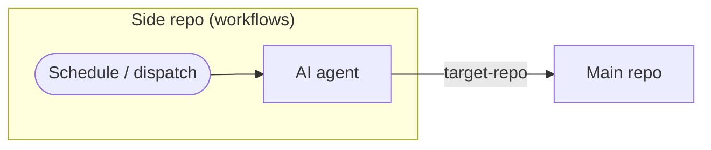
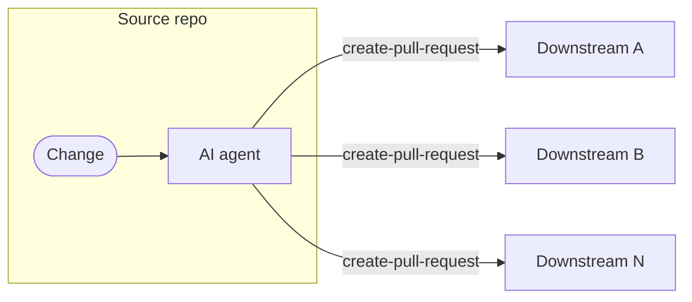

MultiRepoOps extends operational automation patterns (IssueOps, ChatOps, etc.) across multiple GitHub repositories. Using [cross-repository safe outputs](/gh-aw/reference/cross-repository/) and [secure authentication](/gh-aw/reference/auth/), MultiRepoOps enables coordinating work between related projects — creating tracking issues in central repos, synchronizing features to sub-repositories, and enforcing organization-wide policies — all through AI-powered workflows.

## Using a Side Repository

A **side repository** is a dedicated automation repo that runs workflows targeting one or more main codebases. This keeps AI-generated issues, comments, and workflow runs isolated from your main repository — no changes needed to existing projects and no mixing of automation infrastructure with production code.



Teams new to agentic workflows can adopt this pattern: create a private repository, add a PAT as a secret, and point `target-repo` at your main codebase. No changes required to the main repo.

```aw wrap
---
on: weekly on monday

safe-outputs:
  github-token: ${{ secrets.GH_AW_MAIN_REPO_TOKEN }}
  create-issue:
    target-repo: "my-org/main-repo"
    labels: [automation, weekly-check]
    max: 5

tools:
  github:
    github-token: ${{ secrets.GH_AW_MAIN_REPO_TOKEN }}
    toolsets: [repos, issues, pull_requests]
---

# Weekly Repository Health Check

Analyze my-org/main-repo and create issues for stale PRs (>30 days) and failed CI runs on main.
```

Using [Slash commands](/gh-aw/reference/command-triggers/) from a side repo require a bridge: a thin relay workflow in the main repo listens for the command and forwards it via `workflow_dispatch` to the side repo. See [Triage from Side Repo](/gh-aw/gallery/multi-repo/triage-from-side-repo/) for a complete walkthrough.

Authentication details and step-by-step setup are covered in the [Triage from Side Repo](/gh-aw/gallery/multi-repo/triage-from-side-repo/) and [Code Quality Monitoring](/gh-aw/gallery/multi-repo/code-quality-monitoring/) examples, and in the [Authentication reference](/gh-aw/reference/auth/).

### Preparing an advisory fix

Use a dedicated private side repository to prepare and test a fix for an unpublished advisory. GitHub does not run Actions or PR status checks in [temporary private advisory forks](https://docs.github.com/en/code-security/security-advisories/collaborating-in-a-temporary-private-fork-to-resolve-a-security-vulnerability).

1. Restrict access to the side repository, including its run logs and artifacts, to people authorized to see the advisory. Use manual dispatch from trusted workflow code. Do not use a public issue or slash-command relay for confidential work.
2. Use a [target-only checkout](#target-only-checkout) pinned to the upstream commit you intend to patch. A shallow checkout limits history; a sparse checkout limits files in the working tree. Include the build and test dependencies in the checkout configuration so the agent does not need to fetch them later. Use read-only checkout credentials and keep advisory fork credentials out of Actions. Review the compiled jobs and exclude any maintenance or safe-output jobs that can write to the upstream repository.
3. Review the fix and test results privately. Keep any patch artifact in the private side repository, use short retention, and check who can download it. Secret redaction does not remove all advisory details.
4. Apply the reviewed patch to the intended base in the advisory's temporary private fork, push a new branch using your maintainer credentials, and open the PR from the advisory in GitHub. If the base has moved, rebase and retest the fix before handing it off.

The generic PR transfer command is not an advisory handoff command: it can create a normal fork and open a PR. Likewise, the [security advisory safe outputs](/gh-aw/reference/safe-outputs/#security-advisory-drafts-create-security-advisory) target the workflow repository, not the upstream repository or its temporary private fork.

## CentralRepoOps

For automation hosted centrally and targeting software in one or more other repositories, see [CentralRepoOps](/gh-aw/patterns/central-repo-ops/). Workers can run on their own schedules; an orchestrator is optional. The central automation repository can also collect events from component repos for unified visibility.

## Flowing Changes to Downstream Repositories

The source repository propagates changes outward to downstream repos whenever relevant paths change. The agent adapts the changes for each target's structure and opens a pull request for review.



Use `max` to control fan-out breadth, and `title-prefix` plus labels to make the automated PRs easy to filter. See [Feature Synchronization](/gh-aw/gallery/multi-repo/feature-sync/) for a complete example.

## Target-Only Checkout

Side repositories that only need to check out a target repository — not their own hosting repository — can set `permissions.contents: none`. This skips the automatic workflow-repository checkout while keeping any explicitly configured `checkout:` entries (like a target repo) intact:

```yaml
permissions:
  contents: none
checkout:
  - repository: octo-org/target-repository
    path: target
    github-app:
      client-id: ${{ vars.TARGET_APP_CLIENT_ID }}
      private-key: ${{ secrets.TARGET_APP_PRIVATE_KEY }}
```

See [Target-Only Checkout](/gh-aw/reference/checkout/#target-only-checkout-permissionscontents-none) in the checkout reference for details.

## Cross-Repository Safe Outputs

Most safe output types support `target-repo` to write to external repositories, and `allowed-repos` for dynamic multi-target workflows. See [Cross-Repository Safe Outputs](/gh-aw/reference/cross-repository/#cross-repository-safe-outputs) for the complete list and configuration options, including `target-repo: "*"` for runtime-determined targets and the [GitHub Tools reference](/gh-aw/reference/cross-repository/#cross-repository-reading) for reading from private repositories.

## Deterministic Multi-Repo Workflows

For direct repository access without agent involvement, check out multiple repositories using `checkout:` frontmatter or `actions/checkout` steps. See the [Deterministic Multi-Repo example](/gh-aw/reference/cross-repository/#example-deterministic-multi-repo-workflows) in the cross-repository reference.

## Best Practices

Use GitHub Apps over PATs for automatic token revocation; scope tokens minimally to target repositories. Set appropriate `max` limits and consistent label/prefix conventions. Test against public repositories first before rolling out to private or org-wide targets.

## Learn More

- [CentralRepoOps](/gh-aw/patterns/central-repo-ops/) — Central control plane and tracker repo patterns
- [Cross-Repository Operations](/gh-aw/reference/cross-repository/) — Checkout and `target-repo` configuration
- [GitHub Repository Checkout](/gh-aw/reference/checkout/) — Full checkout configuration, including target-only checkout
- [Safe Outputs](/gh-aw/reference/safe-outputs/) — Complete safe output configuration
- [GitHub Tools](/gh-aw/reference/github-tools/) — GitHub API toolsets
- [Authentication](/gh-aw/reference/auth/) — PAT and GitHub App setup
- [Adding Existing Workflows](/gh-aw/setup/working-with-workflows/#adding-existing-workflows) — Sharing workflows across repos
