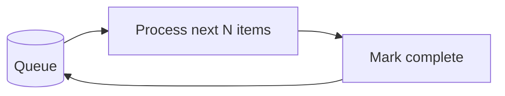
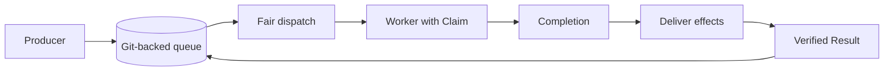
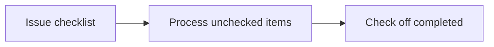

WorkQueueOps is a pattern for processing a backlog incrementally across workflow runs. The native `tools.work-queue` feature provides a Git-backed queue with fair scheduling, task dependencies, and Claim-scoped effects. Issue checklists, sub-issues, cache-memory, and repo-memory are lightweight alternatives when simple progress tracking is enough.

| Approach | Choose it when |
| --- | --- |
| Native work queue | Multiple workers need fair scheduling, verified dependencies, and authorization for each task attempt. |
| Issue checklist | A small backlog needs visible progress without deploying a native queue. |
| Sub-issues | Each work item needs its own discussion, assignee, and completion status under a parent tracking issue. |
| Cache-memory | A short-lived, branch-local backlog can be reconstructed if the cache is evicted. |
| Repo-memory | A file-based backlog needs Git history and persistence shared across workflow branches. |



## Native Work Queue

The native queue stores immutable tasks and lifecycle events in `work-queue.jsonl` on a dedicated Git branch. A trusted producer submits tasks, a dispatcher requests assignments, and workers process them. On an absent branch, the first producer submit atomically installs its compiler-approved Policy with Work. On an existing AW-managed queue, trusted submission and dispatch processing install missing pools from the compiled `aw.json` configuration on demand, before deployment synchronization. The separate `PoolInstall` operation preserves installed pools and the Policy epoch and cannot expand installed worker authority or repository allowlists. New worker profiles, economic changes, and existing-pool Policy updates remain administrator-only and require a quiescent queue. The scheduler selects eligible tasks under Policy; the agent does not choose which task receives a Claim.

A Claim authorizes one attempt at a task. Workers stage safe outputs and a finish intent for each original Claim. Trusted processing records Completion before authorizing those effects and records Result only after independently verified delivery. Dependent tasks wait for their predecessors' Results, not merely for a worker run to finish.



Native `tools.work-queue` supports Git storage only. Issues and pull requests can be dependency nodes, but they are not queue-storage backends. Use the [operator reference](/gh-aw/reference/work-queue/) to inspect and recover queue state, and the [protocol specification](/gh-aw/specs/work-queue-specification/) for implementation coverage and remaining security requirements. The [Linter Factory](/gh-aw/gallery/linter-factory/) shows dispatcher and worker workflows with Claim-scoped outputs.

## Deploy a native queue

This example processes one read-only README check. The operator CLI acts as producer; a dispatcher requests one assignment, and a worker processes it. Start with a repository [set up for agentic workflows](/gh-aw/setup/quick-start/).

### 1. Define the worker and dispatcher

Create an assignment-only worker. Its result stays in the run summary; it cannot create Issues or pull requests.

```aw wrap title=".github/workflows/queue-worker.md"
---
on: workflow_dispatch
permissions:
  contents: read
  copilot-requests: write
engine: copilot
tools:
  github:
    toolsets: [repos]
  work-queue:
    require-assignment: true
    worker: true
safe-outputs:
  noop:
---

# README check worker

Process only the original claims in work_queue_assignment.
For each Claim, read its work.task and inspect the repository README.
Do not modify repository resources.
Report your findings with noop, using the Claim's original handle as claim_handle.
Then call work_queue_claim_finish with that claim_handle and outcome "completed".
If the task cannot be completed, finish that Claim with outcome "cancelled".
```

Create the dispatcher with an explicit worker allowlist and a one-dispatch limit:

```aw wrap title=".github/workflows/queue-dispatcher.md"
---
on: workflow_dispatch
permissions:
  contents: read
  copilot-requests: write
engine: copilot
tools:
  work-queue: true
safe-outputs:
  dispatch-workflow:
    workflows: [queue-worker]
    max: 1
---

# README check dispatcher

Call work_queue_dispatch_next once with:
{"pool":"default","max_claims":1,"max_dispatches":1}
The scheduler selects the Work and worker. Do not call dispatch_workflow
directly or submit additional Work.
```

The compiler supplies the worker's assignment input and keeps queue-write credentials outside agent execution. The selected trusted dispatch credential needs the [dispatch permissions](/gh-aw/reference/work-queue/#worker-evolution).

### 2. Optionally configure scheduling

Defaults are sufficient. To limit this example to one concurrent worker, merge the following into `.github/workflows/aw.json`:

```json title=".github/workflows/aw.json"
{"work_queue": {"concurrency": 1}}
```

Do not replace settings for other queues or pools. Field defaults and later Policy changes belong in the [scheduling reference](/gh-aw/reference/work-queue/#repository-scheduling-settings).

### 3. Compile and publish

```bash
gh aw compile queue-worker queue-dispatcher
```

Publish both Markdown sources, their generated `.lock.yml` files, and any scheduling configuration to the repository's default branch. Configure [engine authentication](/gh-aw/reference/auth/) before running them. Compilation alone does not create the queue.

### 4. Submit and dispatch

Save this immutable task as `work.json`:

```json title="work.json"
{
  "task": "Check whether the README explains installation and report missing steps.",
  "effect_contract": {"kind": "none"}
}
```

The explicit no-write contract permits a checked completion without resource changes. Replace `OWNER/REPO` with the published repository:

```bash
gh aw work-queue --repo OWNER/REPO submit-work \
  --file work.json --worker-profile queue-worker --request-id readme-check-1
gh aw work-queue --repo OWNER/REPO dispatch queue-dispatcher --wait
```

The first accepted submission installs Policy and Work together; there is no separate seed command. Keep the same request ID and payload when retrying an uncertain submission. The dispatcher can select older eligible Work first, and `--wait` waits for the dispatcher, not its workers.

### 5. Inspect the result

```bash
gh aw work-queue --repo OWNER/REPO state
gh aw work-queue --repo OWNER/REPO stats --json
```

Inspect the worker run's summary for its findings. Completion and reservation release are not proof of Result: the queue records Result only after verifying the Claim's permitted effects. See [delivery rules](/gh-aw/reference/work-queue/#claim-scoped-effects-and-delivery) and [operator commands](/gh-aw/reference/work-queue/#operator-commands) for diagnosis and recovery.

For write-capable examples, use [Linter Factory](/gh-aw/gallery/linter-factory/) or [Daily Report Portfolio](/gh-aw/gallery/daily-report-portfolio/). Worker updates, Issue mirroring, and compatibility requirements are covered by the [reference](/gh-aw/reference/work-queue/), not additional deployment steps here.

## Alternative: Issue Checklist

Use GitHub issue checkboxes as a lightweight, human-readable queue. The agent reads the issue body, finds unchecked items, processes each one, and checks it off. Best for small-to-medium batches (< 100 items). Use [Concurrency](/gh-aw/reference/concurrency/) controls to prevent race conditions between parallel runs.

```yaml title="Issue checklist frontmatter"
tools:
  github:
    toolsets: [issues]

safe-outputs:
  update-issue:
    body: true
concurrency:
  group: checklist-queue
  cancel-in-progress: false
```

Give the workflow a specific queue Issue. Each run reads its unchecked items, processes a bounded batch, and updates successful items from `- [ ]` to `- [x]`. Leave failed items unchecked. Add reporting or closure safe outputs only if needed.



Checklist progress markers do not provide native fair scheduling, Claim authority, or verified dependency graphs. The concurrency group serializes runs in that group, but does not protect against other workflows or humans editing the issue.

## Alternative: Sub-Issues

Create one sub-issue per work item under a parent tracking issue. Open sub-issues are pending work; closing a sub-issue marks that item complete. This keeps individual discussions, assignees, and results separate while the parent provides a backlog overview.

Use the GitHub `issues` toolset to read the parent's sub-issues and safe outputs to report and close completed items:

```yaml title="Sub-issue queue frontmatter"
tools:
  github:
    toolsets: [issues]

safe-outputs:
  add-comment:
    max: 6
  close-issue:
    max: 5

concurrency:
  group: sub-issue-queue
  cancel-in-progress: false
```

Each run lists all pages of the parent's open sub-issues, processes at most five, and adds a result comment before closing each successfully completed item. Leave failed items open with an explanation, then add one progress comment on the parent. Use a shared concurrency group for workflows processing the same parent and check for existing results before retrying work.

Sub-issue relationships organize the backlog; they do not enforce processing order, verified dependencies, or Claim-scoped authorization. Other workflows and human edits remain outside the concurrency group's protection.

## Alternative: Cache-Memory

Enable [cache-memory](/gh-aw/reference/cache-memory/) and store a small JSON queue at `/tmp/gh-aw/cache-memory/workqueue.json`:

```yaml title="Cache-memory frontmatter"
tools:
  cache-memory: true
```

```json title="workqueue.json"
{
  "pending": ["item-1", "item-2"],
  "completed": ["item-0"],
  "failed": []
}
```

Each run loads the file, processes a bounded batch of pending items, and moves them to `completed` or `failed` before saving the updated file. The compiler restores and saves the cache automatically. Serialize runs that update the same queue and check whether an item's effects already exist before retrying it.

Cache-memory is branch-scoped and unused caches can be evicted after seven days. Keep a way to reconstruct pending work from repository state; do not use the cache as the only record of irreplaceable tasks.

## Alternative: Repo-Memory

Use [repo-memory](/gh-aw/reference/repo-memory/) for the same JSON queue when progress needs Git history and persistence across workflow branches:

```yaml title="Repo-memory frontmatter"
tools:
  repo-memory: true
```

Store `workqueue.json` at `/tmp/gh-aw/repo-memory-default/workqueue.json`. The compiler restores files from `memory/default` and commits and pushes updates after workflow completion. Use the same bounded processing loop as the cache-memory alternative, with a shared concurrency group for workflows writing the same queue. Concurrent updates can overwrite progress during conflict resolution.

Neither memory alternative provides native fair scheduling, Claim authority, or verified dependency graphs. Standalone `tools.repo-memory` persistence is not supported in native work-queue workers; these are separate queue patterns, not storage backends for `tools.work-queue`.

## Idempotency and Concurrency

All WorkQueueOps patterns should be **idempotent**: running the same item twice should not cause double processing.

| Technique | How |
|-----------|-----|
| Check before acting | Query current state (label present? comment exists?) before making changes |
| Atomic state updates | Write queue state in a single step; avoid partial updates |
| Concurrency groups | Use `concurrency.group` with `cancel-in-progress: false` to prevent parallel runs |
| Retry budgets | Track failed items separately; set a retry limit before giving up |

## Learn More

- [BatchOps](/gh-aw/patterns/batch-ops/) — Process large volumes in parallel chunks rather than sequentially
- [ResearchPlanAssignOps](/gh-aw/patterns/research-plan-assign-ops/) — Research → Plan → Assign pattern for developer-supervised work
- [Work queues](/gh-aw/reference/work-queue/) — Native queue roles, Claim-scoped effects, and operator commands
- [Cache Memory](/gh-aw/reference/cache-memory/) — Short-lived, branch-scoped file storage
- [Repo Memory](/gh-aw/reference/repo-memory/) — Git-backed file storage with persistent history
- [Concurrency](/gh-aw/reference/concurrency/) — Prevent race conditions in queue-based workflows
