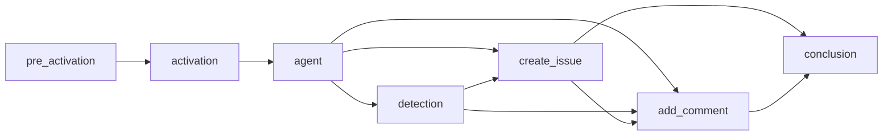
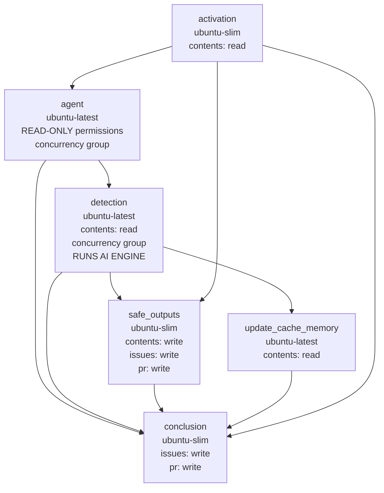

This guide documents the internal compilation process that transforms markdown workflow files into executable GitHub Actions YAML. Understanding this process helps when debugging workflows, optimizing performance, or contributing to the project.

## Overview

The `gh aw compile` command transforms a markdown workflow file into a complete GitHub Actions `.lock.yml` by embedding frontmatter and setting up runtime loading of the markdown body. The process runs five phases, described below.

## Network access

Workflow schemas and built-in Actions/AW lint rules are bundled with the CLI, so compilation downloads no schemas or linters. Remote imports and action references without cached or embedded pins can require GitHub requests. `--validate` also checks runtime packages, container images, and repository features. External scanners are opt-in and may download images or contact upstream services.

Interactive compilation runs a best-effort compiler update check at most once every 24 hours, in the background with a three-second budget. `--no-check-update` disables it; CI and non-interactive invocations skip it.

Opt-in Syft SBOMs go to a private `gh-aw-syft-sboms-*` temporary directory, and each file path is printed; directories with no successful scans are removed.

`gh aw update` refreshes upstream state on each run and shares action release lists and tag resolutions among actions from the same repository. By default it also recompiles workflows, so a separate `gh aw compile` is needed only for extra compilation options.

With SDK authentication, `update` uses native GitHub API clients with pooled connections instead of a fresh `gh api` subprocess per request. Host selection follows GitHub CLI helpers, including `GH_HOST`. If native client setup fails, GitHub CLI requests are used.

Release lookups, container digest lookups, and final integrity checks run in batches of up to eight concurrent operations. Requests for the same action metadata share one fetch, including failures. Action tags resolve through the commit endpoint, which proves commit existence; final validation reuses that evidence only within the same invocation and fetches any unverified entries.

Container digests come from registry metadata only (`docker buildx imagetools inspect`, then `crane digest`), never full image pulls. If both fail, the command reports the failure and keeps any existing pin.

`gh aw update --verbose` logs each network operation's start, completion, elapsed time, and status. Request headers, credentials, and response bodies are never logged.

## Repository Configuration (`aw.json`)

`.github/workflows/aw.json` stores repository-wide compilation settings.

| Field | Type | Default | Description |
|-------|------|---------|-------------|
| `lock_file_logo` | boolean | `true` | Include the ASCII logo in generated workflow headers, including companion workflows. Set to `false` to omit only the logo. |
| `issue_label` | string | `"agentic-workflows"` | Label used to create and find gh-aw's own issues, including detection trackers, failure issues, and maintenance reports. |
| `adaptive_routing` | `"observe"` or `false` | `false` | Record every eligible routed workflow's runs in its [adaptive routing](/gh-aw/reference/adaptive-routing/) history. Workflows that cannot take part are skipped; a workflow's own `adaptive-routing` value, or one from an import, wins. |

```json title=".github/workflows/aw.json"
{
  "lock_file_logo": false
}
```

`gh aw compile --no-logo` disables the logo for a single invocation, even when `lock_file_logo` is `true`. Omitting the flag does not override `lock_file_logo: false`. Nothing else changes.

For repositories with prefixed routing labels, set `"issue_label": "area:agentic-workflows"`. The value must be a nonblank label name of at most 50 characters, without control characters or GitHub Actions expressions. Recompile workflows after changing it. Existing issues must carry the configured label to be found by label-based lookups and cleanup; gh-aw does not relabel them automatically. Per-output `labels` remain additive. Command labels such as `agentic-workflows:disable` are unchanged.

## Compilation Phases

### Phase 1: Parsing and Validation

The compiler extracts the YAML frontmatter, validates it against the workflow schema, validates expression safety (only allow-listed GitHub Actions expressions), and resolves imports.

With `--validate`, generated Actions YAML also passes through a native Go port of the [Actions language-services parsers](https://github.com/actions/languageservices), using the pinned upstream schema and expression grammar. Compiler validation adds the workflow/job `cache-mode` values (`read`, `write`, `write-only`, `none`) that the schema lacks; the upstream conformance parser is unchanged. This supplements the JSON Schema, dependency, and security checks. It does not evaluate expressions, fetch reusable workflows, or replace the compiler's Actions graph.

Expression extraction, condition optimization, import fallback folding, and context-reference checks share this parser and its quote-aware scanner. Reference detection uses AST access nodes, so text inside string literals is not matched. Existing security allowlists still apply. Actions string literals must use single quotes with doubled-quote escaping (`'can''t'`); double-quoted and backtick literals are rejected.

The parser runs offline, without Node.js or npm, and its conformance suite replays checked-in official-parser results in Go tests. To compare against the pinned `@actions/workflow-parser` and `@actions/expressions` packages, run `npm ci --prefix pkg/workflow/actionslanguageservice/conformance --ignore-scripts`, then `make test-actions-parser-conformance`. The comparison covers template acceptance and expression ASTs, not evaluation.

The compiler warns when explicit prompt instructions require shell commands, native reads, or MCP tools that the resolved tool configuration denies. For example, ``Run `jq --version` `` or `Call mcp__github__list_issues` is checked against tool allowlists and GitHub toolsets, including imports. These advisory checks do not infer commands from prose or complex scripts and never expand permissions. Resolve warnings by using permitted tools or allowing the required capability.

#### Import Resolution

Imports are resolved breadth-first: starting from `imports:` in the main workflow, each file's configurations are extracted and nested imports are queued. Visited files are tracked to detect cycles.

| Field | Merge strategy |
|-------|----------------|
| Tools | Deep merge; arrays concatenated and deduplicated |
| MCP servers | Imported servers override main-workflow servers with the same name |
| Network | Union of allowed domains, deduplicated and sorted |
| Permissions | Validation only — main must satisfy imported requirements |
| Safe outputs | Main workflow overrides imported configurations per type |
| Runtimes | Main workflow versions override imported versions |

Processing order follows BFS:

```
Main Workflow
├── import-a.md          → Processed 1st
│   ├── nested-1.md      → Processed 3rd (after import-b)
│   └── nested-2.md      → Processed 4th
└── import-b.md          → Processed 2nd
    └── nested-3.md      → Processed 5th
```

See [Imports Reference](/gh-aw/reference/imports/) for complete merge semantics.

### Phases 2–5: Building the Workflow

| Phase | Steps |
|-------|-------|
| **2 Job Construction** | Builds specialized jobs: pre-activation (if needed), activation, agent, safe outputs, safe-jobs, and custom jobs |
| **3 Dependency Resolution** | Validates job dependencies, detects circular references, computes topological order, generates Mermaid graph |
| **4 Action Pinning** | Pins all actions to SHAs: check cache → GitHub API → embedded pins → add version comment (e.g., `actions/checkout@sha # v6`) |
| **5 YAML Generation** | Assembles final `.lock.yml`: header with metadata, Mermaid dependency graph, alphabetical jobs, embedded original prompt |

### Actions/AW AST Lint Rules

`pkg/workflow/lint` provides an in-process rule registry, independent of external scanners and Go linters. A `lint.Rule` declares an ID, description, default severity, `Targets` (`AWAST`, `ActionsAST`, or both), and `Check(context.Context, lint.Input)`. Zero targets means Actions-only. Rules consume parsed ASTs only (no file discovery, YAML parsing, or compilation) and return diagnostics without mutating either AST. The runner validates registrations, dispatches by available AST, sorts diagnostics deterministically, and continues after a rule fails.

Register built-in checks in `lint.Default()`. Structural rules inspect the AST directly. Data-flow rules use `pkg/workflow/taint.Analyze` with a `taint.Rule` defining `IsSource`, `IsSink`, optional whole-expression `IsFilter`, and known credential outputs. The `secret-leak` rule adapts these results to diagnostics and reports coverage gaps separately from findings.

The CLI hides `secret-leak` coverage warnings in text and JSON output unless `--debug` or explicit JavaScript analysis is enabled; the AST runner still retains them. The registry contract suite requires positive and negative fixtures for every rule and supported AST, checks strict and non-strict severity, and verifies read-only behavior.

`TestLintPerformanceBudget` runs each rule's fixtures on every supported AST, scaling from 32 to 256 jobs under a 250 ms per-check ceiling, with allowances of 12× allocations and 24× runtime plus fixed margins. These are regression guards, not complexity proofs.

`BenchmarkLintRules` reports `ns/op`, `B/op`, and `allocs/op` for each rule, AST, fixture, and size. For comparable samples, run `go test ./pkg/workflow/lint -run '^$' -bench '^BenchmarkLintRules$' -benchmem -benchtime=100ms -count=5`; add `-cpuprofile`, `-memprofile`, or `-trace` to investigate. Live CLI timings use [`DEBUG=workflow:lint:perf`](/gh-aw/reference/workflow-linters/#linter-performance).

Opt-in JavaScript analysis uses the Go TypeScript compiler through a pinned native-preview AST client. Configure `taint.Rule.JavaScript` with a parser and optional source filesystem mapping; `IsJavaScriptFilter` supports whole-expression declassification. Programs are never executed; unresolved modules, calls, syntax, or control flow remain explicit coverage gaps.

The CLI defaults JavaScript analysis to `fast`, which batches entry sources and uses hash-checked transfer summaries for mapped runtime APIs; unknown mapped APIs keep coverage gaps. `deep` analyzes runtime bodies and generated JavaScript explicitly.

`taint.AnalyzeDocument` checks an AW prompt and script hooks against an existing compiled graph. `taint.AnalyzeAuthoredDocument` visits authored execution nodes, prompt, and schema-aware hooks (MCP tools, safe-output handlers, graders, memory validators, engine scripts). Frontmatter is not treated as a complete Actions workflow, so missing generated coverage is reported. [`gh aw lint`](/gh-aw/setup/cli/#lint) accepts `.md`, `.yml`, and `.yaml` (including `.lock.yml`) without recompiling; actionlint runs only on YAML inputs. `--rules` selects AST checks without external actionlint.

`gh aw compile` runs every built-in AST lint rule by default, against the generated graph and authored source, before writing the lock file (also with `--no-emit`). Error findings fail compilation; warnings are advisory. Warning-level `secret-leak` and unavailable-parser `grader-file-io` coverage warnings are hidden from output and totals and do not block dry-run. `--no-lint` disables only this pass; dry-run rejects it. Low-level Go callers use `workflow.WithLint(true)`. Standalone Actions workflows, including dispatch targets, still need `gh aw lint`; compiling a caller does not lint its targets.

`add`, `update`, and `validate` apply the same default when they recompile; only `compile` exposes `--no-lint`.

Compile-time lint needs no native JavaScript parser. Deeper JavaScript driver and custom-grader checks require `gh aw lint --javascript-module <module-path>`. Passing compilation is not evidence of complete JavaScript analysis.

The default registry also checks action pinning (`action-pin`, CTR-002), shell-template injection (`template-injection`, CTR-006), workflow-run trigger scope (`workflow-run-scope`, CTR-021), and job timeouts (`job-timeout`, CTR-026). These are observable subsets of the [compiler threat specification](https://github.com/github/gh-aw/blob/main/specs/compiler-threat-detection-spec.md#74-actions-ast-lint-coverage), not replacements for conformance checks. Authorization, engine policy, checkout provenance, and publisher integrity need evidence beyond an Actions AST.

Additional checks cover blanket write grants and invalid OIDC read permissions (`permission-scope`, CTR-001 subset), disabled AW version checks (`version-check`, CTR-018), conditional configuration imports (`conditional-import`, CTR-020), private-to-public flow opt-outs (`private-to-public`, CTR-031), enabled Node install hooks (`install-scripts`, CTR-014), bare label-allowlist wildcards (`allowed-labels`, CTR-015), bare network allowances (`network-scope`, CTR-011 subset), and wildcard PR push targets (`push-target`, CTR-012 subset). AW-only checks use the authored AST and skip native Actions without source evidence. `push-target` defers when imports may supply constraints.

Further AST-only rules check authored shell/proxy contradictions and cache isolation (`tool-scope`, CTR-003 subset), sandbox bypasses and internal overrides (`sandbox-config`, CTR-004 subset), option-prefixed image operands (`image-argument`, CTR-013 subset), checkout expansion (`checkout-mode`, CTR-033 subset), and fork author-association values (`fork-association`, CTR-034 subset). They do not infer engine capabilities, runtime trust, repository visibility, or generated guards.

Three source-policy checks cover `pull_request_target` admission through `read`/`all` roles (`pull-request-target-roles`, CTR-008 subset), blocked lexical expansions in authored safe-output run scripts (`safe-output-shell-expansion`, CTR-009), and URL-filter arguments without SSL inspection (`firewall-ssl-bump`, CTR-011 subset). The roles rule keeps strict rejection and scoped non-strict warning suppression; shell and firewall prerequisite violations are errors in either mode. The firewall rule checks `--allow-urls` and `--ssl-bump` in `sandbox.agent.args`, an internal override accepted only in non-strict mode. Legacy `network.firewall` blocks are schema-invalid and must be migrated; `ssl-bump: true` does not fix them. These rules do not resolve imports or prove runtime enforcement.

The [Workflow Linters reference](/gh-aw/reference/workflow-linters/) lists each rule's threat ID and analysis boundaries. The runner attaches `Rule.ThreatRuleID` to every diagnostic, including coverage warnings; extension rules may leave it empty.

## Job Types

The compilation process generates specialized jobs based on workflow configuration:

| Job | Trigger | Purpose | Key Dependencies |
|-----|---------|---------|------------------|
| **pre_activation** | Role checks, stop-after deadlines, skip-if-match, or command triggers | Validates permissions, deadlines, and conditions before AI execution | None (runs first) |
| **activation** | Always | Prepares workflow context, sanitizes event text, validates lock file freshness | `pre_activation` (if exists) |
| **agent** | Always | Core job that executes AI agent with configured engine, tools, and Model Context Protocol (MCP) servers | `activation` |
| **detection** | `safe-outputs.threat-detection:` configured | Scans agent output for security threats before processing | `agent` |
| **Safe output jobs** | Corresponding `safe-outputs.*:` configured | Process agent output to perform GitHub API operations (create issues/PRs, add comments, upload assets, etc.) | `agent`, `detection` (if exists) |
| **conclusion** | Always (if safe outputs exist) | Aggregates results and generates workflow summary | All safe output jobs |

### Agent Job Steps

The agent job runs: repository checkout and runtime setup (Node.js, Python, Go) → cache restoration → MCP container initialization → prompt generation from the markdown body → engine execution (Copilot, Claude, or Codex) → output upload as a GitHub Actions artifact → cache persistence. Key environment variables: `GH_AW_PROMPT` (prompt file), `GH_AW_SAFE_OUTPUTS` (output JSON), `GITHUB_TOKEN`.

### Safe Output Jobs

Every safe output job follows the same pattern: download the agent artifact, parse its JSON, execute the corresponding GitHub API operation with the right permissions, and link to related items. Available types include `create_issue`, `create_discussion`, `add_comment`, `create_pull_request`, `create_pr_review_comment`, `create_code_scanning_alert`, `add_labels`, `assign_milestone`, `update_issue`, `update_release`, `push_to_pr_branch`, `upload_assets`, `update_project`, `report_missing_tool`, and `noop`.

### Custom Jobs

Use `safe-outputs.jobs:` for custom jobs with full GitHub Actions syntax, or `jobs:` for additional workflow jobs with user-defined dependencies. See [DeterministicOps](/gh-aw/patterns/deterministic-ops/) for examples of multi-stage workflows combining deterministic computation with AI reasoning.

## Job Dependency Graphs

Jobs run in topological order. Example:



**Execution flow**: pre-activation checks permissions → activation prepares context → agent runs → detection scans output → safe outputs run concurrently (`add_comment` waits for created items) → conclusion summarizes. With threat detection, safe outputs depend on both agent and detection.

## Why Detection, Safe Outputs, and Conclusion Are Separate Jobs

A typical compiled workflow contains these post-agent jobs:



These three jobs form a **sequential security pipeline** rooted in [Plan-Level Trust](/gh-aw/introduction/architecture/): read-only AI reasoning is separated from writes. They cannot be merged because GitHub Actions permissions are fixed per job:

| Job | Key Permissions | Rationale |
|-----|----------------|-----------|
| **detection** | `contents: read` | Runs AI analysis — must not have write access |
| **safe_outputs** | `contents: write`, `issues: write`, `pull-requests: write` | Executes GitHub API write operations |
| **conclusion** | `issues: write`, `pull-requests: write`, `discussions: write` | Updates comments, handles failures |

A combined job would hold write permissions while running threat detection, defeating least privilege and letting a compromised agent bypass the gate. Job-level isolation also enables:

- **Hard gating.** The `safe_outputs` condition `needs.detection.outputs.success == 'true'` stops the job from starting if detection fails; step-level `if` checks are weaker.
- **`always()` for `conclusion`.** It reads `needs.agent.result` to log errors and report missing tools even when writes fail.
- **Right-sized runners.** Detection needs `ubuntu-latest` for AI execution; safe_outputs and conclusion use the lightweight `ubuntu-slim`.
- **Concurrency isolation.** Detection shares the agent's concurrency group to serialize AI execution; safe_outputs does not, so it can overlap other workflows' detection.
- **Artifact handoff.** The agent writes `agent_output.json`, detection emits `success`, and safe_outputs downloads the artifact only if approved. A shared filesystem would allow tampering between phases.

## Action Pinning

All GitHub Actions are pinned to commit SHAs (e.g., `actions/checkout@b4ffde6...11 # v6`) to defend against supply chain attacks — tags can be moved, SHAs cannot. Resolution order is cache (`.github/aw/actions-lock.json`) → GitHub API → embedded pins.

### The actions-lock.json Cache

`.github/aw/actions-lock.json` caches `action@version` → SHA mappings so compilation is consistent regardless of token. Resolving a tag needs GitHub API access, which restricted tokens such as the GitHub Copilot Coding Agent (CCA) token lack; those environments reuse SHAs from a prior compile run with a broader token.

**Commit `actions-lock.json` to version control** so every contributor and automated tool uses the same immutable pins. Refresh with `gh aw update-actions`, or delete and recompile with a permissive token to force full re-resolution.

## The gh-aw-actions Repository

`github/gh-aw-actions` contains the reusable actions that power compiled workflows. Every action step in a generated `.lock.yml` references it (usually by commit SHA, occasionally by a stable tag like `v0` when SHA resolution is unavailable):

```yaml
uses: github/gh-aw-actions/setup@abc1234...
```

Never edit these references by hand — run `gh aw compile` or `gh aw update-actions` to regenerate them. Use `--actions-repo` (with `--action-mode action`) to compile against a fork or specific tag during development; see [Compilation Commands](#compilation-commands).

### Dependabot and gh-aw-actions

Dependabot may open PRs to bump `github/gh-aw-actions` to a newer SHA. **Do not merge them** — pin updates must come from `gh aw compile`, which coordinates pins across all compiled workflows from a single release. `gh aw compile` automatically inserts an ignore rule when a `github-actions` update block exists in `.github/dependabot.yml`. When enabling Dependabot from scratch, use:

```yaml
updates:
  - package-ecosystem: github-actions
    directory: "/.github/workflows"
    ignore:
      - dependency-name: "github/gh-aw-actions/*" # Managed by gh aw compile. Version-locked to the gh-aw compiler; do not bump.
```

## Artifacts Created

Workflows generate several artifacts during execution:

| Artifact | Location | Purpose | Lifecycle |
|----------|----------|---------|-----------|
| **agent_output.json** | `/tmp/gh-aw/safeoutputs/` | AI agent output with structured safe output data (create_issue, add_comment, etc.) | Uploaded by agent job, downloaded by safe output jobs, auto-deleted after 90 days |
| **agent_usage.json** | `/tmp/gh-aw/` | Aggregated token counts: `{"input_tokens":…,"output_tokens":…,"cache_read_tokens":…,"cache_write_tokens":…}` | Bundled in the unified agent artifact when the firewall is enabled |
| **prompt.txt** | `/tmp/gh-aw/aw-prompts/` | Generated prompt sent to AI agent (includes markdown instructions, imports, context variables) | Retained for debugging and reproduction |
| **firewall-audit-logs** | See structure below | Dedicated artifact for AWF audit/observability logs (token usage, network policy, audit trail) | Uploaded by all firewall-enabled workflows; analyzed by `gh aw logs --artifacts firewall` |
| **firewall-logs/** | `/tmp/gh-aw/sandbox/firewall/logs/` | Network access logs in Squid format (when the AWF agent sandbox is enabled) | Analyzed by `gh aw logs` command |
| **cache-memory/** | `/tmp/gh-aw/cache-memory/` | Persistent agent memory across runs (when `tools.cache-memory:` configured) | Restored at start, saved at end via GitHub Actions cache |
| **patches/**, **sarif/**, **metadata/** | Various | Safe output data (git patches, SARIF files, metadata JSON) | Temporary, cleaned after processing |

### `firewall-audit-logs` Artifact Structure

The `firewall-audit-logs` artifact is a dedicated multi-file artifact uploaded by all firewall-enabled workflows. It is **separate** from the unified `agent` artifact. Downstream workflows that need token usage data or firewall audit logs must download this artifact specifically.

```
firewall-audit-logs/
├── api-proxy-logs/
│   ├── token-usage.jsonl        ← Token usage data per request
│   └── token-diag.log           ← Token diagnostics JSONL (only when AWF_DEBUG_TOKENS=1)
├── squid-logs/
│   └── access.log               ← Network policy log (allow/deny)
├── audit.jsonl                  ← Firewall audit trail
└── policy-manifest.json         ← Policy configuration snapshot
```

`token-diag.log` is written only when `AWF_DEBUG_TOKENS=1` is set on the AWF-enabled workflow step.

> **Tip:** Use `gh aw logs <run-id> --artifacts firewall` instead of `gh run download`; the CLI handles artifact naming and backward compatibility. See the [Artifacts reference](/gh-aw/reference/artifacts/).

## MCP Server Integration

Model Context Protocol (MCP) servers provide tools to AI agents. Compilation emits `mcp-config.json` from the workflow's tool configuration. Local servers run in Docker containers with auto-generated Dockerfiles and connect via stdio; HTTP servers connect directly with configured headers and authentication. `allowed:` restricts which tools the agent sees, and secrets inject through Dockerfile env vars (local) or config references (HTTP). At runtime, MCP containers start after runtime setup, the engine executes with tool access, then containers stop.

## Pre-Activation Job

Pre-activation runs gating checks sequentially before any AI execution. Any failure sets `activated=false`, skipping downstream jobs and saving costs:

- **Role checks** (`roles:`) — actor's role exactly matches one of the entries in the allowlist (default `[admin, maintainer, write]`; no privilege hierarchy — `roles: [write]` rejects `admin` and `maintainer` actors)
- **Stop-after** (`on.stop-after:`) — workflow has not passed its deadline (e.g., `+30d`, `2024-12-31`)
- **Skip-if-match** (`skip-if-match:`) — no existing item matches the dedup criteria
- **Command position** (`on.slash_command:`) — slash command appears in the first 3 lines

## Compilation Commands

| Command | Description |
|---------|-------------|
| `gh aw compile` | Compile all workflows in `.github/workflows/` |
| `gh aw compile my-workflow` | Compile specific workflow |
| `gh aw compile --verbose` | Enable verbose output |
| `gh aw compile --strict` | Enhanced security validation |
| `gh aw compile my-workflow --dry-run` | Compile with staging and mandatory validation/shellcheck/model checks; reject existing and added actionable scanner findings and unsupported host effects; Docker scanners are opt-in |
| `gh aw compile my-workflow --environment gh-aw-debug` | Replace the environment on every generated job |
| `gh aw compile --no-emit` | Validate without generating files |
| `gh aw compile --actionlint --zizmor --poutine --grant` | Run security scanners |
| `gh aw compile --actionlint --zizmor --poutine --yamllint` | Run security scanners |
| `gh aw compile --purge` | Remove orphaned `.lock.yml` files |
| `gh aw compile --output /path/to/output` | Custom output directory |
| `gh aw compile --action-mode action --actions-repo owner/repo` | Compile using a custom actions repository (requires `--action-mode action`) |
| `gh aw compile --action-mode action --actions-repo owner/repo --action-tag branch-or-sha` | Compile against a specific branch or SHA in a fork |
| `gh aw compile --action-tag v1.2.3` | Pin action references to a specific tag or SHA (implies release mode) |
| `gh aw validate` | Validate all workflows (compile + all linters, no file output) |
| `gh aw validate my-workflow` | Validate a specific workflow |
| `gh aw validate --json` | Validate and output results in JSON format |
| `gh aw validate --strict` | Validate with strict mode enforced |

> [!TIP]
> Compilation is only required when changing **frontmatter configuration**. The **markdown body** (AI instructions) is loaded at runtime and can be edited without recompilation. See [Editing Workflows](/gh-aw/setup/working-with-workflows/#editing-workflows) for details.

> [!NOTE]
> `--actions-repo` overrides the default `github/gh-aw-actions` repository when `--action-mode action` is set. Pair it with `--action-tag` to compile against a branch or fork.

The optional `--actionlint`, `--zizmor`, and `--poutine` scanners prefer local
binaries on `PATH` when their versions meet the pinned Docker image versions
(actionlint ≥ 1.7.12, zizmor ≥ 1.33.1, poutine ≥ 1.1.6). Missing, older, or
unrecognized versions fall back to Docker. Local actionlint uses shellcheck and
pyflakes from `PATH` when those integrations are enabled; it does not install them.

Compilation and `gh aw lint` ignore actionlint's unsupported-key diagnostic only for workflow- and job-level `cache-mode`.

### Development Testing Mode

`--dry-run` forces `--strict`, `--staged`, `--validate`, `--shellcheck`, and `--models` regardless of frontmatter; explicitly disabling any of them is rejected. Enabled scanners compare the existing locks with the newly emitted ones. New or added medium-or-higher findings, and findings with unknown severity, fail the gate. Matching uses finding identity and occurrence counts, not totals. Findings anchor to field values and logical steps, so line shifts, quoting, comments, and reordered steps do not cause false differences; steps without unique IDs or names use content fingerprints. Incomplete diagnostics and operational errors stay fatal, even alongside usable findings.

Low-severity and informational findings remain visible but do not fail the gate. Zizmor's `secrets-outside-env` rule is excluded in dry-run mode, because repository and organization secrets are common in agentic workflows; ordinary compilation keeps it. With no existing lock, every actionable finding is added. The baseline is the on-disk lock at invocation time, not a Git branch comparison, so repeated dry runs compare against the previous invocation's locks.

Validation errors, unclassified compiler warnings (including safe-update warnings), and scanner execution or parse failures are fatal, including baseline collection failures. Missing required tools block compilation. Model checking uses the observed model inventory: development compilation fails if it is unavailable and the workflow declares `models` policies or `engine.models`. This does not prove live availability. Inventory warnings fail the gate even when cached observations remain; ordinary `--models` compilation reports them as warnings.

Built-in experimental-feature notices are low-severity and nonblocking; the JSON summary lists them in `ignored_low_severity_warnings`. `--allow-experimental` also records acknowledgement in `accepted_experimental_warnings`, but does not exempt arbitrary warning text. The summary reports `warning_baseline`, `minimum_severity`, and `ignored_scanner_rules`, and each scanner's `differential` shows baseline, existing, added, and low-severity ignored counts. A `passed` scanner status means its differential gate passed, not that it found nothing. Required checks and staging stay enabled.

Docker-based scanners and `--validate-images` are opt-in; Docker unavailability does not block the gate, but native `shellcheck` is needed for run-step linting. Run `gh aw validate my-workflow` for source checks and `gh aw compile my-workflow --dry-run --zizmor --actionlint --poutine` for scanner checks. `validate` uses `--no-emit` and skips scanners, so its success does not establish scanner coverage. Report unavailable checks as unverified. Explicitly requested checks still fail the gate on added actionable findings or scanner failures.

Without Docker on `PATH`, CLI scanners print one notice per process and skip Docker checks. MCP compilation continues with native scanners and reports a `docker_unavailable` warning.

MCP callers can require image validation with `validate_images: true`, including with `dry_run: true`; Docker unavailability then fails compilation.

```bash
gh aw compile my-workflow --dry-run --environment gh-aw-debug
```

`--environment NAME` replaces every job's environment in compiled locks, including custom jobs and framework jobs. The name must be a literal, nonblank string of at most 255 characters; expressions and control characters are rejected. Reusable-workflow caller jobs cannot take an environment, so compilation fails if one is present. Configure the environment in the called workflow and compile the caller without the override.

A protected test environment with rotated, restricted credentials is recommended. Replacing an approval environment also replaces its protection rules, so review the test environment's protections. Shared secrets stay in their applicable scopes; an environment name is not secret isolation and does not export secrets into the environment.

Dry-run stages safe outputs and disables compiler-managed GitHub mutations: push jobs, memory/cache persistence, reusable safe-output calls, work-queue operations, reactions, status and failure comments and issues, label removal, and issue locking. `aw_info.json` records `dry_run`. Failure handling, local diagnostics, step summaries, and artifacts remain enabled.

On GitHub.com, dry-run locks set workflow-level `cache-mode: read`, allowing restores but blocking saves, including for authored steps and setup actions. GHES omits this unsupported setting; compiler-managed caches remain restore-only there.

Dry-run compilation adds `workflow_dispatch`, preserves existing manual inputs, and copies reusable-workflow inputs. Actor roles are restricted to `admin`/`maintainer` (including `maintain`); an existing narrower subset is kept and bot exemptions are removed. Other triggers stay intact. This does not upload the lock or authorize a live run.

Daily credit accounting and `max-daily-ai-credits` are removed from diagnostic configuration. An existing positive per-run `max-ai-credits` cap or expression is kept; otherwise an explicit or imported daily limit becomes the per-run cap. A default-only daily limit leaves the standard per-run default. An active default daily guard replaces a disabled per-run cap with the standard one. Disabling both limits stays unchanged.

Set `DEBUG=workflow:compiler_development,cli:compile_development` to log each dry-run mutation, removed environment key, disabled job, and forced flag. Logs name fields and keys, never values.

Dry-run locks drop telemetry settings (`OTEL_*`, `GH_AW_OTLP_*`, `GITHUB_AW_OTEL_*`, W3C trace context, and `CLAUDE_CODE_ENABLE_TELEMETRY`) from every environment level, including user-defined values. The emitted environment sets `OTEL_SDK_DISABLED=true`, `GH_TELEMETRY=false`, `DO_NOT_TRACK=1`, `DISABLE_TELEMETRY=1`, `DISABLE_ERROR_REPORTING=1`, and `CLAUDE_CODE_DISABLE_NONESSENTIAL_TRAFFIC=1`, which jobs and steps inherit. Automatic OTLP export and telemetry authentication steps are disabled. Tools that ignore these variables can still emit telemetry.

The emitted lock's `gh-aw-metadata` header records `"dry_run":true`; normal locks omit the field, which readers treat as `false`. Suppression applies only to the dry-run lock, so restoring a normal lock does not disable its telemetry. Live tests must run the same emitted revision, since dispatching an unchanged remote ref executes its existing lock.

Authored custom jobs, including reusable calls and custom safe-output jobs, become disabled placeholders with no original steps, permissions, environment, or inherited secrets. Output names remain with empty values, so dependent jobs may be skipped, and staging overrides cannot reactivate them. Reusable output contracts and required self-hosted runner policies are kept; the original executable target and matrix-dependent runner are not.

Authored `steps` and `post-steps` are accepted, but their code and credentials are omitted before job construction. They cannot run on separate dispatch, which reduces setup and cleanup coverage in live tests. Agent and compiler-owned steps still run when the lock is dispatched under separate authorization.

Dry-run rejects other authored host steps (`pre-steps`, `pre-agent-steps`, `on.steps`, safe-output and threat-detection steps, secret-masking steps, and unsafe built-in job overrides), custom MCP servers, `mcp-scripts`, custom safe-output scripts or actions, and authored `id-token: write` permissions, including imported declarations. Compiler-generated pull-request stack gates remain. Remove unsupported declarations in a separate diagnostic workflow; there is no unsafe override.

Compiler-generated connector safe-output handlers are accepted. They force staged execution and omit connector write credentials, even when an operation sets `staged: false`. Authored safe-output scripts remain unsupported.

Agent shell commands, custom engine execution, custom credentials, and compiler-managed OIDC integrations still require review. Dry-run is not an execution sandbox or a guarantee of side-effect-free hosted execution.

`--dry-run` cannot be combined with `--no-emit`, `--watch`, `--approve`, or `--allow-action-refs`, which bypass required checks or the trusted safe-update baseline. It is distinct from `--action-mode dev` and never uploads, pushes, dispatches, or runs workflows. Generated files are not approved artifacts.

#### Dry-run coverage output

With `--json`, the result array gains a batch-scoped `workflow: "dry-run"` entry with `dry_run.gate`, forced `required_flags`, `disabled_effects` (omitted `steps` and `post-steps`), and a `scanners` map. Each scanner has `requested` and `status` fields:

| Status | Meaning |
|---|---|
| `passed` | The scanner invocation completed successfully against emitted inputs |
| `failed` | The invocation reported findings or an execution failure, including unavailable tooling |
| `not_run` | The scanner was not requested, was not reached, or had no emitted inputs |

This is invocation coverage, not per-script or per-image coverage. `validate_images_required` identifies optional image validation, but individual image checks are not attested. `model_inventory_available` means an observed inventory exists, not that models are authorized or available.

`dry_run.gate` reflects workflow and batch failures, so check the exit status and the whole result array, not only individual `valid` fields. `compile_only` is true and `execution_authorized` is false even when the gate passes. `unverified_effects` lists what stays unverified, such as agent code, hosted identity, and live model availability.

For diagnosis/patching versus active debugging, live-test review gates, and
Codespaces/SAML triage, follow the
[shared local-debugging strategy](https://github.com/github/gh-aw/blob/main/.github/aw/debug-agentic-workflow.md).

## Debugging Compilation

Run `DEBUG=workflow:* gh aw compile my-workflow --verbose` to trace job creation, action pin resolution, tool configuration, and MCP setup. Inspect generated `.lock.yml` files for header comments, the Mermaid dependency graph, job structure, SHA pins, and MCP config. Common fixes: circular dependencies → review `needs:` clauses; missing action pin → add to `action_pins.json` or enable dynamic resolution; invalid MCP config → verify `command`, `args`, `env`.

## Performance

Simple workflows compile in ~100ms; workflows with imports in ~500ms; workflows that resolve action SHAs dynamically in ~2s. To keep compilation fast, commit `.github/aw/actions-lock.json` and minimize import depth. At runtime, safe output jobs without cross-dependencies run in parallel; enable `cache:` and `cache-memory:` for further speedups.

## Advanced Topics

- **Custom engines**: implement an engine that returns GitHub Actions steps and tool access, then register it with the framework.
- **Schema extension**: add frontmatter fields by updating the workflow schema, rebuilding (`make build`), and wiring up parser handling.
- **Workflow manifest**: imported files are tracked in lock file headers for update detection and audit trails.

## Learn More

- [Editing Workflows](/gh-aw/setup/working-with-workflows/#editing-workflows) - When to recompile vs edit directly
- [Frontmatter Reference](/gh-aw/reference/frontmatter/) - All configuration options
- [Tools Reference](/gh-aw/reference/tools/) - Tool configuration guide
- [Safe Outputs Reference](/gh-aw/reference/safe-outputs/) - Output processing
- [Engines Reference](/gh-aw/reference/engines/) - AI engine configuration
- [Network Reference](/gh-aw/reference/network/) - Network permissions
