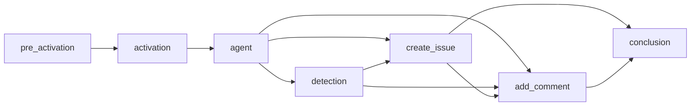
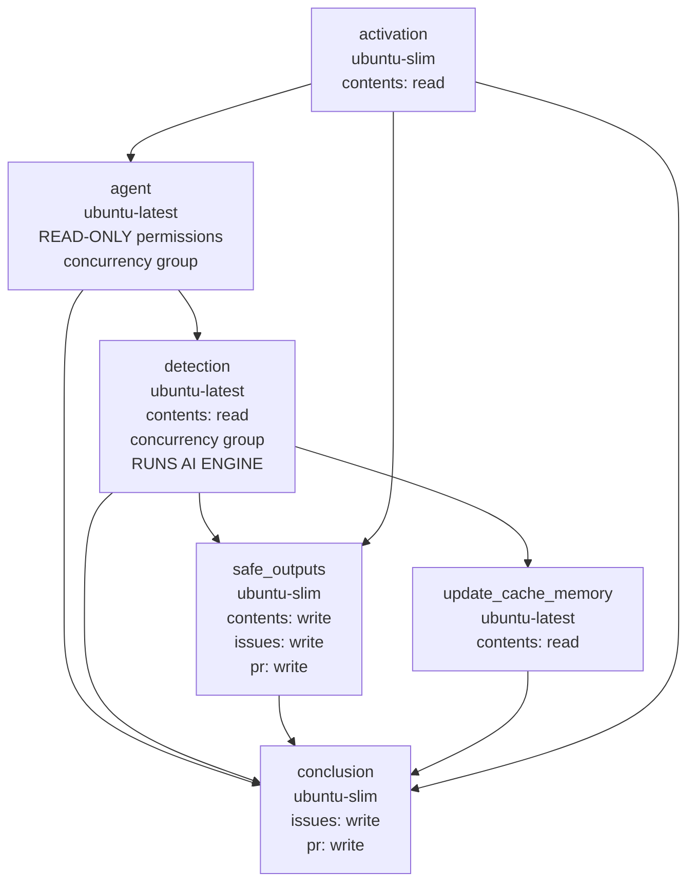

This guide documents the internal compilation process that transforms markdown workflow files into executable GitHub Actions YAML. Understanding this process helps when debugging workflows, optimizing performance, or contributing to the project.

## Overview

The `gh aw compile` command transforms a markdown workflow file into a complete GitHub Actions `.lock.yml` by embedding frontmatter and setting up runtime loading of the markdown body. The process runs five compilation phases (parsing, validation, job construction, dependency resolution, and YAML generation) described below.

When the workflow runs, the markdown body is loaded at runtime — you can edit instructions without recompilation. See [Editing Workflows](/gh-aw/setup/working-with-workflows/#editing-workflows) for details.

## Network access

Workflow schemas and built-in Actions/AW lint rules are bundled with the CLI; they do not download schemas or install linters during compilation. Remote imports and action references not covered by cached or embedded pins can require GitHub requests. `--validate` additionally checks runtime packages, container images, and repository features. External scanners are opt-in and may download container images or contact upstream services.

Interactive compilation performs a best-effort compiler update check at most once every 24 hours. It runs in the background with a three-second total budget, cancels outstanding requests when compilation finishes, and probes identical current/latest release tags only once. `--no-check-update` disables this check; CI and non-interactive invocations skip it.

`gh aw update` refreshes upstream state on each invocation, but shares action release lists and tag resolutions across actions from the same repository within that invocation. Release lists use 100 entries per page, and source content already fetched for comparison or merging is reused. By default, `update` also recompiles workflows, so a separate `gh aw compile` is unnecessary unless additional compilation options are required.

When SDK authentication is available, update uses native GitHub API clients with pooled HTTP connections for source metadata, workflow downloads, release lists, and action tags, instead of starting a fresh `gh api` subprocess for each request. Host selection follows the GitHub CLI helpers, including `GH_HOST` and repository detection. If native client setup fails, existing GitHub CLI requests remain available.

Independent action release lookups, container digest lookups, and final action integrity checks run in bounded batches of up to eight concurrent operations. Concurrent requests for the same action metadata share one fetch, including failures. Action tags resolve through the commit endpoint with a SHA-only response, avoiding separate annotated-tag peeling requests and commit diff downloads. Successful resolutions also prove commit existence; final validation reuses that evidence only within the same update invocation, checks the stored version/SHA pair against it, and fetches any unverified entries. Cache changes, workflow rewrites, and summaries are applied sequentially after each batch.

Container digest resolution uses registry metadata only (`docker buildx imagetools inspect`, then `crane digest`); it never pulls full images to discover their digests. If both methods fail, the command reports the failure and preserves any existing pin rather than downloading image layers.

`gh aw update --verbose` prints network-operation start messages and completion messages with elapsed time and success/failure status. These cover GitHub CLI calls, native source/commit API requests, public API fallbacks, Git workflow downloads, and each metadata-only container-digest resolution strategy. Native update requests also report connection reuse, DNS lookup, TCP connect, TLS handshake, and time to first response byte (measured from request start, including connection setup). GitHub CLI timings include subprocess startup and all pages requested by that invocation; they are not per-page HTTP timings. Request headers, credentials, and response bodies are not included.

## Repository Configuration (`aw.json`)

`.github/workflows/aw.json` stores repository-wide compilation settings.

| Field | Type | Default | Description |
|-------|------|---------|-------------|
| `lock_file_logo` | boolean | `true` | Include the ASCII logo in generated workflow headers, including companion workflows. Set to `false` to omit only the logo. |

```json title=".github/workflows/aw.json"
{
  "lock_file_logo": false
}
```

`gh aw compile --no-logo` disables the logo for a single invocation, even when `lock_file_logo` is `true`. Omitting the flag does not override `lock_file_logo: false`. Metadata, manifests, the “DO NOT EDIT” notice, and regeneration instructions are unchanged.

## Compilation Phases

### Phase 1: Parsing and Validation

The compiler extracts the YAML frontmatter, validates it against the workflow schema, validates expression safety (only allow-listed GitHub Actions expressions), and resolves imports.

With `--validate`, generated Actions YAML also passes through a native Go port of the [Actions language-services parsers](https://github.com/actions/languageservices). The port uses the pinned upstream workflow schema and expression grammar, including field-specific context restrictions and implicit `if` expressions. Compiler validation adds the supported workflow/job `cache-mode` values (`read`, `write`, `write-only`, `none`) missing from that schema; the upstream conformance parser remains unchanged. It supplements the existing JSON Schema, dependency, and security checks; it does not evaluate expressions, fetch reusable workflows, or replace the compiler's Actions graph. Diagnostics identify positions in the generated YAML.

Compiler expression extraction, condition optimization, import fallback folding, and context-reference checks share this parser and its quote-aware interpolation scanner. Reference detection and rewriting use AST access nodes, including single-quoted bracket notation, rather than matching reference-like text inside string literals. Existing security allowlists still apply. Actions string literals require single quotes with doubled-quote escaping (`'can''t'`); double-quoted and backtick literals, previously accepted by some compiler helpers, are rejected. The separate gh-aw experiment-comparison shorthand is normalized before Actions parsing.

The parser runs offline, without Node.js or npm. Its conformance suite replays checked-in official-parser results during Go tests. To compare directly against the pinned `@actions/workflow-parser` and `@actions/expressions` packages, run `npm ci --prefix pkg/workflow/actionslanguageservice/conformance --ignore-scripts` followed by `make test-actions-parser-conformance`. CI runs both the recorded corpus and additional boundary cases against the official parsers. The comparison covers template-reader acceptance and expression ASTs, not expression evaluation or the upstream workflow converter's execution semantics.

The compiler also warns when explicit prompt instructions require shell commands, native reads, or MCP tools denied by the resolved tool configuration. For example, ``Run `jq --version` `` or `Call mcp__github__list_issues` is checked against tool allowlists and GitHub toolsets, including imports. These advisory checks do not infer every command from prose or complex shell scripts and never expand permissions. Resolve warnings by changing the prompt to use permitted tools or allowing the specific required capability.

#### Import Resolution

Imports are resolved with a deterministic breadth-first traversal: starting from `imports:` in the main workflow, each file is loaded, its configurations are extracted, and any nested imports are appended to the queue. Visited files are tracked to detect cycles.

| Field | Merge strategy |
|-------|----------------|
| Tools | Deep merge; arrays concatenated and deduplicated |
| MCP servers | Imported servers override main-workflow servers with the same name |
| Network | Union of allowed domains, deduplicated and sorted |
| Permissions | Validation only — main must satisfy imported requirements |
| Safe outputs | Main workflow overrides imported configurations per type |
| Runtimes | Main workflow versions override imported versions |

Processing order follows BFS:

```
Main Workflow
├── import-a.md          → Processed 1st
│   ├── nested-1.md      → Processed 3rd (after import-b)
│   └── nested-2.md      → Processed 4th
└── import-b.md          → Processed 2nd
    └── nested-3.md      → Processed 5th
```

See [Imports Reference](/gh-aw/reference/imports/) for complete merge semantics.

### Phases 2–5: Building the Workflow

| Phase | Steps |
|-------|-------|
| **2 Job Construction** | Builds specialized jobs: pre-activation (if needed), activation, agent, safe outputs, safe-jobs, and custom jobs |
| **3 Dependency Resolution** | Validates job dependencies, detects circular references, computes topological order, generates Mermaid graph |
| **4 Action Pinning** | Pins all actions to SHAs: check cache → GitHub API → embedded pins → add version comment (e.g., `actions/checkout@sha # v6`) |
| **5 YAML Generation** | Assembles final `.lock.yml`: header with metadata, Mermaid dependency graph, alphabetical jobs, embedded original prompt |

### Actions/AW AST Lint Rules

`pkg/workflow/lint` provides an in-process rule registry independent of external scanners and Go source-code linters. A `lint.Rule` declares an ID, description, default severity, supported `Targets` (`AWAST`, `ActionsAST`, or both), and `Check(context.Context, lint.Input)`. Zero targets retain the Actions-only extension contract. Input contains an AW document, an Actions execution AST, or both. Rules consume parsed ASTs only: no file discovery, YAML parsing, workflow compilation, or fabricated execution graphs. They return structured diagnostics and errors without mutating either AST. The runner validates registrations, dispatches by available AST, sorts diagnostics deterministically, and continues other rules after a failure.

Register new built-in checks in `lint.Default()`. Structural rules can inspect the AST directly. Data-flow rules can use `pkg/workflow/taint.Analyze` with a `taint.Rule` defining `IsSource`, `IsSink`, optional whole-expression `IsFilter`, and known action credential outputs. Taint results retain symbolic source provenance. The `secret-leak` lint rule adapts these results to common diagnostics and reports coverage gaps separately from findings.

The CLI hides secret-leak coverage warnings unless `--debug` or explicit JavaScript analysis is enabled, in both text and JSON output. The AST runner retains these diagnostics; error findings, analysis failures, and other rules' warnings are unaffected. The registry-wide positive/negative contract suite requires fixtures for every rule and supported AST, checks strict/non-strict severity, and verifies repeatable, read-only behavior.

`TestLintPerformanceBudget` also exercises every registered rule's safe and unsafe fixtures on every supported AST, expanding execution from 32 to 256 jobs. Workflow/frontmatter parsing and optional external JavaScript compilation are outside this measurement; shell and expression parsing performed inside a check remains part of its cost. The test logs time and allocations, enforces a generous 250 ms per-check ceiling, and limits the eight-fold workload increase to 12 times the allocations plus 1,000 and 24 times the runtime plus 5 ms. The margins tolerate shared-CI scheduling noise. Constant-time configuration rules need not scale with the number of jobs. These finite workloads are regression guards, not proofs of algorithmic complexity or limits on arbitrary user programs.

`BenchmarkLintRules` tracks each rule/AST/fixture/size independently, reporting `ns/op`, `B/op`, and `allocs/op`. Comparable before/after samples use `go test ./pkg/workflow/lint -run '^$' -bench '^BenchmarkLintRules$' -benchmem -benchtime=100ms -count=5`. Add `-cpuprofile lint.cpu` or `-memprofile lint.mem` to locate costly Go computations; `go tool pprof` reads the profiles. `-trace lint.trace` captures the runner's per-rule regions. Live CLI timings use [`DEBUG=workflow:lint:perf`](/gh-aw/reference/workflow-linters/#linter-performance).

Opt-in JavaScript analysis uses the Go TypeScript compiler through a pinned, upstream-exported native-preview AST client. Configure `taint.Rule.JavaScript` with a parser and optional repository source filesystem/runtime-path mapping; `IsJavaScriptFilter` supports whole-expression declassification while retaining child side effects. `taint.AnalyzeJavaScript` also accepts symbolic stdin, environment, arguments, and file bindings directly. Analyzed programs are never executed, and unresolved modules, calls, syntax, or control flow remain explicit coverage gaps.

The CLI defaults configured JavaScript analysis to `fast`: native entry sources are batched across AW inputs, and APIs reached through operator-verified runtime mappings use source/dependency-hash-checked transfer summaries. Exact source resolution precedes summary verification; ordinary repository imports remain traversable regardless of their directory name. For paired documents, ordinary compiled checks remain active while JavaScript checks use authored sources. Unknown mapped runtime APIs retain coverage gaps instead of initiating deep traversal. Cache priming is best-effort, and parsed Actions graphs are loaded one file at a time. `deep` explicitly analyzes available runtime bodies and generated JavaScript. An unset Go API mode preserves deep behavior. `BenchmarkNativeJavaScriptBatch` and `BenchmarkJavaScriptFastSummary` measure configured analysis separately from the AST-only budgets above.

`taint.AnalyzeDocument` checks an AW prompt and script hooks alongside an existing compiled Actions graph. `taint.AnalyzeAuthoredDocument` independently visits explicit execution nodes, prompt, and schema-aware hooks using `aw.ExecutionBlocks` and `taint.AnalyzeAuthoredScripts`. Hooks include MCP tools, safe-output handlers, graders, memory validators, and engine scripts, preserving their return, environment, sandbox, and payload-encoding contracts. Authored-only analysis reports missing generated execution coverage rather than interpreting frontmatter as a complete Actions workflow. File discovery and parsing belong to the CLI adapter. [`gh aw lint`](/gh-aw/setup/cli/#lint) accepts `.md`, `.yml`, and `.yaml`, including `.lock.yml`, without recompiling; actionlint runs only on YAML inputs. `--rules` selects AST checks without external actionlint.

`gh aw compile` runs every built-in Actions/AW AST lint rule by default against the generated execution graph and authored source before writing the lock file, including with `--no-emit`. Error findings fail compilation; warnings remain advisory. Warning-level `secret-leak` diagnostics and unavailable-parser `grader-file-io` coverage warnings are hidden: neither is printed or counted toward compiler warning totals, and neither blocks compiler dry-run. `gh aw compile --no-lint` disables this pass without disabling existing compiler validation, schema checks, or explicitly requested external scanners. Dry-run compilation rejects `--no-lint`. Low-level Go compiler callers enable this pass with `workflow.WithLint(true)`; CLI compilation enables it automatically. Standalone native Actions workflows, including downstream dispatch targets, still require `gh aw lint`; compiling a caller does not recursively compile or lint its dispatch targets.

The same default applies whenever `add`, `update`, or `validate` recompiles a workflow. Only `compile` exposes `--no-lint`; fix lint findings before using other recompiling commands.

Compile-time lint is Actions/AW AST-only, without a mandatory native JavaScript parser dependency. Deeper authored JavaScript driver and custom-grader checks require standalone `gh aw lint --javascript-module <module-path>`. Missing-parser coverage warnings are advisory and do not block compiler dry-run. Passing compilation is not evidence of complete JavaScript analysis.

The default registry also checks action pinning (`action-pin`, CTR-002), direct shell-template injection (`template-injection`, CTR-006), workflow-run trigger scope (`workflow-run-scope`, CTR-021), and specified job timeouts (`job-timeout`, CTR-026). These are observable subsets of the [compiler threat specification](https://github.com/github/gh-aw/blob/main/specs/compiler-threat-detection-spec.md#74-actions-ast-lint-coverage), not replacements for compiler or runtime conformance checks. Authorization, engine policy, guarded checkout provenance, and runtime publisher integrity require evidence beyond a standalone Actions AST.

Additional checks cover explicit blanket write grants and invalid OIDC read permissions (`permission-scope`, CTR-001 subset), disabled AW version integrity checks (`version-check`, CTR-018), conditional configuration imports (`conditional-import`, CTR-020), AW private-to-public flow opt-outs (`private-to-public`, CTR-031), enabled Node install hooks (`install-scripts`, CTR-014), bare label-allowlist wildcards (`allowed-labels`, CTR-015), explicit bare network allowances (`network-scope`, CTR-011 subset), and unconstrained wildcard PR push targets (`push-target`, CTR-012 subset). AW-only checks use the authored AST directly or as a companion, not reconstructed Actions properties or recursively loaded imports, and skip native Actions without source evidence. Push-target defers missing-constraint findings when imports may supply constraints.

Further AST-only rules check authored shell/proxy contradictions and cache isolation (`tool-scope`, CTR-003 subset), explicit sandbox bypasses and internal overrides (`sandbox-config`, CTR-004 subset), option-prefixed image operands (`image-argument`, CTR-013 subset), explicit checkout expansion and literal prerequisites (`checkout-mode`, CTR-033 subset), and fork author-association enum values (`fork-association`, CTR-034 subset). These do not infer engine capabilities, runtime selector trust, repository visibility, or generated admission guards.

Three source-policy checks cover explicit `pull_request_target` admission through `read`/`all` roles (`pull-request-target-roles`, CTR-008 subset), blocked lexical expansions in authored safe-output run scripts (`safe-output-shell-expansion`, CTR-009), and URL-filter arguments without SSL inspection (`firewall-ssl-bump`, CTR-011 subset). The shell rule and compiler validation share `pkg/workflow/shellpattern` to prevent detector drift. The roles rule preserves strict rejection and scoped non-strict warning suppression; shell and firewall prerequisite violations are errors in either mode. The firewall rule checks authored `--allow-urls` and `--ssl-bump` tokens in `sandbox.agent.args`, an internal override accepted only in non-strict mode. Legacy `network.firewall` blocks are schema-invalid and reported as requiring migration, not as fixable by setting `ssl-bump: true`. These rules do not resolve imported settings or prove runtime firewall enforcement, generated checkout safety, or publishing provenance.

The [Workflow Linters reference](/gh-aw/reference/workflow-linters/) lists each built-in rule's compiler threat ID and analysis boundaries. `Rule.ThreatRuleID` records the known mapping; the runner attaches it to every diagnostic, including coverage warnings. CLI text, JSON, and `--list-rules` preserve that reference. Extension rules can leave the field empty when unmapped.

## Job Types

The compilation process generates specialized jobs based on workflow configuration:

| Job | Trigger | Purpose | Key Dependencies |
|-----|---------|---------|------------------|
| **pre_activation** | Role checks, stop-after deadlines, skip-if-match, or command triggers | Validates permissions, deadlines, and conditions before AI execution | None (runs first) |
| **activation** | Always | Prepares workflow context, sanitizes event text, validates lock file freshness | `pre_activation` (if exists) |
| **agent** | Always | Core job that executes AI agent with configured engine, tools, and Model Context Protocol (MCP) servers | `activation` |
| **detection** | `safe-outputs.threat-detection:` configured | Scans agent output for security threats before processing | `agent` |
| **Safe output jobs** | Corresponding `safe-outputs.*:` configured | Process agent output to perform GitHub API operations (create issues/PRs, add comments, upload assets, etc.) | `agent`, `detection` (if exists) |
| **conclusion** | Always (if safe outputs exist) | Aggregates results and generates workflow summary | All safe output jobs |

### Agent Job Steps

The agent job runs: repository checkout and runtime setup (Node.js, Python, Go) → cache restoration → MCP container initialization → prompt generation from the markdown body → engine execution (Copilot, Claude, or Codex) → output upload as a GitHub Actions artifact → cache persistence. Key environment variables: `GH_AW_PROMPT` (prompt file), `GH_AW_SAFE_OUTPUTS` (output JSON), `GITHUB_TOKEN`.

### Safe Output Jobs

Every safe output job follows the same pattern: download the agent artifact, parse its JSON, execute the corresponding GitHub API operation with the right permissions, and link to related items. Available types include `create_issue`, `create_discussion`, `add_comment`, `create_pull_request`, `create_pr_review_comment`, `create_code_scanning_alert`, `add_labels`, `assign_milestone`, `update_issue`, `update_release`, `push_to_pr_branch`, `upload_assets`, `update_project`, `report_missing_tool`, and `noop`.

### Custom Jobs

Use `safe-outputs.jobs:` for custom jobs with full GitHub Actions syntax, or `jobs:` for additional workflow jobs with user-defined dependencies. See [DeterministicOps](/gh-aw/patterns/deterministic-ops/) for examples of multi-stage workflows combining deterministic computation with AI reasoning.

## Job Dependency Graphs

Jobs execute in topological order based on dependencies. Here's a comprehensive example:



**Execution flow**: Pre-activation validates permissions → Activation prepares context → Agent executes AI → Detection scans output → Safe outputs run in parallel → Add comment waits for created items → Conclusion summarizes results. Safe output jobs without cross-dependencies run concurrently; when threat detection is enabled, safe outputs depend on both agent and detection jobs.

## Why Detection, Safe Outputs, and Conclusion Are Separate Jobs

A typical compiled workflow contains these post-agent jobs:



These three jobs form a **sequential security pipeline** rooted in [Plan-Level Trust](/gh-aw/introduction/architecture/) — AI reasoning (read-only) is separated from write operations. They cannot be merged because GitHub Actions permissions are per-job and immutable for the duration of a job:

| Job | Key Permissions | Rationale |
|-----|----------------|-----------|
| **detection** | `contents: read` | Runs AI analysis — must not have write access |
| **safe_outputs** | `contents: write`, `issues: write`, `pull-requests: write` | Executes GitHub API write operations |
| **conclusion** | `issues: write`, `pull-requests: write`, `discussions: write` | Updates comments, handles failures |

A combined job would hold write permissions while running threat detection, defeating least privilege and letting a compromised agent bypass the gate. Job-level isolation also enables:

- **Hard gating.** The `safe_outputs` job condition `needs.detection.outputs.success == 'true'` prevents the runner from starting at all if detection fails. Step-level `if` checks within one job are weaker.
- **`always()` semantics for `conclusion`.** It inspects upstream results via `needs.agent.result` to log errors and report missing tools even when writes fail.
- **Right-sized runners.** Detection needs `ubuntu-latest` for AI execution; safe_outputs and conclusion use the lightweight `ubuntu-slim`.
- **Concurrency isolation.** Detection shares a concurrency group with the agent job to serialize AI execution; safe_outputs intentionally does not, so it can run alongside other workflows' detection phases.
- **Artifact-based handoff.** The agent writes `agent_output.json`; detection emits `success`; safe_outputs only downloads the artifact if approved. A shared filesystem in a single job would allow output tampering between phases.

## Action Pinning

All GitHub Actions are pinned to commit SHAs (e.g., `actions/checkout@b4ffde6...11 # v6`) to defend against supply chain attacks — tags can be moved, SHAs cannot. Resolution order is cache (`.github/aw/actions-lock.json`) → GitHub API → embedded pins.

### The actions-lock.json Cache

`.github/aw/actions-lock.json` caches resolved `action@version` → SHA mappings so compilation produces consistent results regardless of the available token. Resolving a tag to a SHA requires GitHub API access, which fails under restricted tokens — notably the GitHub Copilot Coding Agent (CCA) token. With the cache, CCA and similar restricted environments reuse SHAs from a prior compile run with a broader-scope token.

**Commit `actions-lock.json` to version control** so every contributor and automated tool uses the same immutable pins. Refresh with `gh aw update-actions`, or delete and recompile with a permissive token to force full re-resolution.

## The gh-aw-actions Repository

`github/gh-aw-actions` contains the reusable actions that power compiled workflows. Every action step in a generated `.lock.yml` references it (usually by commit SHA, occasionally by a stable tag like `v0` when SHA resolution is unavailable):

```yaml
uses: github/gh-aw-actions/setup@abc1234...
```

Never edit these references by hand — run `gh aw compile` or `gh aw update-actions` to regenerate them. Use `--actions-repo` (with `--action-mode action`) to compile against a fork or specific tag during development; see [Compilation Commands](#compilation-commands).

### Dependabot and gh-aw-actions

Dependabot may open PRs to bump `github/gh-aw-actions` to a newer SHA. **Do not merge them** — pin updates must come from `gh aw compile`, which coordinates pins across all compiled workflows from a single release. `gh aw compile` automatically inserts an ignore rule when a `github-actions` update block exists in `.github/dependabot.yml`. When enabling Dependabot from scratch, use:

```yaml
updates:
  - package-ecosystem: github-actions
    directory: "/.github/workflows"
    ignore:
      - dependency-name: "github/gh-aw-actions/*" # Managed by gh aw compile. Version-locked to the gh-aw compiler; do not bump.
```

## Artifacts Created

Workflows generate several artifacts during execution:

| Artifact | Location | Purpose | Lifecycle |
|----------|----------|---------|-----------|
| **agent_output.json** | `/tmp/gh-aw/safeoutputs/` | AI agent output with structured safe output data (create_issue, add_comment, etc.) | Uploaded by agent job, downloaded by safe output jobs, auto-deleted after 90 days |
| **agent_usage.json** | `/tmp/gh-aw/` | Aggregated token counts: `{"input_tokens":…,"output_tokens":…,"cache_read_tokens":…,"cache_write_tokens":…}` | Bundled in the unified agent artifact when the firewall is enabled; accessible to third-party tools without parsing step summaries |
| **prompt.txt** | `/tmp/gh-aw/aw-prompts/` | Generated prompt sent to AI agent (includes markdown instructions, imports, context variables) | Retained for debugging and reproduction |
| **firewall-audit-logs** | See structure below | Dedicated artifact for AWF audit/observability logs (token usage, network policy, audit trail) | Uploaded by all firewall-enabled workflows; analyzed by `gh aw logs --artifacts firewall` |
| **firewall-logs/** | `/tmp/gh-aw/sandbox/firewall/logs/` | Network access logs in Squid format (when the AWF agent sandbox is enabled) | Analyzed by `gh aw logs` command |
| **cache-memory/** | `/tmp/gh-aw/cache-memory/` | Persistent agent memory across runs (when `tools.cache-memory:` configured) | Restored at start, saved at end via GitHub Actions cache |
| **patches/**, **sarif/**, **metadata/** | Various | Safe output data (git patches, SARIF files, metadata JSON) | Temporary, cleaned after processing |

### `firewall-audit-logs` Artifact Structure

The `firewall-audit-logs` artifact is a dedicated multi-file artifact uploaded by all firewall-enabled workflows. It is **separate** from the unified `agent` artifact. Downstream workflows that need token usage data or firewall audit logs must download this artifact specifically.

```
firewall-audit-logs/
├── api-proxy-logs/
│   ├── token-usage.jsonl        ← Token usage data per request
│   └── token-diag.log           ← Token diagnostics JSONL (only when AWF_DEBUG_TOKENS=1)
├── squid-logs/
│   └── access.log               ← Network policy log (allow/deny)
├── audit.jsonl                  ← Firewall audit trail
└── policy-manifest.json         ← Policy configuration snapshot
```

`token-diag.log` is optional debug output from the AWF api-proxy token persistence diagnostics (`diag()` in `containers/api-proxy/token-persistence.js`). The file is only written when `AWF_DEBUG_TOKENS=1`, so that variable must be set on the workflow step that runs with AWF enabled when token diagnostics are needed.

> **Tip:** Use `gh aw logs <run-id> --artifacts firewall` to download and analyze firewall data instead of `gh run download` directly. The CLI handles artifact naming and backward compatibility automatically. See the [Artifacts reference](/gh-aw/reference/artifacts/) for the complete artifact naming guide.

## MCP Server Integration

Model Context Protocol (MCP) servers provide tools to AI agents. Compilation emits `mcp-config.json` from the workflow's tool configuration. Local servers run in Docker containers with auto-generated Dockerfiles and connect via stdio; HTTP servers connect directly with configured headers and authentication. `allowed:` restricts which tools the agent sees, and secrets inject through Dockerfile env vars (local) or config references (HTTP). At runtime, MCP containers start after runtime setup, the engine executes with tool access, then containers stop.

## Pre-Activation Job

Pre-activation runs gating checks sequentially before any AI execution. Any failure sets `activated=false`, skipping downstream jobs and saving costs:

- **Role checks** (`roles:`) — actor's role exactly matches one of the entries in the allowlist (default `[admin, maintainer, write]`; no privilege hierarchy — `roles: [write]` rejects `admin` and `maintainer` actors)
- **Stop-after** (`on.stop-after:`) — workflow has not passed its deadline (e.g., `+30d`, `2024-12-31`)
- **Skip-if-match** (`skip-if-match:`) — no existing item matches the dedup criteria
- **Command position** (`on.slash_command:`) — slash command appears in the first 3 lines

## Compilation Commands

| Command | Description |
|---------|-------------|
| `gh aw compile` | Compile all workflows in `.github/workflows/` |
| `gh aw compile my-workflow` | Compile specific workflow |
| `gh aw compile --verbose` | Enable verbose output |
| `gh aw compile --strict` | Enhanced security validation |
| `gh aw compile my-workflow --dry-run` | Compile with staging and mandatory validation/shellcheck/model checks; reject existing and added actionable scanner findings and unsupported host effects; Docker scanners are opt-in |
| `gh aw compile my-workflow --environment gh-aw-debug` | Replace the environment on every generated job |
| `gh aw compile --no-emit` | Validate without generating files |
| `gh aw compile --actionlint --zizmor --poutine --grant` | Run security scanners |
| `gh aw compile --actionlint --zizmor --poutine --yamllint` | Run security scanners |
| `gh aw compile --purge` | Remove orphaned `.lock.yml` files |
| `gh aw compile --output /path/to/output` | Custom output directory |
| `gh aw compile --action-mode action --actions-repo owner/repo` | Compile using a custom actions repository (requires `--action-mode action`) |
| `gh aw compile --action-mode action --actions-repo owner/repo --action-tag branch-or-sha` | Compile against a specific branch or SHA in a fork |
| `gh aw compile --action-tag v1.2.3` | Pin action references to a specific tag or SHA (implies release mode) |
| `gh aw validate` | Validate all workflows (compile + all linters, no file output) |
| `gh aw validate my-workflow` | Validate a specific workflow |
| `gh aw validate --json` | Validate and output results in JSON format |
| `gh aw validate --strict` | Validate with strict mode enforced |

> [!TIP]
> Compilation is only required when changing **frontmatter configuration**. The **markdown body** (AI instructions) is loaded at runtime and can be edited without recompilation. See [Editing Workflows](/gh-aw/setup/working-with-workflows/#editing-workflows) for details.

> [!NOTE]
> The `--actions-repo` flag overrides the default `github/gh-aw-actions` repository used when `--action-mode action` is set. Use it together with `--action-tag` to compile against a branch or fork during development.

The optional `--actionlint`, `--zizmor`, and `--poutine` scanners prefer local
binaries on `PATH` when their versions meet the pinned Docker image versions
(actionlint ≥ 1.7.12, zizmor ≥ 1.31.1, poutine ≥ 1.1.6). Missing, older, or
unrecognized versions fall back to Docker. Local actionlint uses shellcheck and
pyflakes from `PATH` when those integrations are enabled; it does not install them.

Compilation and `gh aw lint` ignore actionlint's unsupported-key diagnostic for
workflow- and job-level `cache-mode`. Other syntax and security diagnostics,
including step-level keys, misspelled keys, and malformed values, are unaffected.

### Development Testing Mode

`--dry-run` enables `--strict`, `--staged`, `--validate`, `--shellcheck`,
and `--models`. These settings are
forced regardless of frontmatter; explicitly disabling a required flag is rejected.
Enabled scanners first scan the existing lock files before compilation, then scan
the emitted diagnostic locks with the same scanner configuration and result filters.
Existing and added medium-or-higher findings, or findings with unknown severity,
fail the scanner gate. Matching uses finding identity and occurrence counts, not
aggregate totals. Actions and AW ASTs anchor findings to field values and logical
steps, tolerating line shifts, YAML quoting and comments, and reordered steps
with stable IDs or unique names. Steps without an ID or unique name use a
content fingerprint, so repeated names or action references do not conflate
different steps. Ambiguous locations and unparseable workflows retain
coordinates and a file fingerprint rather than guessing a matching field.
Zizmor findings retain all primary and related symbolic scopes, including
source/sink relationships across files. Finding identity includes the reported
semantic scope, not just its step label. Incomplete diagnostics and
operational errors joined with findings remain fatal; usable findings cannot
hide partial scanner failures.
Low-severity and informational findings remain visible but do not fail the gate.
Zizmor's `secrets-outside-env` rule is excluded in dry-run mode because repository
and organization secrets are common in agentic workflows; ordinary compilation
retains the rule. With no existing lock, every actionable finding is added.
The baseline is the on-disk lock at invocation time, not a Git branch comparison;
repeated dry runs compare against the locks left by the preceding invocation.

Validation errors, unclassified compiler warnings (including safe-update warnings),
and scanner execution/parsing failures remain fatal, including failures while
collecting the baseline. Missing required tools block compilation
rather than silently skipping checks. Model checking uses the observed active
model inventory; development compilation fails if that inventory is unavailable
and the workflow declares `models` policies or `engine.models`. It does not prove
live model availability.
Observed-inventory refresh and collection warnings are also reported: they fail
the dry-run gate even when cached observations remain available. Ordinary
`--models` compilation reports them as warnings instead.

Built-in experimental-feature notices are low-severity and nonblocking.
They remain visible and the JSON summary records `ignored_low_severity_warnings`.
`--allow-experimental` additionally records explicit acknowledgement in
`accepted_experimental_warnings`; it does not exempt arbitrary warning text.
The summary identifies `warning_baseline`, `minimum_severity`, and
`ignored_scanner_rules`; each scanner's `differential` reports baseline, existing,
added, and low-severity ignored counts. A scanner status of `passed` means its
differential gate passed, not that its output contained no findings.
Required checks and staging remain enabled.

Docker-based scanners and `--validate-images` remain opt-in. Docker unavailability
does not block the dry-run gate; install native `shellcheck` for required run-step
linting without Docker. When Docker is available, running `gh aw validate my-workflow`
is recommended for source checks, alongside
`gh aw compile my-workflow --dry-run --zizmor --actionlint --poutine` for scanner
checks. `validate` uses `--no-emit` and skips these scanners; its success does not
establish scanner coverage. Run the scanner-enabled compile command when possible
and report unavailable checks as unverified. Explicitly requested checks
still fail the dry-run gate on added actionable findings or scanner failures.

When optional CLI scanner preparation cannot find Docker on `PATH`, it prints one
informational notice per process and does not retry image downloads. MCP
compilation continues with compatible native scanners and reports skipped
Docker-based checks with a concise `docker_unavailable` warning.

MCP callers can opt into required image validation with `validate_images: true`,
including with `dry_run: true`; Docker unavailability then fails compilation.

```bash
gh aw compile my-workflow --dry-run --environment gh-aw-debug
```

The optional `--environment NAME` replaces every job's environment in compiled
`.lock.yml` files, including
existing name/URL objects, manual-approval environments, custom jobs, and framework
jobs. It accepts a literal, non-blank name of at most 255 characters. Expressions
and control characters are rejected. GitHub Actions does not allow an environment
on reusable-workflow caller jobs, so compilation fails if such a job is present
instead of silently leaving it outside the override. Configure the environment in
the called workflow and compile the caller without the override when using
reusable workflows.

A protected test environment with rotated, restricted development credentials
is recommended, not required. Replacing an approval environment also replaces
its protection rules: configure and review the test environment's protections.
Authorized repository, organization, and enterprise-provided shared secrets
remain in the job's applicable secret scope; an environment name is not secret
isolation and does not automatically export secrets into process environment
variables.

Dry-run mode stages safe outputs and disables compiler-managed GitHub mutations:
push jobs, memory/cache persistence, reusable safe-output calls, work-queue
operations, reactions, status/failure comments and issues, label removal, and
issue locking. `aw_info.json` records the boolean `dry_run` flag. Failure handling,
local diagnostics, step summaries, and run artifacts remain enabled. No new
memory-tool fields are required; ordinary compilation preserves persistence.

On GitHub.com, dry-run locks also set workflow-level `cache-mode: read`, allowing
cache restores but preventing saves, including caches used by authored steps and
setup actions. GHES compilation omits this setting because it is not supported
there; compiler-managed caches remain restore-only.

Dry-run compilation adds `workflow_dispatch`, preserves existing manual inputs,
and copies reusable-workflow inputs when adding manual dispatch. Actor roles are
restricted to `admin`/`maintainer` (including `maintain`); an existing narrower
subset is preserved and bot exemptions are removed. Other triggers remain intact.
This does not upload the lock or authorize a live run.

Daily credit accounting, its ledger/app wiring, and `max-daily-ai-credits` are
removed from the diagnostic configuration. An existing positive per-run
`max-ai-credits` cap or expression is preserved. Otherwise an explicitly configured
or imported daily limit becomes the per-run cap, including runtime expressions.
The ordinary per-run default remains when the daily limit was only a default;
an active default daily guard replaces an explicitly disabled per-run cap with
the standard per-run cap. Explicitly disabling both limits remains unchanged.

Set `DEBUG=workflow:compiler_development,cli:compile_development` to log each
dry-run configuration mutation, removed environment key, disabled job, and forced
CLI flag to stderr. Logs identify changed fields/keys, never their values.

Dry-run locks omit telemetry configuration under `OTEL_*`, `GH_AW_OTLP_*`, and `GITHUB_AW_OTEL_*`,
W3C trace context (`TRACEPARENT`, `TRACESTATE`, `BAGGAGE`), and
`CLAUDE_CODE_ENABLE_TELEMETRY` from workflow, job,
step, container, and service environment mappings, including user-defined values.
Workflow environment suppression occurs before job and header generation so
telemetry-only masking steps and environment-source entries are also omitted.
Engine environment overrides are filtered before native engine configuration is rendered.
The emitted workflow environment sets `OTEL_SDK_DISABLED=true`,
`GH_TELEMETRY=false`, `DO_NOT_TRACK=1`, `DISABLE_TELEMETRY=1`,
`DISABLE_ERROR_REPORTING=1`, and `CLAUDE_CODE_DISABLE_NONESSENTIAL_TRAFFIC=1`.
These opt-outs are inherited by jobs and steps. Conflicting overrides in job,
step, container, and service environment mappings are replaced.
Automatic OTLP export configuration and telemetry authentication steps are also
disabled. Existing network permissions, local diagnostics, summaries, and artifacts remain
available; ordinary compilation preserves telemetry configuration. Tools that
ignore these variables can still emit telemetry. This does not rewrite custom
scripts that configure their own exporters.

The emitted lock's `gh-aw-metadata` header records `"dry_run":true`. Normal and
older locks omit this optional field, which readers interpret as `false`.
Suppression applies to the lock emitted by `--dry-run`, not a previously compiled
normal lock on GitHub. Restoring that normal lock after diagnostic compilation
does not disable its telemetry. Any permitted live test must review and execute
the same emitted lock revision; dispatching an unchanged remote ref executes its
existing lock instead.

Authored custom jobs, including reusable calls and custom safe-output jobs, become
disabled placeholders with no original steps, permissions, environment, or inherited
secrets. Output names are retained with empty values; dependent jobs may be skipped.
Staging overrides in custom publishing steps cannot reactivate these jobs.
Reusable output contracts and required self-hosted runner policies are preserved
without retaining the original executable target or matrix-dependent runner.

Dry-run rejects authored host steps (`steps`, `pre-steps`, `pre-agent-steps`,
`post-steps`, `on.steps`, safe-output and threat-detection steps, secret-masking
steps, and unsafe built-in job overrides), custom MCP servers, `mcp-scripts`,
custom safe-output scripts/actions, enabled Bash graders, and authored
`id-token: write` permissions, including safe-output and imported declarations.
Compiler-generated pull-request stack gates remain available. Remove unsupported
declarations in a separate diagnostic workflow; there is no unsafe override.

Agent shell commands, custom engine execution, custom credentials, and
compiler-managed OIDC integrations still require review. Dry-run is not an
execution sandbox or a guarantee of side-effect-free hosted execution.

`--dry-run` cannot be combined with `--no-emit`, `--watch`, `--approve`, or
`--allow-action-refs`, because those options bypass required checks or the trusted
safe-update baseline. It is distinct from `--action-mode dev`, does not change
action reference mode, and does not upload, push, dispatch, or run workflows.
Generated files remain available for inspection after failed checks and must not
be treated as approved artifacts.

#### Dry-run coverage output

Compilation prints its limited effect scope before checks and a scanner-coverage
summary afterward. With `--json`, the existing result array gains a batch-scoped
`workflow: "dry-run"` entry containing `dry_run.gate`, forced `required_flags`,
and a `scanners` map. Each scanner has `requested` and `status` fields:

| Status | Meaning |
|---|---|
| `passed` | The scanner invocation completed successfully against emitted inputs |
| `failed` | The invocation reported findings or an execution failure, including unavailable tooling |
| `not_run` | The scanner was not requested, was not reached, or had no emitted inputs |

This is invocation coverage, not per-script or per-image coverage. Optional image
validation is identified separately by `validate_images_required`; the summary
does not attest individual image checks. `model_inventory_available` indicates
an observed inventory exists, not that runtime models are authorized or available.

`dry_run.gate` reflects both workflow and batch failures. Check the command exit
status and the entire result array, not only individual workflow `valid` fields.
Preflight failures can stop compilation before this summary is emitted.
`compile_only` is true and `execution_authorized` is false even when the gate
passes. `unverified_effects` lists excluded surfaces, not a per-workflow effect
inventory; agent code, hosted identity/approvals, live model availability, and
diagnostic exports remain unverified. Ordinary compilation keeps its existing
output shape.

For diagnosis/patching versus active debugging, live-test review gates, and
Codespaces/SAML triage, follow the
[shared local-debugging strategy](https://github.com/github/gh-aw/blob/main/.github/aw/debug-agentic-workflow.md).

## Debugging Compilation

Run `DEBUG=workflow:* gh aw compile my-workflow --verbose` to trace job creation, action pin resolution, tool configuration, and MCP setup. Inspect generated `.lock.yml` files for header comments, the Mermaid dependency graph, job structure, SHA pins, and MCP config. Common fixes: circular dependencies → review `needs:` clauses; missing action pin → add to `action_pins.json` or enable dynamic resolution; invalid MCP config → verify `command`, `args`, `env`.

## Performance

Simple workflows compile in ~100ms; workflows with imports in ~500ms; workflows that resolve action SHAs dynamically in ~2s. To keep compilation fast, commit `.github/aw/actions-lock.json` and minimize import depth. At runtime, safe output jobs without cross-dependencies run in parallel; enable `cache:` and `cache-memory:` for further speedups.

## Advanced Topics

- **Custom engines**: implement an engine that returns GitHub Actions steps and tool access, then register it with the framework.
- **Schema extension**: add frontmatter fields by updating the workflow schema, rebuilding (`make build`), and wiring up parser handling.
- **Workflow manifest**: imported files are tracked in lock file headers for update detection and audit trails.

## Learn More

- [Editing Workflows](/gh-aw/setup/working-with-workflows/#editing-workflows) - When to recompile vs edit directly
- [Frontmatter Reference](/gh-aw/reference/frontmatter/) - All configuration options
- [Tools Reference](/gh-aw/reference/tools/) - Tool configuration guide
- [Safe Outputs Reference](/gh-aw/reference/safe-outputs/) - Output processing
- [Engines Reference](/gh-aw/reference/engines/) - AI engine configuration
- [Network Reference](/gh-aw/reference/network/) - Network permissions
