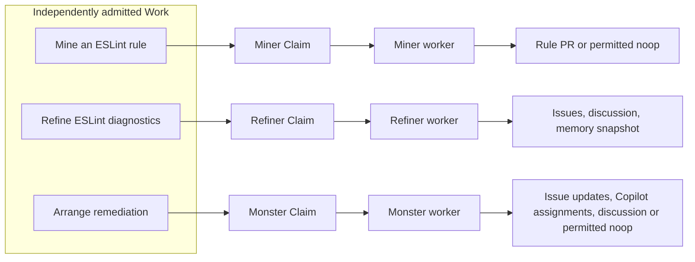
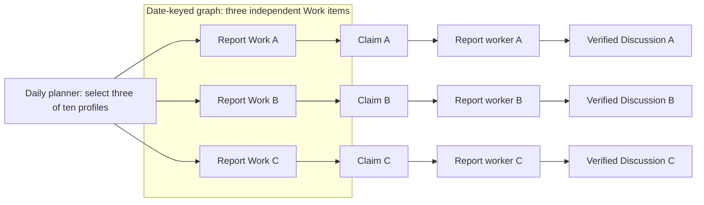

Work queues can be Git-backed or issue-backed. Native `tools.work-queue` uses
Git storage. Lightweight issue checklists and sub-issue queues use
[WorkQueueOps](/gh-aw/patterns/workqueue-ops/) with GitHub read tools and safe
outputs. This reference describes the native version-3 protocol. Git is the only
backend, and `tools.work-queue` has no `storage` field.

The workflow runtime and operator use the Git executable for ledger reads,
checkpoint verification and compare-and-swap publication, not GitHub's REST or
GraphQL Git APIs. They fetch only the queue branch and its complete history into
an isolated bare object store, independently of the source checkout. Git uses
the selected queue credential through ephemeral authentication; it does not
reuse persisted checkout credentials. Agents and snapshot MCP servers remain
credential-free.

The native queue enforces fair scheduling, immutable task dependency graphs,
and worker effects authorized by individual Claims. Its only source of
authority is `work-queue.jsonl`, a transaction log that records events in causal
order. Defaults behave like first in, first out (FIFO): one priority, one
accounting key, and the oldest eligible Work first. Accounting keys group tasks
for fairness accounting. Configured weights share opportunities to receive
durable Claims, not CPU time or successful completions.

In the native protocol, issues and pull requests can be dependency nodes, but
cannot store the queue. Optional backing Issues mirror admitted Work; they do
not grant Claim authority or establish Result. [WorkQueueOps](/gh-aw/patterns/workqueue-ops/) describes
issue checklists, sub-issues, cache-memory, and repo-memory as alternatives, but those
progress markers do not provide native fair scheduling, Claim authority, or
verified dependency graphs.

The native protocol distinguishes the following records and lifecycle events:

| Term | Meaning |
| --- | --- |
| Work | An immutable task definition. Tasks can form a directed acyclic graph (DAG), a dependency graph with no cycles. |
| Claim | Authorization for one attempt at a Work item. Its original `claim_handle` identifies that attempt. |
| Policy | Installed scheduling and delivery limits with approved worker contracts. First submission installs Policy and Work; economic changes require an explicit quiescent update. |
| Deployment | A durable prospective execution revision/availability for a logical worker; compatible evolution does not reset Policy or revoke outstanding assignments. |
| Pool | A group of tasks with shared worker routes and capacity limits. |
| Reservation | Native worker capacity held for an assignment, including while launch or termination is uncertain. |
| Native launch | The request to start a GitHub Actions worker run. A committed assignment is not proof of launch. |
| Completion | A durable record of task completion, published before the Claim's effects. It is not proof of delivery. |
| Result | A record published only after independently verified delivery of the Claim's effects. |
| Release | The operation that frees a native reservation after trusted evidence of exact termination or definitive nonlaunch. |
| IssueLink | An immutable, checked link from one admitted Work item to one backing Issue. |
| IssueComment | An immutable canonical summary or historical Claim-comment handle. |

See [deployment](/gh-aw/guides/deploy-work-queue/) for first-use bootstrap, the
[specification](/gh-aw/specs/work-queue-specification/) for normative behavior and
implementation coverage, and the
[formal verification reference](https://github.com/github/gh-aw/blob/main/specs/work-queue/README.md)
for executable models, contracts and reproduction instructions.

For workflow examples, see the [Linter Factory](/gh-aw/patterns/linter-factory/)
for fair dispatch and Claim-scoped worker outputs, and the
[Daily Report Portfolio](/gh-aw/patterns/daily-report-portfolio/) for a daily
dispatcher coordinating reporting workers.

## Initialization and authorization

An absent queue is uninitialized, not an error to repair with administrator
seeding. The first accepted producer or dispatcher submission creates the queue
with one version-3 commit containing Policy followed by Work. The commit retains
the original submission request and identity; there is no separate Policy
request or queue-enrollment step. Read commands may report `queue_missing`;
that result does not require Policy seeding.

| Entry point | First-use behavior |
| --- | --- |
| Workflow `work_queue_submit` | Atomically installs scheduling resolved from `aw.json` and AW-approved worker routes with the first Work. |
| Native `submit-work`, `submit-graph` | Resolves scheduling and AW worker routes from the verified repository revision. Embedding hosts can supply an approved `Branch.PolicyProposal`. |
| Activation, reads, snapshots, dispatch-only requests and controls | Do not create a queue or install Policy. |
| `policy` | Updates only an existing, quiescent queue. Standalone Policy seeding is unsupported. |

Agentic Workflows and Actions supply authenticated runtime identity. The queue
uses that identity for operation roles and Claim ownership, not producer
enrollment or allowlists. Agents cannot choose Policy
or receive queue-write credentials. Worker routes must accept
`work_queue_assignment` and be verifiable at their approved immutable revisions.

Worker user prompts include the normalized version-3 `work_queue_assignment`
as JSON inside `<work-queue-assignment>`, including its `claims`, `pool`, and
`worker_profile`. Per-Claim `<work-claim>` blocks provide scoped finish guidance.
Task payloads and predecessor results remain data; prompt context does not
replace the runtime's authenticated Claim checks.

GitHub enforces repository access rules; the queue requires no branch-protection
setup or repository-rule inventory. Actual Git access denials remain errors.
An installed Policy stays authoritative, and malformed or policyless existing
ledgers are rejected rather than reset. Historical Policy-only genesis records
remain readable.

## Repository scheduling settings

The optional `.github/workflows/aw.json` `work_queue` object contains global
scheduling and Issue/label settings. Missing file, missing section and `{}` use defaults. Unknown
fields, null, wrong types and out-of-range values are errors. AW supplies
authentication, credentials and worker routes through declared workers and
`safe-outputs.dispatch-workflow.workflows`; these do not belong in `work_queue`.

| Field | Default | Accepted values |
| --- | --- | --- |
| `concurrency` | 16 | Integer 1–4,096; logical and native capacity per pool |
| `pending_limit` | 4,096 | Integer 1–4,096; queue-wide pending Work |
| `retry.max_attempts` | 3 | Integer 1–16 |
| `retry.backoff_seconds` | 30 | Integer 1–3,600 |
| `mode` | `weighted-priority` | `weighted-priority` or `strict-priority` |
| `class_weights` | `[8,4,2,1,1]` | Five integer class weights, each 1–1,000 |
| `accounting_weights` | `{"":1}` | Named integer fairness weights, each 1–1,000; the empty key retains weight 1; `{}` uses defaults |
| `pools` | One `default` pool | Up to 64 named scheduling objects with optional `concurrency`, `retry`, `per_account_limit` (1–4,096); inherit AW routes and singleton assignments; `{}` uses defaults |
| `issues` | Disabled | `true`, `false`, or `{"label":"work"}`; global backing Issue projection and tracking/status label prefix, at most 33 UTF-8 bytes |

The first submission publishes the resolved Policy and Work in one atomic
commit. Concurrent first submissions retry against the installed winner without
losing or duplicating Work. The installed scheduling Policy stays authoritative:
scheduling edits affect a future bootstrap or explicit
`policy --from-config --epoch EPOCH`, never silently replace an active queue.
Updates require quiescence across Work, reservations and delivery.
Workflow-level `work-queue-policy` is deprecated and conflicts with repository
`work_queue`; historical Policies remain readable with their original semantics.
Workflow-level `tools.work-queue.issues` is deprecated; configure projection and
labels in `aw.json`. Issue settings configure protected workflow hooks, not new
projector grants or scheduling epochs. Definitions at both levels conflict
rather than silently overriding each other.

### Worker evolution

Compatible worker deployments change future execution without draining the
queue. Compiler-derived logical contracts cover declared inputs, permissions,
tools and output/resource capabilities, including imports; prompts and engine
selection are not deployment identity. New admissions freeze the approved
contract. Pending unpinned Work follows only compatible execution revisions;
`execution_ref` explicitly pins an approved revision. Historical profiles
without contract metadata retain exact-ref behavior.

Deployment transitions preserve Work identities, dependencies, Results,
fairness debt and reservations. Existing Dispatch profiles and run/credential
bindings remain the authority for completion, delivery and reconciliation.
Incompatible, unavailable or AW-unapproved workers block only affected Work and
its dependent successors, without charging fairness or consuming attempts.
Scheduling economics and genuinely conflicting shared resources use the
separate quiescent Policy update.

GitHub's workflow-dispatch API requires a named ref, not a raw commit SHA.
Queue launches share the ordinary `dispatch_workflow` safe-output POST transport,
but disable its legacy-response fallback: a queue launch sends at most one POST
and requires the pinned API's run identity response.
Trusted JavaScript dispatch creates or reuses the lightweight tag
`refs/tags/gh-aw/work-queue/<approved-sha>` and reads it back to verify its exact
commit before launching. It never moves or deletes an existing tag. This requires
`contents: write` alongside `actions: write` on the trusted dispatch credential;
the agent receives neither credential. The Claim and native-run binding retain
the approved SHA, and a mismatched run cannot authorize worker effects.
Rejected launches release their reservations but fail the dispatcher; release
is not successful execution. Always-visible diagnostics report only static
events, counts, flags, elapsed time and HTTP status, including known validation
categories. They omit assignments, identities, tokens and raw error bodies.

Protected producer/dispatcher processing synchronizes only its AW-approved
targets before a new submission or dispatch request; replay of an accepted
request does not retarget it. Workers cannot publish deployment updates.
Native operators use `deploy --from-config`, optionally selecting `--pool` or
`--worker-profile`. Each transition compares the current ref/contract. Historical
pinned availability updates use `activate: false` and never promote an old
revision as the current route.

JavaScript synchronization and native publication derive activation from the repository's verified
immutable default revision, not a caller-selected ref with a matching contract
stamp. Caller-local AW approval can narrow installed targets but cannot select
their revision or alter installed authority. Availability comes from that
revision's worker source declaration, compiled assignment input and literal
contract stamp, plus exact active native registration. Missing artifacts pause
only the affected worker; permission, rate-limit and transport failures propagate.
Historical availability-only updates
require an already registered exact revision and the same native checks.

> [!WARNING]
> Direct repository writers can replace or delete the ledger. A missing queue
> branch is fresh genesis and may lose prior request identities, reservations
> and delivery evidence. Checkpoints preserve accepted request identities and
> bootstrap Work positions; they do not recover a deleted branch.

## Backing Issues

```json title=".github/workflows/aw.json"
{"work_queue": {"issues": {"label": "cookie", "title_prefix": "[cookie queue]"}}}
```

`issues: true` enables projection with the `work` tracking label, a
`work:<status>` label, and Issue titles like `[work queue] abcdef012345`. An object
may override `label` (for example, `cookie` produces `cookie:queued`) and
`title_prefix` (for example, `[cookie queue] abcdef012345`); an empty object
uses defaults. Titles and summaries show the first 12 characters of the Work
ID, and the Issue body retains the full ID in a machine-readable comment.
The conclusion job omits payload `title` and `description` fields from newly
created Issues because it does not receive the original runtime masks and
configured secret environment. Sanitized artifacts cannot recover those
redaction sources, and the authoritative ledger payload remains unchanged.
Absent or false disables the integration. The label prefix must be a
nonblank literal of at most 33 UTF-8 bytes, leaving room for the longest status
suffix within GitHub's 50-character label limit. The title prefix must be a
nonblank literal of at most 80 UTF-8 bytes; unknown keys are rejected.

Status labels are created as needed in the target repository with purple
(`7057FF`). Statuses use lowercase, hyphenated names with no spaces (for
example, `work:queued` and `work:needs-review`); whitespace in a configured
prefix is replaced with hyphens. The projector replaces only its own status
labels, preserving unrelated labels. No organization Issue field or Project
is required.

The existing activation and conclusion jobs project only Work admitted by
their authenticated run/attempt and Work in their original authenticated Claims.
AW-managed queues use this authenticated scope, not projector enrollment.
Automatic projection targets the queue repository and the Work pool's allowed
repositories; no global scan or shared-queue scope is implied.
Historical Policies without `authorization: "aw"` retain `Policy.projectors`
rules authorizing exact principal, workflow revision, pool and backing
repository. Even AW-managed queues require explicit exact `backing_issues`
grants for pre-existing Issues and explicit projector authority for
cross-repository projection; ordinary `aw.json` does not supply those grants.
A shared queue, workflow name, label,
API token, or caller-supplied Work ID does not grant scope. Agent execution
stages intents and receives no projector or queue-writer credential.
Conclusion refreshes checked Git state after queue settlement, including when
earlier jobs fail. Staged/trial projection performs no live queue or Issue writes.

An immutable submission node may specify `backing_issue`, using the same
lossless resource identity shape as an external dependency:

```json
{
  "kind": "issue",
  "host": "github.com",
  "repository": "owner/repo",
  "repository_id": "123",
  "resource_id": "456",
  "number": "7"
}
```

Resource `host` must equal the hostname of `GITHUB_SERVER_URL` for dependencies,
Work subjects, effect targets, and projector `backing_issues`. It defaults to
`github.com` when `GITHUB_SERVER_URL` is unset. On GitHub Enterprise Cloud with
data residency, for example `GITHUB_SERVER_URL=https://contoso.ghe.com`, use
`"host": "contoso.ghe.com"`; resources on other hosts, including `github.com`,
are rejected.

This property is separate from `subject`, effect scope, and dependencies.
Admission rejects pre-existing Issues without an installed exact-target grant;
each projecting workflow must independently hold that grant. Repository
allowlisting, marker text, and a generated summary do not establish ownership.
Without it, the hook creates an Issue and publishes its checked `IssueLink`.
Admission and link publication enforce one Work per Issue under concurrency;
links and comment handles cannot be rebound. The configured tracking label is
created if missing and repaired when removed. Human titles, bodies, types,
unrelated labels/fields, and discussion are preserved.

Each backing Issue has a canonical summary and one historical comment per
owned Claim, with run, ledger, and verified outcome links. Summaries include
changing status alongside its label. Completion projects **Verifying**, verified PR delivery **Needs review**,
and verified non-PR delivery **Done**. A successful `keep_open` finish instead retains
the Work: its summary returns to the queue after verified delivery, while its
historical Claim comment records the retained outcome. Native job failure/cancellation is
diagnostic, not Work cancellation or Result. A closed backing Issue or exact
Issue `subject` triggers trusted cancellation only when its fresh
closed state, tracking and status labels, repository identity, and unique
immutable Work identity are verified. Dependency-only Issues do not qualify;
ambiguous matches are left untouched.
The handler first reads the checked ledger and ignores Issues without an exact
Work binding before fetching configuration or authenticating the native run.
Event labels never authorize cancellation; fresh label checks still apply,
including when label projection races with closure.
The administrator records `WorkCancellation` for nonterminal Work. For Work
already completed or cancelled by another request, the handler does not
rewrite the outcome. After verifying a terminal ledger commit, it posts an
idempotent comment reporting the observed state without claiming the closure
caused it. This does not stop an already running worker or establish Result.
Retained Work with pending delivery cannot be cancelled until that barrier
settles; Issue closure never revokes the completed Claim's existing authority.
Human status-label changes alone cannot establish cancellation or Result.
When Work Queue Issue mirroring is enabled, the compiler generates
`.github/workflows/agentic-workqueue.yml` to handle `issues: closed` and
`issue_comment: created` events outside agentic workflows; it removes this file
when Issue mirroring is no longer used.

Generated Issue bodies, summaries, and Claim comments use the packaged
`actions/setup/md/work_queue_issue_*.md` templates and always include a
generated-by footer linking the producing run. Existing human Issue bodies
are not replaced.

Both protected hooks request `contents: write`, `issues: write`, and
`actions: read`, including separately minted projector App tokens. Agent
execution does not receive those write credentials. Issue creation uses the
shared `withRetry` helper only for a proven pre-execution rate-limit rejection;
timeouts and partial or ambiguous mutation responses are not blindly retried.

Issues stay open by default. Ordinary AW configuration exposes no closure
policy. An authorized operator may install a projector rule's
`"completion_policy": "close-on-result"` before Work admission; closure still
requires a verified non-PR Result and current target authority. Later policy
expansion cannot retroactively authorize closure. Agent payload fields,
including `issue_completion_policy`, never control closure. PR delivery alone
never authorizes closure.
Likewise, `keep_open: true` on a successful Claim finish prevents closure even
under `close-on-result`; only a later terminal Work completion can authorize it.

### Synchronization and recovery

Both Go operator and JavaScript runtime queue reads recover the known
deployment-aliasing checkpoint defect, including when validating older checkpoints
in Git history, from a
verified, unchanged checkpoint in the direct Git parent. Recovery accepts only deployment
state exactly explained by the retained, valid transactions; other corruption
still fails validation. Reads do not write to Git. The next authorized checked
publication persists the original checkpoint and all retained requests by
fast-forward, without deleting work or rewriting Git history.

Submission and dispatch reconcile worker revisions only in the requested pools.
Unrelated pools do not add deployment writes or block their progress.

Short per-Work/per-Issue coordination spans fresh checked reads and native
writes without holding agents. Projection journals persist native creation
intent and verified receipts; bindings are batched in Git commits with an exact
expected-head lease and a checked single parent. Publication conflicts refresh
and replay the ledger; uncertain acknowledgements recover stable requests.
Maintenance does not change Claims, fairness, reservations, or recovery reserve.

Only a later authorized hook for the same Work/Claims can retry pending
synchronization. There are no Issue intake scans, global dirty-Work sweeps,
schedules, or independent repair workflows. Transferred/deleted Issues,
deleted immutable comments, exhausted pagination, and uncertain creation remain
explicitly pending. Marker text or bot identity is not proof of creation.
Ambiguous native writes retain coordination: locks never expire or get stolen,
and absent verified receipts never authorize blind recreation.

Creation intent is durable before sending either an Issue or comment mutation.
An interruption before sending and a crash after GitHub accepted the write but
before saving its receipt are indistinguishable to the next hook. Both remain
pending, potentially indefinitely; a later hook alone cannot unblock a retained
lock or prove that an unreceipted creation never happened. Recording a
`sent` flag after the call would permit duplicates in that second crash window.
GitHub does not provide documented creation deduplication, and marker text or an
empty discovery result is not proof of noncreation. Automatic crash recovery
that can safely clear these fences is not implemented.

Hooks batch up to 25 owned targets. Ledger and journal reads use immutable Git
objects; journal writes use the same Git CAS boundary as queue publication.
GraphQL remains for scoped Issue preflight, label discovery, native repository
identity and projection coordination. Native writes are paced and exhausted
API rate limits stop subsequent native requests. Hook API metrics exclude Git
transport and do not represent its elapsed time. Shared activation evidence
and GitHub App token minting are additional hosted requests.

Upgrade every Go/JavaScript reader, compiler, runtime setup action, and operator
deployment before installing `projectors` or enabling new backing-Issue records.
The protocol remains version 3, but older closed-schema readers reject these
extensions. Existing logs need no migration; no automatic reader upgrade or
fallback to an older deployment is supported.

## Runtime debug logging

The JavaScript runtime uses the shared logger framework to write opt-in,
timestamped debug events to stderr. `DEBUG=work-queue:*` enables all queue
namespaces. `DEBUG=work-queue:store,work-queue:dispatch` selects components;
`DEBUG=work-queue:*,-work-queue:replay` excludes replay events. Namespace
patterns support `*`, with comma or whitespace separators.
`ACTIONS_RUNNER_DEBUG=true` or `RUNNER_DEBUG=1` enables all queue events,
including when a GitHub Actions run is re-run with debug logging.
Each emitted event ends with `+Nms`, the monotonic elapsed time since the previous
emitted event in the same namespace within that process. The first event uses
`+0ms`; suppressed events do not reset the interval. Always-visible queue
diagnostics and failures use the same timing.

Namespaces cover `store`, `replay`, `scheduler`, `native`, `dispatch`,
`reconciler`, `run`, `claims`, `delivery`, `effects`, `memory`, `intents`, and `mcp`. Events describe
publication attempts, conflicts, recovery, capacity and packing limits,
native launch and binding, independent verification, and durable settlement.
`DEBUG=work-queue:run` traces automatic terminal-run cleanup: ignored events,
staged previews, binding counts, release outcomes, and sanitized failure categories,
without logging event payloads, task content, native identities, or raw errors.
Metadata contains only counts, flags, retry delays, and HTTP status codes.
Blocked control and launch-processing failures are always visible, even without
`DEBUG`. Diagnostics, receipts, the step summary, and the Actions failure annotation
include a fixed human-readable explanation and recovery action alongside the
stable error category. GitHub enforces API access using the trusted job's Actions
permissions and selected credential; the ledger does not infer token permissions
from repository-role metadata. An actual GitHub access denial explains which
job permissions to check while the agent job remains read-only. Credential
identity, Claim ownership, and immutable worker-revision checks remain in place.
Raw provider errors and secret values are
never printed.

A failure after a grant retains the durable request and commit IDs in the control
receipt, together with each original reservation's blocked launch status.
Unknown launch or release outcomes remain unknown; failure alone does not prove
that no worker launched.
Payloads, identifiers, repository names, paths, URLs, tokens, raw API responses,
raw error messages, and stack traces are not logged. Debug events do not grant
authority or replace durable queue receipts.

## Workflow roles and intent tools

`tools.work-queue` gives the agent an immutable snapshot of the queue at
activation. The trusted compiler and runtime establish the workflow's role.
The agent cannot grant itself authority through snapshot metadata or files it
creates. In this reference, *trusted processing* means queue operations
performed by the runtime or authorized operator, rather than by the agent.

| Role | Behavior |
| --- | --- |
| Observer | Can read and explain the queue and use normally authorized reports or `noop`. Cannot submit, dispatch, or finish Work. |
| Producer/dispatcher | AW-authorized participant stages task plans within scheduling bounds and requests assignments within pool and budget limits. Trusted processing refreshes the log, selects tasks by Policy, and commits the next fair group of assignments atomically. |
| Worker | Requires a version-3 Claim array. Trusted activation authenticates the actual run, workflow, and revision before authorizing effects for each Claim. |

A declared worker with missing assignment input fails; it does not become an
observer. An absent queue can be reported as uninitialized. An existing log
that is empty, malformed, or unsupported produces an explicit error, not an
empty backlog. A dispatcher without a worker assignment can control the queue
only within its authority; this does not authorize arbitrary resource writes.

| MCP tool | Purpose |
| --- | --- |
| `work_queue_read`, `work_queue_explain` | Inspect the immutable snapshot. Predictions may be stale; sorting changes only the display order. |
| `work_queue_submit` | Stage immutable task or graph plans within size and installed scheduling limits. |
| `work_queue_dispatch_next` | Request the next assignments from a pool, within a specified limit. The scheduler selects the Work and target. |
| `work_queue_claim_finish` | Stage a `completed` or `cancelled` finish intent for an original Claim, optionally retaining Work with `keep_open: true`. |

When `<mcp-clis>` lists the runtime wrapper, the invocation is
`work-queue work_queue_read '{}'`. These subcommands are Model Context Protocol
(MCP) tools available to the agent, not `gh aw work-queue` operator commands.

### Claim-scoped effects and delivery

The compiler supplies the reserved `work_queue_assignment` input and caller
context. Assignment input alone does not authorize effects (changes made by
safe outputs), and a rerun cannot inherit attempt 1's authority.

Every safe output and finish intent belongs to one original Claim. The
`claim_handle` selector identifies that Claim. Only an originally single-Claim
assignment can omit it. Multi-Claim assignments require the original
`claim_handle` on every message, even when only one member remains open.
Malformed, null, foreign, or conflicting selectors fail.

Each Claim finishes independently with `outcome: "completed"` or `"cancelled"`.
To finish successfully while leaving the Work in the queue, pass
`{"outcome":"completed","keep_open":true}` (and `claim_handle` for a batch).
`keep_open` defaults to false and accepts only booleans; true is invalid with
`"cancelled"`. Retries must preserve both the outcome and the keep-open choice.
A missing finish intent does not authorize effects. Assignments contain one
Claim by default. Batching multiple Claims is enabled only for compatible Work
that can reuse substantial setup.

Staging a finish intent does not make it durable. Trusted processing publishes
Completion before authorizing that Claim's effects and publishes Result only
after independently verified delivery. Completion is not Result.
Retained Work cannot receive another Claim while delivery is pending or failed.
Verified delivery makes it available for a new fair grant without satisfying
its successors' dependencies, resetting fairness debt, or reopening the old
Claim's effect authority. Its backing Issue stays open. Checkpoints and
compaction preserve the keep-open choice and every historical Claim settlement.
Successful retained rounds reset retry attempts and backoff so repeated success
does not exhaust the failure-retry limit.

A predecessor is a dependency that must be satisfied before a task can run.
An issue predecessor needs fresh evidence that it is completed; a pull request
predecessor needs evidence that it was actually merged. These nodes consume no
Claims. Work waits for its own predecessors' Results, not for the overall
worker run to conclude.

A lost launch response, dispatcher cancellation, or elapsed deadline does not
prove that a worker never launched. Cancellation does not stop a native worker
or release its reservation. Reservations remain until exact termination or
definitive nonlaunch evidence exists; reconciliation processes that evidence
separately. If delivery is uncertain after Completion, effects are not rerun.
Verification within configured bounds produces Result or DeliveryFailure, an
explicit terminal delivery failure.

Bounded reconciliation also checks never-started reservations. When the exact
originating run attempt is authenticated and terminal, a fresh ledger check
must still show `reserved` with no sender or native run. Trusted prelaunch
cancellation then releases capacity and makes unfinished Work eligible under
the installed retry policy. Active origins, unavailable evidence, and any
durable start marker retain their reservations; cancellation never resends a
possibly started launch.

Compiled queue workers also register a `workflow_run: completed` handler in
`agentic-workqueue.yml`, including when Issue mirroring is disabled. It selects
only the completed run's existing reservation, then independently authenticates
the original run attempt, revision, principal and dispatch correlation before
releasing capacity. Unfinished Claims follow the installed retry policy;
completed Claims and delivery barriers are preserved. The handler never
dispatches work, replays effects, or treats Actions success as a verified Result.
It runs trusted default-branch code, not the worker's checkout or artifacts.
An unavailable or mismatched native read retains the reservation for subsequent
bounded dispatcher reconciliation or `reconcile --dispatch-id`.

### Diagnostic artifacts

Audit exports for each Claim contain executed operations, temporary-ID
references, and structured errors. They do not contain raw handler output and
are not proof of Result. Exports use private directories and files, redact
secrets from decoded fields, and default to one-day retention. Final uploads
fail closed: if redaction fails, the upload does not proceed. Protected
in-memory verification evidence remains separate, and the unused on-disk
delivery receipt is removed.

Only queue workers receive the upload paths and final redaction step.
Repository references are not anonymized. Opaque masks registered only in the
safe-output job cannot be recovered from agent logs. See
[Claim diagnostic artifacts](/gh-aw/patterns/daily-report-portfolio/#claim-diagnostic-artifacts)
for file purposes and redaction limits.

## Performance regression tests

The offline suite exercises real disposable Git repositories as well as the
trusted control adapter, deployment synchronization, reconciliation and native
worker binding with injected API fixtures:

```bash
npm --prefix actions/setup/js run test:work-queue-performance
```

Fixtures contain at least 200 KiB of checkpoint data, 15–27 Work items,
100–300 retained requests, one or three worker profiles, and 8–64 Git ancestry
commits. Real-Git assertions require zero ledger API calls for nested
checkpoints, detached reads, stable-request recovery, journal publication and
CAS conflicts. Damaged checkpoints and unavailable ancestry fail closed.
Injected object-transport fixtures also retain historical API/cache budgets;
their simulated network costs are not production Git measurements.
The local stress simulator explicitly registers its Git-backed adapter for both
parent and worker RPC clients, keeping ledger operations on disposable local
repositories rather than the production GitHub transport.

Compiled controls keep the protected queue publisher credential separate from
the worker-dispatch credential. Git reads recheck remote access even when local
immutable objects are reused; an unknown or rotating client does not require
an API ancestry walk.

Optional live-data tests use a privately captured ledger and the exact queue
head's Git objects already fetched into the current checkout:

```bash
GH_AW_WORK_QUEUE_PERF_LEDGER=/path/to/private/work-queue.jsonl \
GH_AW_WORK_QUEUE_PERF_LIVE_HEAD=IMMUTABLE_QUEUE_SHA \
npm --prefix actions/setup/js run test:work-queue-performance
```

These tests verify native checkpoint ancestry, compare reconstructed state with
the captured ledger, and measure cold and repeated reads with and without static
authentication caching. They make no network requests, publish no queue records,
and launch no workers. Missing live-data settings skip the optional cases.

## Operator commands

`gh aw work-queue` defaults to branch `work-queue` and supports Git storage only.
`--repo owner/repo` selects the repository. An explicit `--branch` selects a
separate authoritative queue; it does not migrate an existing queue.

The CLI and workflow runtime share the QueueCommit contract (the fixed
transaction format and allowed record types) and scheduling rules. Independent
test fixtures check both implementations. Access failures, malformed logs, and
unsupported versions produce explicit errors. Commands do not silently
initialize Policy over an invalid log.

| Command | Purpose |
| --- | --- |
| `replay`, `stats` | Inspect state reconstructed from the log, typed dependency nodes, individual Claims, and native reservations. `replay --run-id ID` uses an exact Actions activation snapshot; `replay --file PATH` uses a downloaded snapshot without network access. |
| `state [--graph GRAPH] [--pool POOL] [--state STATE] [--search TEXT]` | Display an ASCII tree of graphs, Work, and Claims using metadata only. `--offset` and `--limit` paginate at most 256 rows/64 KiB. |
| `inspect --work-id ID` or `inspect --claim-id ID` | Show full copyable IDs, dependency cross-references, current and historical ownership, original assignment membership, and separate delivery and native-run barriers. |
| `tui` (alias `interactive`) | Browse the queue with a keyboard, search, multi-select, and view details for the focused item. Review cancellation and future priority changes before publishing. |
| `explain --pool POOL [--work-id ID]` | Evaluate scheduler selection or inspect a dependency path without changing scheduling counters. |
| `explain --request-id ID` or `explain --claim-id ID` | Reconstruct an exact historical grant from the authoritative log up to that point. |
| `trace --request-id ID` or `trace --claim-id ID` | Read causal events within size limits, without exposing payloads or receipt contents. `--offset` and `--limit` control pagination. |
| `compact` | Replace the current log prefix with a version-3 checkpoint of deterministic replay state. Preserves fairness accounting, ownership, delivery barriers, bootstrap Work positions and request identities, including across repeated compaction. |
| `policy --file policy.json --epoch EPOCH` | Update an existing queue's authorized Policy for future work only when quiescent. Does not seed an absent queue. |
| `policy --from-config --epoch EPOCH` | Resolve repository scheduling and AW worker routes, then explicitly update an existing quiescent queue. Mutually exclusive with `--file`. |
| `deploy --from-config [--pool POOL] [--worker-profile PROFILE]` | Refresh protected worker revisions and availability on an existing AW-managed queue without draining or changing scheduling economics. Uses exact compiler contracts and current-route CAS; unavailable targets pause locally. |
| `submit-work --file work.json` | Admit an immutable payload with default priority 3 and shared accounting key `""`. On an absent queue, atomically install verified scheduling and AW routes with Work without administrator seeding. |
| `submit-graph` | Atomically admit a normalized graph within size limits, including issue and pull request dependency nodes. Bootstraps an absent queue under the same rules as `submit-work`. |
| `dispatch-next --pool POOL --max-claims N --max-dispatches N` | Commit the next assignments selected by deterministic fair scheduling and their reservations. Does not send a workflow-dispatch POST. |
| `dispatch DISPATCHER [--wait] [--dry-run]` | Use the GitHub CLI to start one verified dispatcher at the repository's default-branch snapshot revision. Its trusted controls grant and launch eligible assignments; it does not directly assign a Claim to a worker. |
| `control`, `cancel-work` | Apply authorized pause, cutover, or cancellation decisions without refunding accounted service or force-releasing a reservation for a possible native run. |
| `cancel-claim --claim-id ID[,ID...] --reason CODE` | Atomically revoke the exact current Claims' authority and terminally cancel their Work. Does not retry work, impersonate a worker, or stop a native run. |
| `reprioritize --work-id ID[,ID...] --priority 1..5 --reason CODE` | Apply an administrator-only, compare-and-set priority override to future grants of available Work. Preserves admitted definitions, FIFO positions, retry boundaries, and accumulated fairness charges. |
| `evidence`, `reconcile --dispatch-id ID` | Inspect authenticated run evidence and reconcile exact termination. Uncertainty retains reserved capacity. |

`--json` returns structured output where supported. `--request-id` identifies
the same logical publication across retries. Each command's `--help`
describes validated inputs. Reservation, native launch, verified run binding,
Completion, Result, and Release are distinct; successful `dispatch-next` is
not proof of launch.

After an accepted worker dispatch, trusted controls verify the exact first run
attempt, retrying transient reads and pending run-title correlation within the
pool's reconciliation attempt and deadline limits. They never repeat the dispatch
POST. If native verification succeeds but binding publication fails, the
uncertainty marker retains the verified run evidence as a discovery hint, not a
durable binding. The hint remains available after queue compaction. Unverified
responses never become native evidence. Reconciliation must still verify the
exact repository, workflow, revision, principal, attempt and dispatch token before
binding; uncertainty alone never releases the reservation.

### Replay an Actions snapshot

Reproduce ledger validation and scheduling with the current CLI against a
captured activation artifact:

```bash
gh aw work-queue --repo github/gh-aw replay --run-id 38645334879 \
  --pool default --max-claims 3 --max-dispatches 3 --json
```

`--run-id` searches the exact run's retained `activation` artifacts and selects
the snapshot matching its current attempt, repository, workflow, and run identity.
Expired artifacts are skipped; multiple matching snapshots, no match, or invalid
artifacts fail explicitly. Candidate downloads and snapshot reads each have an
aggregate 162 MiB limit. `--file PATH` accepts an already downloaded snapshot instead.

Artifact replay is read-only and does not treat captured data as publication
authority. JSON output contains metadata and counts, not Work payloads.
Optional `--pool` evaluates the fair scheduler at the snapshot's capture time;
`--max-claims` and `--max-dispatches` bound that prediction. It does not refresh
external dependencies, reconcile live reservations, validate a live dispatch
credential, create tags, launch workers, or replay effects. Credential-preflight
fixes require runtime regression tests or a reviewed live dispatcher run;
successful ledger replay alone does not prove those fixes or worker completion.

To activate the ESLint factory through its trusted queue dispatcher:

```bash
gh aw work-queue --repo github/gh-aw dispatch eslint-factory-dispatcher --wait --json
```

`dispatch` verifies the dispatcher source and compiled lock at the immutable
default-branch revision, then creates or reuses the lightweight snapshot tag
`refs/tags/gh-aw/work-queue/<verified-sha>`. It reads back the exact tag name,
commit object type and SHA before invoking the existing workflow-run transport
with that tag, never the moving default branch. Existing mismatched tags,
permission errors and uncertain tag creation fail before dispatch; the command
never overwrites or deletes a tag. The operator's authenticated GitHub credential
needs `actions: write` and, when creating the tag, `contents: write`.
Snapshot tags are retained. This prevents ordinary default-branch updates from
changing the activated revision, but repository writers able to move or delete
tags remain trusted: they must not mutate these tags while in use. Post-dispatch
SHA verification cannot undo execution if a privileged writer changes the tag.
The command requires the activation's returned run URL and checks that run's
repository, workflow, event, and SHA against the verified snapshot. Missing
identity or a mismatch fails explicitly after activation; it never selects the
latest run or automatically dispatches again. Inspect the accepted activation
before retrying.
It accepts only an unassigned dispatcher with a declared worker allowlist, never
a worker requiring `work_queue_assignment`. Both compiled control allowlists
must match the source worker-name set exactly; missing, malformed, drifted or
ambiguous control configurations fail before tag creation or dispatch. Recompile
the dispatcher after changing its source allowlist.
It does not enable workflows, upload
files, or supply assignment inputs. `--dry-run` previews the verified route only;
it does not create tags, compile or execute a workflow. Activated JSON output's
`ref` is the snapshot tag; preview output's `ref` is the default branch.
`--wait` waits for the dispatcher, not
its workers' independently verified Results. A successful activation is not proof
of Claims, worker launches, or consumption; inspect the ledger afterward.

Direct `--claim-id`, `--work-id`, `--worker-profile`, `--ref`, alternate queue
branches, and `--request-id` overrides are unsupported for `dispatch`. The
dispatcher owns its native run identity and compiled queue authority. Existing
Claims retain their original immutable worker route; this command does not
reassign them or retry uncertain effects.

`submit-work --execution-ref IMMUTABLE_SHA` explicitly pins execution to a
registered, compatible revision. Retries retain the original admission contract
and pin; an explicit pin change is rejected. Omit the flag for compatible
prospective deployment updates. Unmarked historical Policies retain exact-ref
behavior until an explicit quiescent migration to AW-managed contracts.

A Policy update requires a quiescent queue: no nonterminal (unfinished) Work,
outstanding reservations, or unresolved delivery barriers for completed Work.
On a JavaScript workflow submission to a repository with no branches, a valid
first producer submission initializes
the default branch with `.gh-aw/work-queue-bootstrap`. If the approved worker
workflow is not yet deployed and verifiable at its immutable revision, the
submission stops there: deploy the worker, then retry the same submission.
Policy and Work enter the queue together only after verification, in its first
commit on a separate queue branch. Reads and dispatches never initialize a
repository. The queue branch must differ from the empty repository's default
branch.

### Migration from standalone seeding

Setup scripts that call `initializeWorkQueue`, supply `initializationContext`,
or run `policy` before the first submission are unsupported. Authorized first
submission replaces those steps; `policy` remains available only for later
quiescent updates. Existing queues do not need a reset or history rewrite.

Worker finish is a Claim-scoped MCP intent, not an operator command that can
impersonate a worker. Direct `claim --work-id`, legacy scalar assignments
(including agent-selected winners), Issues storage, old records, automatic
upgrades, and arbitrary run-ID adoption are unsupported by the native protocol.
Before deploying the current protocol, quiesce old writers and workflows and
preserve their evidence. Permissions to change the queue and trusted run
evidence must be established independently. An operator actor string does not
authorize a worker.

### Keyboard browser and checked actions

```bash
gh aw work-queue --repo owner/repo tui
gh aw work-queue --repo owner/repo state --json --limit 80
gh aw work-queue --repo owner/repo cancel-claim \
  --claim-id CLAIM_A,CLAIM_B --reason operator_cancelled --request-id incident-cancel
gh aw work-queue --repo owner/repo reprioritize \
  --work-id WORK_A,WORK_B --priority 1 --reason operator_reprioritized --request-id incident-priority
```

The terminal user interface (TUI) requires interactive standard input and
output and a terminal at least 45 columns wide by 16 rows high. At 100 columns,
it shows the tree beside details for the focused item. In narrower terminals,
`Tab` or `Enter` switches panes. Scrollable details show full IDs; list labels
abbreviate them. Text markers indicate selection and focus, so these states do
not depend on color alone.

| Key | Action |
| --- | --- |
| Arrows or `j`/`k`, `PgUp`/`PgDn`, `g`/`G` | Navigate Work and Claim attempts |
| Left/right or `h`/`l` | Collapse/expand Claim history |
| `Tab`/`Enter` | Focus details; arrows/page keys scroll that pane |
| `/`, then `Enter` | Apply a case-insensitive ID/metadata search |
| `Space` | Toggle multi-selection, including selections hidden by search |
| `c`, `p` | Review cancellation or select priority 1..5; `y` publishes, `n`/`Esc` dismisses |
| `r`, `?`, `q` | Refresh, keyboard help, quit |
| `Esc` outside a dialog | Clear search and selection |

The view refreshes every 10 seconds while idle. Search and action review pause
automatic reads. Each action shows its authority and exact targets. It cannot
publish if all targets do not fit in the confirmation view. Each TUI action
generates a stable request ID; `tui` rejects `--json` and `--request-id`.
Uncertain acknowledgments remain visible for inspection with
`explain --request-id`. If a read fails, the previous view remains visible with
an explicit stale or error status.

The tree groups graph membership and Claim attempts, not dependencies.
Details show cross-references for shared Work dependencies and issue or pull
request gates. Neither view displays payloads or receipt bodies.
`replay --json` provides the full authoritative state reconstructed from the
log.

Cancellation and reprioritization accept repeated selector flags or
comma-separated IDs. Both require an administrator and publish one checked,
all-or-nothing transaction. Compare-and-set (CAS) checks ensure that the
target's state has not changed before publication. A Claim selector includes
a durable ownership fence: a check tied to the exact owner, so refreshing
after a conflict cannot cancel a replacement owner. Completed ownership cannot
be cancelled, and historical Claims cannot cancel a new attempt.

Cancellation preserves dispatch membership, fairness charges, and native
reservations. It does not stop the native worker or free reserved capacity.
Exact termination or definitive nonlaunch evidence requires separate
reconciliation.

Priority overrides apply only to available Work, including Work waiting for a
retry. They do not change active assignments, admitted metadata, defaults for
child Work admission, fairness weights, or prior charges. Configured weights
determine each priority class's share. Defaults favor lower priority numbers
but do not guarantee strict priority ordering. If another grant or priority
change makes an action stale, the action is rejected rather than applied to a
different target.

Go and JavaScript protocol tests cover these administrator extensions. The
existing fixed-priority TLA+ models do not model arbitrary operator
reprioritization.

## Workflow examples

### Linter Factory

The [Linter Factory](/gh-aw/patterns/linter-factory/) routes eligible Work to
three worker profiles. This diagram shows the default singleton assignment
shape: one original Claim per Work item and worker assignment. The profiles
are not an automatic miner-to-refiner-to-monster dependency chain.



Each worker attributes its outputs and finish intent to its original Claim.
Outputs depend on the installed contract; trusted processing publishes
Completion before delivery and Result only after independent verification.
Compatible multi-Claim batching requires explicit Policy.

### Daily Report Portfolio

The [Daily Report Portfolio](/gh-aw/patterns/daily-report-portfolio/) admits
three of ten reporting profiles per daily activation. The three Work items
share a date-keyed graph but are independent roots, with no dependency edges
between them.



The diagram illustrates successful singleton assignments, not guaranteed
launches or publications. The dispatcher requests at most three Claims and
three dispatches; the native scheduler selects eligible Work from fresh queue
state, so older cohorts may win first. Each Discussion belongs to its worker's
original Claim and requires independently verified delivery before Result.
