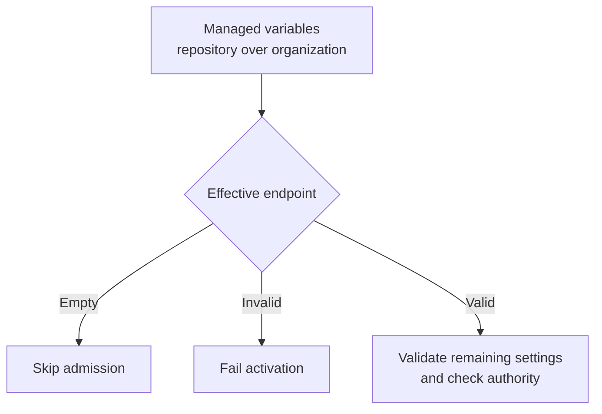
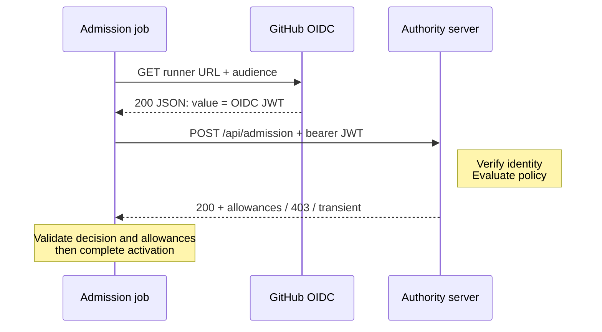
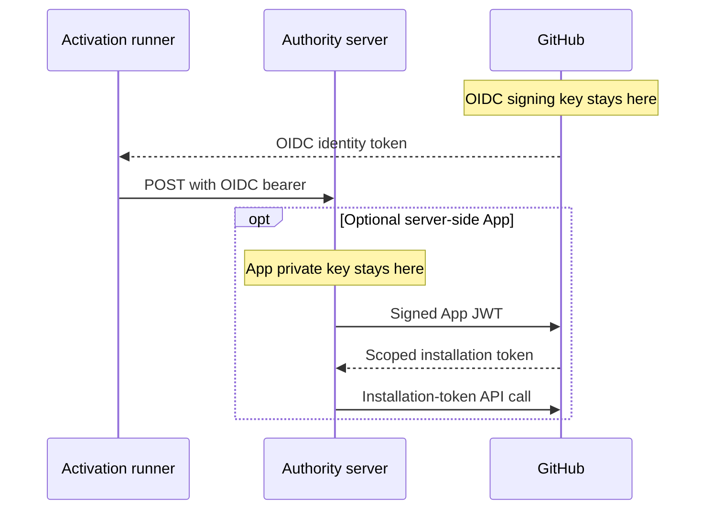
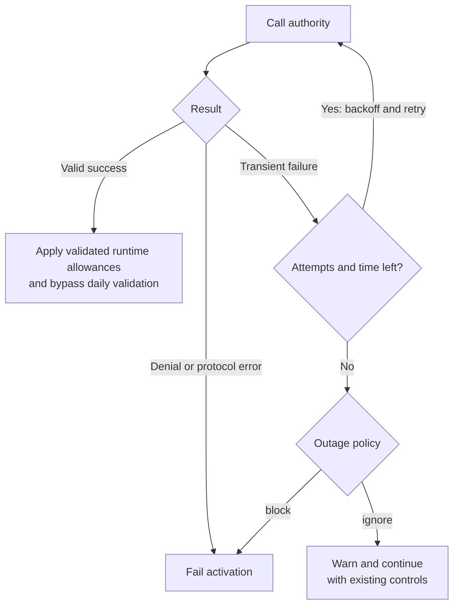
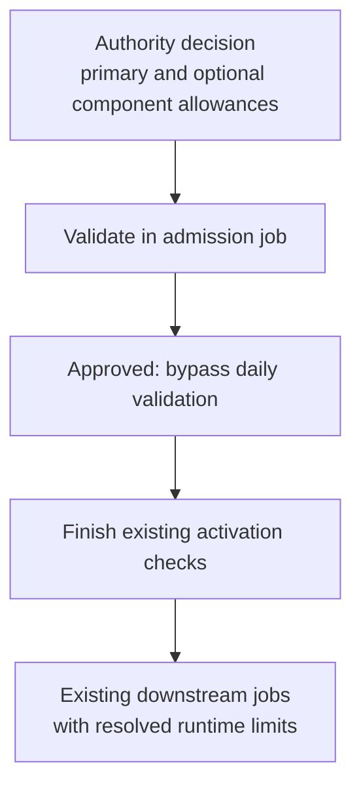

**Version**: 1.4 draft<br />
**Status**: gh-aw client implemented; admission authority deployed separately<br />
**Date**: 2026-10-20

The terms MUST, MUST NOT, SHOULD, and MAY indicate normative requirements. This repository implements the gh-aw client and compiler integration. The admission authority, trusted accounting ingestion, provisioning, and backend claim verification remain deployment-owned services; the contracts below apply to both sides.

## 1. Scope and Ownership

Admission runs in a separate compiler-owned `admission` job before activation when enabled at compilation. The compiler MUST omit both `admission` and `conclusion_admission` by default and emit them when workflow frontmatter sets `on.admission: true` or `.github/workflows/aw.json` sets `"admission": true`. Either opt-in enables both jobs; workflow-level `false` MUST NOT override repository-level `true`. Changing these settings requires recompilation. For opted-in workflows, activation MUST depend on admission while allowing an unconfigured admission job to be skipped. Only the validated result, component allowances and caller-owned trace context propagate to activation; credentials, request identity and service diagnostics remain admission-scoped. Without a configured endpoint, an explicit job `if` skips admission, and activation continues through its existing fallback checks. A deployment-selected **admission authority server** (the authority) MUST implement the HTTPS admission service, trusted usage ingestion, policy evaluation, and protected operator diagnostics. It MAY use a server-side GitHub App for backend verification and configuration provisioning.

The compiler MUST record the effective compile-time opt-in as an explicit `admission` boolean in `gh-aw-manifest`, including `false` when disabled. This field indicates whether admission jobs are generated, not whether a runtime endpoint is configured or a run is admitted.

The gate is a **cooperative admission check** for participating workflows, not an unbypassable organization policy or hard spending cap. It decides whether an AW execution may start and returns runtime maximum AI Credits: a required primary allowance and optional, independent threat-detection and evals allowances. A validated allowance overrides that component's configured or default runtime limit, rather than adding to it or taking the minimum. Omitted optional allowances preserve existing component policy. Correlation uses the caller's W3C `traceparent`, not a response trace or correlation ID. This is not a billing API, spend-inspection endpoint, inference proxy, or mid-execution cancellation mechanism.

The isolated compiler-owned `conclusion_admission` job provides the corresponding **completion notification** after the ordinary `conclusion` job publishes the full unified agentic session as a usage artifact. The conclusion job passes only a size-bounded compact unified session and the usage artifact IDs through job outputs; the callback then posts them to `/api/conclusion`. The authority can process the compact metadata immediately and resolve the full session through GitHub without polling or waiting for a workflow-completion webhook. This is end-of-session delivery, not a live event stream while the agent runs. It neither authorizes execution nor settles billing. Delivery is best-effort and does not change completed agent or safe-output results.

The protocol uses REST POST with a JSON body, authenticated exclusively by a GitHub Actions OIDC identity token with an audience restricted to the intended authority deployment. The client MUST NOT send `GITHUB_TOKEN`, a PAT, Copilot token, GitHub App JWT, installation access token, App private key, API key, or custom activation credential to the admission service. The feature MUST support only this protocol, with no GET, alternate authentication mode, negotiation, or credential fallback.

## OIDC Token Broker Contract

The token broker is independent of admission. Its normative server and client contracts, capability authorization, issuance requirements, compliance tests, and implementation limitations are defined in the [Token Broker Specification](/gh-aw/specs/token-broker-specification/). Admission success or an ignored admission outage does not authorize token issuance or permit broker authentication to fail open.

## 2. Configuration and Provisioning

### Managed Environment Variables

Admission endpoint, audience, and outage configuration MUST come exclusively from managed GitHub Actions variables, resolved at workflow runtime and passed to the admission job's step as environment variables. Repository JSON files and workflow/frontmatter configuration MAY enable code generation as specified above, but MUST NOT define or override these runtime settings. The compiler MUST register these variables with the existing `gh aw env get/update` mechanism:

| Actions variable | Managed YAML field | Built-in fallback |
|------------------|--------------------|-------------------|
| `GH_AW_DEFAULT_ADMISSION_URL` | `default_admission_url` | Empty; gate disabled |
| `GH_AW_DEFAULT_ADMISSION_AUDIENCE` | `default_admission_audience` | Effective endpoint URL |
| `GH_AW_DEFAULT_ADMISSION_ON_OUTAGE` | `default_admission_on_outage` | `ignore` |

The corresponding managed-defaults YAML is:

```yaml
default_admission_url: https://admission.example.org/api/admission
default_admission_audience: https://admission.example.org/api/admission
default_admission_on_outage: ignore
```

The service route is `/api/admission`; the deployment origin is configurable. A nonempty URL MUST be the full absolute HTTPS URL for that route, without embedded credentials, query parameters, fragments, or GitHub Actions expressions. A nonempty audience MUST be a literal deployment-specific value without control characters or expressions. It identifies the intended recipient; it is not a secret or a GitHub App identifier.

The conclusion route MUST be `/api/conclusion` on that same configured origin, including any explicit port. It MUST NOT have an independently configurable destination or audience. Both operations use the effective admission audience; when the audience is unset, its fallback remains the configured `/api/admission` URL, not the derived conclusion URL. An empty endpoint disables both operations before token acquisition.

Each effective runtime variable takes precedence over its built-in fallback; repository Actions variables override organization variables. Enterprise-wide rollout provisions organization variables in each enrolled organization, not an assumed native enterprise Actions-variable scope. Compiler-process environment variables MUST NOT determine these values, and workflow-local configuration MUST NOT introduce another runtime override layer. A configured endpoint enables admission only in workflows compiled with an admission opt-in. An unset or empty endpoint makes the check a no-op; an audience or outage policy alone MUST NOT enable it. A nonempty but invalid endpoint MUST fail validation, not silently disable the check.



For opted-in workflows, the compiler MUST emit the runtime variable hooks, so enabling, disabling, or changing managed runtime settings does not require recompilation. Without either opt-in, the compiler MUST omit admission dependencies, activation admission outputs, and conclusion compact-session preparation. Existing managed-default update semantics remain unchanged: omitted or null YAML fields delete the corresponding variable at the selected scope. Operators MUST preserve other defaults when updating a defaults file.

Managed variables distribute configuration, not locked policy. Repository Actions variables override same-named organization variables: a principal permitted to manage repository variables can shadow the organization endpoint with an empty or different value, change the audience, or select `ignore`. Workflow editors can also omit the step or change its environment wiring. Consequently, these variables cannot mandate participation or prevent bypass; an empty endpoint and default fail-open behavior are intentional availability choices.

Stronger enforcement requires the controlled AI/backend resource to independently authorize usage and enforce authoritative quota or reservations, with protected configuration and workflow identities. The admission call alone does not provide that boundary. HTTPS validation alone does not establish an approved destination; deployments SHOULD enforce approved origins and runner egress independently.

### GitHub App Responsibilities

When the authority uses a GitHub App for provisioning or verification, that App requires a private key. That key MUST remain in the authority's protected server-side secret storage, with access control, rotation, and audit. It MUST NOT be distributed to workflows, Actions variables, workflow secrets, artifacts, or responses.

The App MUST be installed on the relevant organization or repository-owning account, with approved permissions and repository access for the chosen operations. Requested registration permissions are not sufficient: installation owners must approve new permissions before they become available. An enterprise installation does not substitute for the organization installation and organization permissions needed to manage organization Actions variables.

The authority MUST follow GitHub's [App JWT authentication](https://docs.github.com/en/apps/creating-github-apps/authenticating-with-a-github-app/generating-a-json-web-token-jwt-for-a-github-app) and [installation-token generation](https://docs.github.com/en/apps/creating-github-apps/authenticating-with-a-github-app/generating-an-installation-access-token-for-a-github-app) specifications. Sign the App JWT using `RS256`, include an issued-at timestamp in `iat` and the App's client ID or application ID in `iss`, and set `exp` no more than ten minutes into the future. GitHub recommends the client ID and an `iat` sixty seconds in the past for clock skew. Use that JWT as a bearer credential for App-level operations, including [`POST /app/installations/{installation_id}/access_tokens`](https://docs.github.com/en/rest/apps/apps#create-an-installation-access-token-for-an-app); use the resulting installation token, not the App JWT, for the organization/repository APIs below.

Installation IDs MUST come from trusted tenant enrollment and authoritative GitHub installation metadata, bound to the verified repository owner and repository. Unverified request fields MUST NOT select another tenant's installation. Installation tokens expire after one hour; honor GitHub's returned `expires_at` and renew as needed. Treat tokens as opaque, without fixed-length or format assumptions. Scope tokens with the documented `permissions` and, for repository operations, `repositories` or `repository_ids` parameters to only the approved access needed; tokens cannot expand an installation's grants. Provisioning and verification tokens SHOULD have separate least-privilege scopes.

The following permissions apply only when the authority performs the corresponding operation, following GitHub's [App permission matrix](https://docs.github.com/en/rest/authentication/permissions-required-for-github-apps) and [Actions variables API](https://docs.github.com/en/rest/actions/variables):

| Backend operation | Required GitHub App permission |
|-------------------|--------------------------------|
| Create/update/delete organization variables or bulk-set their selected repositories | Organization **Variables: write** |
| Read organization variables | Organization **Variables: read** |
| Create/update/delete repository variables | Repository **Variables: write** |
| Read repository variables or organization variables shared with a repository | Repository **Variables: read** |
| Verify workflow runs, attempts, or jobs through the Actions API | Repository **Actions: read** |
| Read/download full-session usage artifacts referenced by a conclusion request | Repository **Actions: read** |
| Read workflow/source files for trusted logical-ID mapping, if used | Repository **Contents: read** |

Organization and repository Variables are distinct permission categories; repository **Actions: write** is not the variable-write permission. Contents write, Workflows write, Secrets, Checks write, and Deployments write are not required for the operations in this table. Individual add/remove-selected-repository variable endpoints have additional permission requirements; implementations MUST check the selected endpoint rather than assume all visibility-management endpoints have identical grants.

With administrator authorization and the applicable installation grants, the App MAY provision only the non-secret admission URL, audience, and outage defaults at supported organization/repository scopes. Enterprise-wide provisioning requires authorized organization installations for each target organization. Unsupported provisioning, missing approvals, or insufficient permissions MUST be reported to the administrator, not silently bypassed or replaced with a PAT.

Only non-secret configuration is provisioned. App IDs and installation IDs do not authenticate a workflow. The App does not mint the workflow's OIDC token.

## 3. Admission Job and Request Contract

For opted-in workflows, gh-aw MUST emit a compiler-owned `admission` job after applicable trigger/authorization prerequisites and before activation and agent execution. The job MUST use trusted, pinned bootstrap and admission code, not execute repository-supplied task scripts. Its setup MUST NOT inherit workflow-specific authentication or mint telemetry App credentials. Custom `jobs.admission` configuration, including setup/pre/regular hooks, permissions, conditions, outputs and environments, MUST be rejected regardless of opt-in.

The `admission` and isolated `conclusion_admission` jobs MUST gain `id-token: write` for their respective authority requests; activation, agent, and ordinary conclusion steps MUST NOT receive this permission merely because admission is generated. Independently configured OIDC features retain their own required permissions. Admission MUST NOT forward GitHub API tokens or provider secrets. The compiler MUST emit endpoint-gated job conditions requiring `${{ vars.GH_AW_DEFAULT_ADMISSION_URL != '' }}` so no admission or callback runner, bootstrap or token acquisition starts without an endpoint. Audience or outage variables alone do not enable admission. Activation MUST use an explicit cancellation-safe condition allowing admission results `success` or `skipped`, while rejecting `failure` or `cancelled` and preserving its other eligibility checks. Approval skips daily validation; skipped admission and successfully ignored outages retain the existing fallback.

Daily-AIC code and credentials remain in activation; the daily-limit variable MUST NOT enable the admission job. Since GitHub's implicit success gate also observes skipped ancestors, downstream jobs without explicit status-function semantics MUST use cancellation-safe direct-dependency result checks. This permits an intentionally skipped admission ancestor without admitting failed required prerequisites. Existing explicit status-function conditions retain their intended behavior.

Reusable-workflow callers must also permit `id-token: write` in the calling job's permission envelope for the compiler-owned admission and conclusion-admission jobs. Compiler-generated `call-workflow` jobs include that mandatory permission for local gh-aw Markdown targets, even before the target's lock file is regenerated. Hand-authored callers must grant it explicitly; a callee cannot elevate the caller's permissions.

The entire admission and conclusion-admission jobs are their respective OIDC trust boundaries, not just their client steps. They contain no author-provided hooks and do not share OIDC bootstrap environments or acquired tokens with other jobs. The ordinary conclusion job contains the artifact publication and reporting steps but no admission callback credential; only compact allowlisted metadata and artifact locators pass to the callback job. Jobs independently granted `id-token: write` can still request identity tokens for an admission audience: job separation is not audience restriction, and OIDC does not prove which helper executed. The authority MUST enforce its verified workflow identity policy and MUST NOT treat a bearer token alone as proof that this helper ran. Operators must review existing federated relying-party policies. Workflow editors and managed-variable owners remain within the cooperative boundary.

The journey below uses GitHub.com endpoints. Other supported GitHub deployments require independently configured issuer and API hosts. Credential placeholders and decoded token examples are synthetic, not usable credentials. The GitHub response excerpts omit unrelated fields; the admission request and success bodies are complete.

### Protocol Flow



The step first resolves the endpoint and remaining settings as specified in Section 2. No endpoint means no token or request. For an enabled gate, it snapshots the current execution's nine identity strings and compiled workflow hash, acquires the token below, and sends the admission request. The authority verifies the token and request bindings as specified in Section 4, optionally verifies run-attempt metadata, and returns the Section 5 decision. Only then does the client follow [Continuing After Admission](#continuing-after-admission). Transient retries follow Section 6 without changing the invocation or creating another entitlement.

### Requesting the OIDC Token

GitHub supplies `ACTIONS_ID_TOKEN_REQUEST_URL` and `ACTIONS_ID_TOKEN_REQUEST_TOKEN` to the job when its effective permissions allow OIDC issuance. The permission requirement and both acquisition methods are documented in GitHub's [OIDC permissions](https://docs.github.com/en/actions/reference/security/oidc#workflow-permissions-for-the-requesting-the-oidc-token) and [methods for requesting the OIDC token](https://docs.github.com/en/actions/reference/security/oidc#methods-for-requesting-the-oidc-token). A reusable workflow cannot elevate permissions denied by its caller.

The trusted helper requests the effective audience explicitly using GitHub's documented OIDC exchange. The [`core.getIDToken(audience)` API](https://docs.github.com/en/actions/reference/security/oidc#standard-audience-issuer-and-subject-claims) illustrates the same exchange:

```javascript
const oidcToken = await core.getIDToken(effectiveAudience);
```

For `effectiveAudience = "https://admission.example.org/api/admission"`, the equivalent exchange is:

```http
GET <ACTIONS_ID_TOKEN_REQUEST_URL>&audience=https%3A%2F%2Fadmission.example.org%2Fapi%2Fadmission HTTP/1.1
host: <host from ACTIONS_ID_TOKEN_REQUEST_URL>
authorization: bearer <ACTIONS_ID_TOKEN_REQUEST_TOKEN>
accept: application/json

HTTP/1.1 200 OK
content-type: application/json

{
  "value": "<OIDC_JWT>"
}
```

The request URL is the complete, job-issued URL, including its existing query parameters; the audience is URL-encoded once and appended as documented. It MUST NOT be replaced with the public issuer/discovery URL or a guessed GitHub REST endpoint. `ACTIONS_ID_TOKEN_REQUEST_TOKEN` is the runner's bootstrap bearer credential for this GitHub request only. The response's `value` is a different credential: the signed OIDC identity JWT that authenticates to the authority. Neither credential is `GITHUB_TOKEN`, and no App key, App JWT, or installation token is involved in runner-side acquisition.

The helper MUST keep both credentials in memory, mask the acquired token, and send only the OIDC JWT to the authority. It MUST NOT print either credential, decode a live token into diagnostics, or publish tokens through step/job outputs. The toolkit call illustrates the API, not a complete client: acquisition and any internal retries MUST satisfy Section 6's bounded deadline and generic-error requirements.

Admission MUST NOT use `actions/create-github-app-token` or another App-token action. Such actions mint GitHub App installation access tokens, not Actions OIDC identity tokens, and require App credentials that admission MUST NOT introduce into the runner. The implemented pinned `actions/github-script` step invokes the bounded OIDC client under the endpoint `if` condition; token generation is not a separate unconditional step.

See [Runtime-Minted Token Revocation](#runtime-minted-token-revocation) for OIDC disposal versus installation-token revocation.

### HTTP Request

The service accepts `POST /api/admission`, with `content-type: application/json`, `cache-control: no-store`, and an `authorization` header containing the bearer OIDC identity token. Execution metadata belongs in the JSON body, not the URL. There are no query parameters. Other HTTP methods MUST NOT admit execution or evaluate spending policy; the client MUST NOT fall back to GET.

```http
POST /api/admission HTTP/1.1
host: admission.example.org
authorization: bearer <OIDC_JWT>
content-type: application/json
cache-control: no-store
traceparent: 00-4bf92f3577b34da6a3ce929d0e0e4736-00f067aa0ba902b7-01

{
  "repo": "acme/project",
  "workflow_id": "acme/project/.github/workflows/triage.lock.yml@refs/heads/main",
  "workflow_hash": "aaaaaaaaaaaaaaaaaaaaaaaaaaaaaaaaaaaaaaaaaaaaaaaaaaaaaaaaaaaaaaaa:bbbbbbbbbbbbbbbbbbbbbbbbbbbbbbbbbbbbbbbbbbbbbbbbbbbbbbbbbbbbbbbb",
  "workflow_call_id": "1234-2:acme/project/.github/workflows/triage.lock.yml@refs/heads/main",
  "run_id": "1234",
  "run_attempt": "2",
  "ref": "refs/heads/main",
  "event_type": "workflow_dispatch",
  "actor": "octocat",
  "triggering_actor": "hubot"
}
```

`<OIDC_JWT>` means exactly the token returned in the preceding response's `value`, not the bootstrap request token. The `authorization` header MUST be present, and the token MUST appear nowhere else, including the body, URL, trace context, diagnostics, outputs, artifacts, or response. The caller MUST provide `traceparent` even when client OTel export is disabled. Redirects MUST NOT be followed.

This POST targets the configured authority, not `api.github.com`. It is the proposed API defined by this specification, not a GitHub REST API. The authority consumes the OIDC token directly and returns an admission decision; there is no intermediate exchange for a cloud access token or a credential for continuing the workflow.

### Proxy-Friendly Header Conventions

Emit lowercase application-controlled protocol field names and accept all HTTP field names case-insensitively, following [HTTP field-name semantics](https://www.rfc-editor.org/rfc/rfc9110.html#section-5.1). Transport-generated HTTP/1.1 fields such as `Date` or `Content-Length` MAY use conventional casing; HTTP/2 field names MUST follow its lowercase transport requirement. Use the standard W3C `traceparent` field, not `trace-parent`, `otel-traceparent`, or `x-trace-id`. The required standard request fields are `authorization`, `content-type`, `cache-control`, and `traceparent`.

Any future custom header MUST use the lowercase `gh-aw-` namespace followed by ASCII alphanumeric, hyphen-separated words: `gh-aw-[a-z0-9]+(?:-[a-z0-9]+)*`. Do not use underscores, spaces, dotted OTel attribute names, or an `x-` prefix. This protocol defines no custom headers and no response trace or correlation identifier.

Proxies and API gateways MUST allow and preserve the standard fields, without appending or comma-joining `traceparent` values, rewriting trace IDs, or caching admission responses. They MUST NOT forward arbitrary caller headers or use forwarded-host headers to select an issuer, audience, or tenant. Document transport limits that accommodate valid GitHub OIDC tokens and trace context. Infrastructure header/body limits still apply before protocol processing.

### JSON Request Fields

All ten fields are required exactly once in a UTF-8 JSON object. Every value is a string, including run IDs and attempt numbers. Standard runner sources below are defined in GitHub's [default environment variables](https://docs.github.com/en/actions/reference/workflows-and-actions/variables#default-environment-variables); the executing workflow reference uses gh-aw's existing metadata wiring:

| Field | Meaning and validation |
|-------|------------------------|
| `repo` | `GITHUB_REPOSITORY`: current execution's `owner/repository` slug; MUST match signed `repository` |
| `workflow_id` | `GH_AW_INFO_WORKFLOW_ID`, populated from `job.workflow_ref`, matching `aw_info.workflow_id`: `owner/repository/.github/workflows/file.yml@ref`; neither a short logical AW ID nor a numeric GitHub workflow ID |
| `workflow_hash` | `GH_AW_ADMISSION_WORKFLOW_HASH`: compiler-owned `<frontmatter_hash>:<body_hash>` from the executing workflow's existing lock-file metadata. Both components are lowercase 64-character SHA-256 hex strings. This identifies normalized workflow configuration and prompt content for potential authority-side caching, not a Git commit SHA or OIDC claim. |
| `workflow_call_id` | Derive exactly `<run_id>-<run_attempt>:<workflow_id>`, matching `aw_info.workflow_call_id`; not a separate GitHub claim |
| `run_id` | `GITHUB_RUN_ID`: canonical ASCII decimal run ID; preserve as a string and compare with signed `run_id` |
| `run_attempt` | `GITHUB_RUN_ATTEMPT`: canonical ASCII decimal attempt number; MUST match signed `run_attempt` |
| `ref` | `GITHUB_REF`: current GitHub Actions ref; MUST match signed `ref` |
| `event_type` | `GITHUB_EVENT_NAME`: current event name; MUST match supported signed `event_name` |
| `actor` | `GITHUB_ACTOR` / `github.actor`: original run actor login; MUST match signed `actor` |
| `triggering_actor` | `GITHUB_TRIGGERING_ACTOR` / `github.triggering_actor`: current attempt's initiator, which may differ from `actor`; not an OIDC claim |

The compiler MUST embed the workflow's existing frontmatter and body hashes directly in the admission step environment, not read a caller-supplied variable or recompute a hash from runtime event data. Prompt-only changes alter the body component; normalized configuration/import changes alter the corresponding existing hashes. The client MUST validate both components and preserve the complete value unchanged across retries. Missing or malformed hashes block an enabled gate before acquiring credentials. These hashes cover the existing compiler-defined content inputs, not a new claim that every runtime dependency or external resource is content-addressed.

`workflow_hash` is untrusted cache-hint metadata, not proof of content, permission, enrollment, or authorization. The authority MAY use it to locate previously verified workflow metadata or parsed policy inputs, but MUST independently bind cached content to the authenticated repository and executing workflow revision before using it for authorization. It MUST NOT reuse another invocation's admission or skip current identity, policy, accounting-freshness, or revocation checks because hashes match. Section 8 defines cache isolation and retry identity.

The client MUST pass both values from the current [GitHub Actions context](https://docs.github.com/en/actions/reference/workflows-and-actions/contexts#github-context), not infer one from the other. `actor` identifies the original run actor; `triggering_actor` identifies the current attempt's initiator. GitHub reruns retain the privileges of `github.actor`, even when `github.triggering_actor` has different privileges. Actor-specific authorization MUST use verified identity, including signed `actor_id`, and MUST NOT substitute the rerun initiator's privileges for the original actor's.

`triggering_actor` is not a documented GitHub OIDC claim and MUST NOT be assumed to be signed by the identity token. Until independently verified, it is informational request metadata, not an authorization or accounting identity. Before using it for policy or budget attribution, the authority MUST compare it with authoritative [workflow run-attempt metadata](https://docs.github.com/en/rest/actions/workflow-runs#get-a-workflow-run-attempt) bound to the signed repository, run ID, and attempt, and use the verified account ID where identity stability is required. An App-backed lookup requires repository **Actions: read**. A policy depending on this identity MUST NOT fall back to unverified data or a more permissive policy when verification fails.

The client derives fields from the current runner context and executing workflow reference, not caller-supplied `aw_context`. Existing gh-aw populates `GH_AW_INFO_WORKFLOW_ID` from `job.workflow_ref` and builds `aw_info.workflow_call_id` with `buildWorkflowCallId`; admission MUST preserve those semantics. For reusable workflows, `github.workflow_ref` and `GITHUB_WORKFLOW_REF` identify the caller and MUST NOT replace the executing reference. Missing executing identity or run attempt MUST block admission rather than use the metadata helper's empty-reference or default-attempt fallback. The request sends no full event payload, arbitrary inbound context, usage, balances, or policy values. Original triggering-event lineage is not part of this protocol.

The service MUST reject missing, duplicate, unknown, malformed, empty, or oversized fields, non-object bodies, non-string values, unsupported content types, and request query parameters. It MUST impose documented body/header limits and SHOULD support an 8 KiB JSON body. Invalid UTF-8, control characters, invalid repository slugs, non-positive run numbers, or inconsistent invocation IDs receive the uniform denial. Body values MUST NOT be interpreted as executable expressions, outbound URLs, or credential selectors.

JSON member names and string values in requests and success responses MUST decode to Unicode scalar-value sequences. Unpaired surrogate escapes MUST be rejected, not replaced; valid surrogate pairs remain supported. Decode JSON escapes exactly once and compare decoded identifiers exactly, without case folding or Unicode normalization. Invalid request strings receive the uniform denial; invalid success strings are blocking protocol failures.

`run_id` and `run_attempt`, in both the body and matching verified claims, MUST be nonempty ASCII strings matching `[1-9][0-9]*`. Signs, leading zeros, whitespace, decimal points, exponent notation, and Unicode digit substitutions are invalid. Compare the original decoded strings exactly, without integer normalization; documented field-length limits MUST NOT require conversion to a bounded numeric type. This grammar does not redefine other opaque identifiers or their deployment-specific claim types. Opaque identifiers and refs MUST NOT be unnecessarily split. Large decimal identifiers MUST NOT pass through floating-point conversion.

### OpenTelemetry Correlation

The caller MUST send a valid W3C `traceparent` on every admission POST, independently of client OTel enablement. The version-00 form is `00-<trace-id>-<client-span-id>-<trace-flags>`, with a nonzero 32-character lowercase hexadecimal trace ID and a nonzero 16-character span ID. Use the shared validated trace-context helpers, never arbitrary inherited header text.

Reuse a valid AW trace context through the existing OTLP helpers. If none exists, generate a cryptographically random trace ID, never one derived from repository, actor, run, spend, or a credential. The admission operation and its HTTP attempts share the trace ID; each HTTP attempt has a distinct client span ID. The authority parents its server span to valid incoming context and correlates protected diagnostics with that context and the verified invocation metadata it already receives.

The admission job MUST reuse existing upstream trace context when available and pass its caller-owned trace ID to activation setup. A skipped admission job preserves activation's normal trace fallback. When client exporters are configured, admission operation and attempt spans use the existing export helpers. Trace identifiers do not substitute for authenticated invocation identity or an idempotency key.

Client lifecycle logs and the collapsed `### Admission gate` step summary report only fixed outcome categories, allowance presence, budget sources and attempt counts. Endpoint configuration, tokens, request/actor identity, workflow hashes, allowance amounts, spend and raw response diagnostics MUST NOT appear in these diagnostics. Summary-write failures emit a generic warning without changing the decision.

The unified agent session artifact (`usage/aw_session.jsonl`) records validated outputs relayed through activation as a `guardrail.admission` event with admission provenance. Its `data` contains `status` and, for admitted runs, numeric `maxAiCredits` plus independently supplied `threatDetectionMaxAiCredits` and `evalsMaxAiCredits`. Omitted optional fields remain absent; skipped or ignored decisions contain no allowances. A job skipped before running the helper produces no decision event. The event records approved limits, not measured spend or proof that a component executed. Invalid metadata produces a generic collection warning without recording raw values. Credentials, endpoints, request identity, hashes and service diagnostics are excluded. Human-readable summaries continue to withhold amounts; numeric values are available only in the structured session artifact. Detection and evals execution consume their respective activation outputs through the existing runtime budget path.

Creating and sending request trace context MUST NOT enable client telemetry export. Without configured exporters, no relay, exporter, or telemetry endpoint is started for admission. The service MUST NOT return `trace_id`, `traceparent`, `correlation_id`, or another OTel trace identifier in JSON or response headers. It already receives the context needed for correlation; no service-issued resource attribute or cross-job correlation handoff is required.

Trace IDs MUST NOT be used as metric datapoint dimensions, public metric labels, or authorization to access another tenant's telemetry.

Trace context is untrusted observability data, not an authorization claim. Within overall HTTP transport limits, missing, malformed, oversized, or duplicate trace context MUST NOT change admission or outage decisions: the authority discards it and starts a fresh context without echoing or logging raw invalid values. Export failures MUST NOT change the decision, disable the check, or cause another admission request.

Only `traceparent` is propagated across this boundary. Arbitrary `tracestate` and `baggage` MUST NOT be forwarded or reflected; received values are ignored. Sampling is locally controlled and independent of spend, actor privileges, or an attacker-supplied sampled flag. Credentials, policy reasons, usage, balances, and personal metadata MUST NOT be encoded in trace identifiers or propagation headers.

Responses do not echo trace headers or disclose internal reason identifiers. The successful JSON response carries only the Section 5 policy allowances. Detailed service reasons remain in protected, tenant-scoped telemetry and MUST NOT appear in workflow-visible span attributes or events. Denied, skipped, and fail-open executions preserve existing OTel configuration; no response identifier is required or fabricated.

### Continuing After Admission

The authority responds synchronously on the same POST; Section 5 gives the complete response and validation rules. The admission helper validates the entire response, including any optional component allowances, before accepting approval or publishing job outputs. Its decision outputs are `result`, `max-ai-credits`, and, when provided, `max-ai-credits-threat-detection` and `max-ai-credits-evals`. An omitted optional allowance produces no corresponding output.

The compiler MUST relay validated admission job outputs through activation job outputs. Activation collects the result through `GH_AW_ADMISSION_RESULT` for its daily-validation conditions. Existing agent, threat-detection and evals engine execution steps select only their own allowance when the result is `admitted`, and pass it through `GH_AW_MAX_AI_CREDITS` into the existing AWF API proxy `maxAiCredits` configuration. Explicit local limits, including unlimited sentinels, do not bypass a supplied admission allowance. Skipped or ignored admissions preserve existing configured/default limits. An admitted primary execution missing its required allowance MUST fail closed. Invalid runtime allowance values MUST fail closed with a generic diagnostic. Neither optional allowance enables a component or inherits the primary allowance.

The helper then succeeds, and activation finishes its remaining checks. GitHub Actions schedules the already-dependent agent job only if the existing [job dependency and success conditions](https://docs.github.com/en/actions/reference/workflows-and-actions/workflow-syntax#jobsjob_idneeds) permit it. The authority makes no callback or additional GitHub API call to resume the workflow. The workflow's normal engine credentials remain separate and MUST NOT be sent to the authority.

The agent and its continuations consume the same effective invocation budget; they do not acquire another entitlement by repeating admission. All subsequent supported OTLP records retain the returned resource attribute as described above. If the endpoint is absent or an outage is ignored, there are no service decision values to transport; existing local/default controls remain. A denial, invalid success, or failed budget propagation blocks the agent instead of taking this continuation path.

### Conclusion Notification

The compiler MUST generate the unified session and compact metadata in the ordinary conclusion job, attempt usage-artifact upload, complete any configured upload retry, and only then run the trusted conclusion-admission callback job, including for work-queue participants. The callback MUST NOT acquire credentials or send a request before artifact publication attempts finish. The callback job MUST use an endpoint-gated `always()` condition and preserve the existing conclusion eligibility: a skipped conclusion job MUST NOT cause callback delivery. An unsuccessful agent can still produce a useful session. If both artifact-upload attempts fail, the callback still attempts compact metadata delivery: ordering requires completed upload attempts, not guaranteed artifact availability. Failure or cancellation that prevents the conclusion job from running cannot guarantee a notification; consumers MUST NOT interpret absence as zero usage or successful completion.

The callback reconstructs the same ten identity fields from compiler metadata and the current Actions context; it MUST NOT transport admission's identity or credentials through job outputs. Only the compact session and usage artifact IDs may pass from the ordinary conclusion job through outputs. Metadata preparation MUST read `/tmp/gh-aw/usage/aw_session.jsonl` from the runtime tree, not the separate `RUNNER_TEMP/gh-aw` setup tree. The callback MUST revalidate the handed-off JSONL against the shared compact projection and reject out-of-profile records or unsafe coverage counters before OIDC acquisition. The callback obtains a fresh OIDC JWT using its own bootstrap credentials and the same effective audience. Admission tokens MUST NOT be persisted or reused across jobs. The authority MUST apply Section 4's issuer, audience, tenant, invocation and executing-workflow verification to conclusion requests independently of admission. A client-side `admitted` result is not required: executions allowed by the ignored-outage fallback also need session delivery.

Like `jobs.admission`, `jobs.conclusion_admission` MUST reject all author customization, including setup/pre/regular steps, permissions, conditions, dependencies and environment. Its OIDC capability MUST NOT be shared with author hooks. The ordinary conclusion job retains independently configured OTLP OIDC permissions, including for work-queue participants; admission alone does not enable those permissions.

The complete request is a JSON object containing exactly Section 3's ten admission identity strings plus `session`, `session_compaction`, and `usage_artifact_ids`. `session` contains compact profile version 1 JSONL as defined by the [compact unified session specification](/gh-aw/specs/unified-agent-session-specification/#38-compact-unified-session-normative): at most 128 allowlisted metadata records and 16 KiB of UTF-8 JSONL. Agent conversation, reasoning, prompts, tool input/output and other unbounded payloads MUST NOT be sent. The client MUST derive this projection from the existing generated, redacted unified session using the shared helper, without modifying the full artifact or reparsing raw engine logs.

`session_compaction` MUST contain exactly `version`, `included_events`, `omitted_events`, `oversized_lines`, `scan_truncated`, and `truncated`, mapping the shared helper's corresponding version and coverage fields. The compact profile is intentionally lossy; false truncation flags MUST NOT be interpreted as a complete session or complete usage accounting.

`usage_artifact_ids` MUST be an array of at most two unique canonical positive-decimal strings of at most 20 digits, preserving IDs without numeric conversion. The compiler supplies `steps.upload-usage-artifact.outputs.artifact-id` and `steps.upload-usage-artifact-retry.outputs.artifact-id` to the callback. Available retry IDs precede initial IDs because overwrite retries may supersede an earlier artifact. Empty outputs are omitted, duplicate IDs are collapsed, and malformed nonempty IDs fail the client before OIDC acquisition. If neither upload produced an ID, the array MUST be empty, not fabricated. The full session remains available as `aw_session.jsonl` inside a successfully published usage artifact.

```http
POST /api/conclusion HTTP/1.1
host: admission.example.org
authorization: bearer <FRESH_CONCLUSION_OIDC_JWT>
content-type: application/json
cache-control: no-store
traceparent: 00-4bf92f3577b34da6a3ce929d0e0e4736-a3ce929d0e0e4736-01

{
  "repo": "acme/project",
  "workflow_id": "acme/project/.github/workflows/triage.lock.yml@refs/heads/main",
  "workflow_hash": "aaaaaaaaaaaaaaaaaaaaaaaaaaaaaaaaaaaaaaaaaaaaaaaaaaaaaaaaaaaaaaaa:bbbbbbbbbbbbbbbbbbbbbbbbbbbbbbbbbbbbbbbbbbbbbbbbbbbbbbbbbbbbbbbb",
  "workflow_call_id": "1234-2:acme/project/.github/workflows/triage.lock.yml@refs/heads/main",
  "run_id": "1234",
  "run_attempt": "2",
  "ref": "refs/heads/main",
  "event_type": "workflow_dispatch",
  "actor": "octocat",
  "triggering_actor": "hubot",
  "session": "{\"type\":\"session.format\",\"data\":{\"version\":1}}\n",
  "session_compaction": {
    "version": 1,
    "included_events": 1,
    "omitted_events": 0,
    "oversized_lines": 0,
    "scan_truncated": false,
    "truncated": false
  },
  "usage_artifact_ids": ["8123"]
}
```

The session line above illustrates compact-profile wire encoding only; the full unified-session schema applies to the artifact, not this bounded projection. The compiler MUST wire the exact same workflow hashes and executing `job.workflow_ref` used by admission, including reusable-workflow executions and reruns.

The client MUST bound source reads, oversized-line framing, scalar projection, record count and serialized compact bytes as specified in T-UAS-076 through T-UAS-078. A large full-session file or agent message MUST NOT force an oversized request or whole-file allocation. Missing, empty, non-regular or symlinked files, malformed retained-size JSON/UTF-8 records and I/O errors produce a generic warning without a request; oversized records and scan/output budget omissions are instead reported through compaction statistics.

The entire UTF-8 JSON request, including identity, compaction statistics, artifact IDs and JSON escaping, MUST be at most **65,536 bytes (64 KiB)**. The identity is bounded to 8 KiB; the compact JSONL is at most 16 KiB and its enclosing JSON string is at most twice that size plus quotes. Fixed compaction fields and at most two 20-digit IDs leave the request strictly below the envelope cap; the client MUST still measure the final serialized request before OIDC acquisition. The authority MUST enforce this cap and validate the compact profile and invocation binding rather than treating the preview as a full session.

Artifact IDs are untrusted locators, not authorization. Before retrieving a full session, the authority MUST independently authenticate to GitHub with an enrolled server-side credential, bind each artifact to the verified repository/run and executing workflow invocation and attempt, and reject cross-tenant or mismatched artifacts. An App-backed artifact read/download requires repository **Actions: read**. GitHub API locations MUST be derived from trusted deployment/repository metadata and numeric artifact IDs, not caller-provided URLs. The authority MUST validate full-session identity and schema and bound archive, download, parsing and storage resources. Missing, superseded, expired or unavailable artifacts MUST remain explicitly unavailable; the compact projection MUST NOT become a success-shaped full-session fallback. Session contents remain untrusted agent-generated data, not authorization instructions or authoritative billing evidence.

| Response | Meaning | Client behavior |
|----------|---------|-----------------|
| `202` or `204` | Accepted for asynchronous processing, or already accepted | Complete delivery; discard any response body |
| `408`, `429`, `5xx`, network failure or timeout | Transient delivery failure | Bounded retry |
| Any other status, including redirects | Rejected or unsupported | Stop immediately and warn; never follow redirects |

The client MUST reuse Section 6's three-attempt maximum, ten-second per-token/per-HTTP timeout, 60-second monotonic end-to-end deadline, credential masking and renewal, and bounded backoff. It snapshots the complete request once before the first token acquisition. Retries MUST retain identical identity, compact session bytes, compaction statistics, artifact IDs, audience and trace ID; each HTTP attempt uses a fresh span ID. A valid existing workflow trace is reused; otherwise the client generates one without enabling telemetry export.

Unlike admission, all conclusion-delivery failures MUST warn without failing the job, undoing safe outputs, altering allowances, or changing completed execution results. `GH_AW_DEFAULT_ADMISSION_ON_OUTAGE` controls only the start-time gate; `block` MUST NOT turn completion-notification outages into failed workflow outcomes. Artifact publication and its retry MUST already have completed before callback execution, so callback timeouts cannot delay or prevent those attempts. Successful delivery means acceptance, not proof that backend processing has finished.

The authority MUST durably enqueue or record the session before acknowledging acceptance. A lost acknowledgement and cross-instance retries MUST NOT enqueue duplicate processing or double-count usage. Deduplication MUST use the verified invocation identity from Section 8 and operation type, not trace IDs, `jti`, hashes, or unverified body fields alone. An identical accepted payload is acknowledged again; a conflicting payload for the same verified invocation MUST NOT overwrite the accepted session. Token renewal or a repeated notification MUST NOT grant new entitlements, change admission decisions, reserve or settle funds, or rewrite prior results.

The compact POST excludes prompts, tool arguments, code and other unbounded agent messages, but its bounded metadata and the resolvable full artifact can still contain sensitive information. Managed-endpoint enrollment authorizes compact delivery and protected full-session retrieval, not public disclosure. Both client and authority MUST withhold raw session bodies, credentials and response diagnostics from logs, traces, summaries and metrics; ingress body sampling MUST remain disabled. The authority MUST enforce tenant isolation, access control and bounded retention for stored sessions, and MUST NOT assume redaction makes session content public or secret-free.

## 4. Authentication and Trust Boundary

### Secret Locations and Credential Flow

Workflow identity and optional backend credentials use separate token flows:



The App private key and installation tokens never go to the admission runner. The key signs App JWTs, not workflow OIDC tokens. Managed variables contain only non-secret configuration. The admission runner's OIDC bootstrap credential is used only with GitHub; `GITHUB_TOKEN` and provider secrets are not used by admission. Transient tokens MUST NOT enter logs, traces, artifacts, or decision storage. Activation does not inherit admission's OIDC issuance capability.

### OIDC Verification

The service MUST authenticate before reading tenant policy or usage. It MUST use a maintained JWT verifier and validate the signature, permitted algorithm, trusted GitHub issuer, exact configured audience, expiry, not-before, and issuance time with bounded clock skew. Unsigned tokens, algorithm confusion, missing required claims, and unexpected claim types MUST be rejected.

Issuer metadata and signing keys MUST come from a deployment-configured trusted GitHub issuer. The service MUST NOT discover an issuer, JWKS endpoint, GitHub API host, or network destination from unverified token, body, or trace data. Signing-key rotation and cache refresh MUST be bounded and tested. An unknown key triggers a bounded trusted refresh; inability to refresh is an outage, while a definitively invalid signature or key is a denial.

For GitHub.com, the authority reads the [discovery metadata documented by GitHub](https://docs.github.com/en/actions/reference/security/oidc#oidc-token-claims):

```http
GET /.well-known/openid-configuration HTTP/1.1
host: token.actions.githubusercontent.com
accept: application/json
```

The relevant response fields are:

```json
{
  "issuer": "https://token.actions.githubusercontent.com",
  "jwks_uri": "https://token.actions.githubusercontent.com/.well-known/jwks",
  "id_token_signing_alg_values_supported": ["RS256"]
}
```

It obtains public verification keys from `jwks_uri`, the signing-key location identified by that [documented GitHub OIDC metadata](https://docs.github.com/en/actions/reference/security/oidc#oidc-token-claims):

```http
GET /.well-known/jwks HTTP/1.1
host: token.actions.githubusercontent.com
accept: application/json
```

Both GETs are unauthenticated public reads: neither the workflow JWT, its bootstrap credential, nor an App credential is sent. These are cacheable issuer/key lookups, not required round trips on every admission. The JWKS response is a JSON object with a `keys` array; RSA entries identify their `kid`, `kty`, `alg`, and `use`, and provide the public modulus `n` and exponent `e`. The authority selects the public RSA signing key using the JWT header's `kid` and verifies `RS256` locally. `kid` is only a lookup key within the trusted set; token-supplied `jku`, `x5u`, or embedded keys MUST NOT select another verification source. The authority does not send the JWT back to GitHub for validation.

The expected audience MUST be configured independently on the authority. It MUST NOT be accepted merely because it matches a request parameter or the token's own `aud` claim. GitHub.com and each supported GitHub Enterprise deployment require explicit issuer/trust configuration; unsupported deployments receive no credential downgrade.

The verified deployment claim matrix MUST state the accepted JSON shape of `aud`. The default admission profile requires a single JSON string exactly equal to the configured audience. A deployment MAY accept a single-element array containing that string only when this issuer profile has been independently verified and explicitly configured. All other arrays, additional recipients, non-string members, and undeclared claim shapes MUST receive the uniform denial. A JWT library's audience-membership default or the incoming token MUST NOT select or broaden the trusted profile.

### Decoded OIDC Payload Example

An OIDC JWT has three base64url-encoded components: header, payload, and signature. Its claims are signed, not encrypted; decoding alone does not authenticate them. The following synthetic decoded header and payload correspond to Section 3's non-reusable-workflow request and GitHub's [documented OIDC claims](https://docs.github.com/en/actions/reference/security/oidc#oidc-token-claims):

```json
{
  "typ": "JWT",
  "alg": "RS256",
  "kid": "synthetic-key-1"
}
```

```json
{
  "iss": "https://token.actions.githubusercontent.com",
  "aud": "https://admission.example.org/api/admission",
  "sub": "repo:acme@1000/project@1001:ref:refs/heads/main",
  "repository": "acme/project",
  "repository_id": "1001",
  "repository_owner": "acme",
  "repository_owner_id": "1000",
  "workflow_ref": "acme/project/.github/workflows/triage.lock.yml@refs/heads/main",
  "workflow_sha": "0123456789abcdef0123456789abcdef01234567",
  "run_id": "1234",
  "run_attempt": "2",
  "ref": "refs/heads/main",
  "event_name": "workflow_dispatch",
  "actor": "octocat",
  "actor_id": "101",
  "jti": "synthetic-token-1",
  "iat": 1700000000,
  "nbf": 1700000000,
  "exp": 1700000300
}
```

The dates, IDs, and key identifier are illustrative; this is not a currently valid token. Use the actual verified NumericDate claims, not an assumed fixed token lifetime. The subject illustrates GitHub's [immutable subject format](https://docs.github.com/en/actions/reference/security/oidc#immutable-subject-claims); deployments MUST validate their configured subject policy rather than assume one universal `sub` layout.

There is deliberately no `workflow_id`, `workflow_call_id`, `event_type`, or `triggering_actor` claim: the request maps these as specified in Section 3 and below. For a reusable workflow, GitHub's [documented reusable-workflow token](https://docs.github.com/en/actions/how-tos/secure-your-work/security-harden-deployments/oidc-with-reusable-workflows#how-the-token-works-with-reusable-workflows) additionally identifies the executing workflow with `job_workflow_ref` and `job_workflow_sha`; caller claims remain separate.

### Invocation and Tenant Binding

Authorization MUST use signed immutable `repository_id` and `repository_owner_id`, trusted tenant enrollment, and allowed workflow identities. A valid GitHub signature alone does not authorize an arbitrary repository or tenant.

The service MUST compare repository, run ID, attempt, ref, event, and actor body fields against verified claims. `triggering_actor` follows the separate run-attempt verification requirements in Section 3; no corresponding OIDC claim is required or assumed. It MUST validate signed `workflow_ref` and `workflow_sha` and, for reusable workflows, `job_workflow_ref` and `job_workflow_sha` where applicable. Required claims and equality rules MUST be verified for each supported deployment and trigger; unavailable or ambiguous identity MUST NOT select weaker policy.

The body `workflow_id` MUST equal the verified executing workflow reference: signed `workflow_ref` for a non-reusable workflow, or signed `job_workflow_ref` for a reusable workflow. Caller and executing references and their corresponding signed SHAs MUST remain distinct when they differ. The authority MUST recompute `workflow_call_id` from the verified run ID, attempt, and executing reference; the derived string is not an additional signed claim. A short logical AW policy selector, if used, MUST come from protected policy or authoritative workflow data at the verified revision, not a redefinition of `workflow_id`. An unknown logical-policy mapping receives a conservative repository policy or denial.

Backend GitHub API checks MAY validate run state, enrollment, or mappings using the authority's own appropriately scoped App installation token. Successful reads of public repository/run data alone are not caller authentication. Backend credentials MUST NOT replace verification of the incoming OIDC identity.

OIDC remains a bearer credential: possession permits replay to the intended audience until expiration. It is not proof of a unique HTTP request or permission for a financial mutation. The service MUST enforce invocation binding, bounded replay handling, and spend-independent probe controls.

### Optional Run-Attempt Verification Calls

If policy uses `triggering_actor`, the authority MUST perform the independently authenticated verification required in Section 3. The calls below run on the authority, not the activation runner, and use backend App credentials rather than the workflow's OIDC token. They do not provision variables during admission.

The authority reuses an unexpired, appropriately scoped installation token or creates one through GitHub's [`POST /app/installations/{installation_id}/access_tokens`](https://docs.github.com/en/rest/apps/apps#create-an-installation-access-token-for-an-app). In this synthetic example, installation `42` comes from trusted enrollment and repository `1001` from the verified identity. `<APP_JWT>` is signed server-side as specified in Section 2; it is not `<OIDC_JWT>`.

```http
POST /app/installations/42/access_tokens HTTP/1.1
host: api.github.com
authorization: bearer <APP_JWT>
accept: application/vnd.github+json
content-type: application/json
x-github-api-version: 2026-03-10

{
  "repository_ids": [1001],
  "permissions": {
    "actions": "read"
  }
}

HTTP/1.1 201 Created
content-type: application/json

{
  "token": "<INSTALLATION_TOKEN>",
  "expires_at": "2026-10-19T20:15:00Z"
}
```

The version header follows GitHub's [REST API versioning](https://docs.github.com/en/rest/about-the-rest-api/api-versions). Installation-token responses contain additional documented fields; honor `expires_at` and treat `token` as opaque. The App installation must already have approved repository **Actions: read** and access to this repository; the request cannot grant either permission to itself.

With that installation token, the authority calls GitHub's [`GET /repos/{owner}/{repo}/actions/runs/{run_id}/attempts/{attempt_number}`](https://docs.github.com/en/rest/actions/workflow-runs#get-a-workflow-run-attempt), deriving the path from verified repository/run/attempt identity:

```http
GET /repos/acme/project/actions/runs/1234/attempts/2 HTTP/1.1
host: api.github.com
authorization: bearer <INSTALLATION_TOKEN>
accept: application/vnd.github+json
x-github-api-version: 2026-03-10

HTTP/1.1 200 OK
content-type: application/json

{
  "id": 1234,
  "run_attempt": 2,
  "repository": {
    "id": 1001,
    "full_name": "acme/project"
  },
  "actor": {
    "login": "octocat",
    "id": 101
  },
  "triggering_actor": {
    "login": "hubot",
    "id": 102
  }
}
```

This response excerpt uses the endpoint's documented [workflow-run response schema](https://docs.github.com/en/rest/actions/workflow-runs#get-a-workflow-run). The authority verifies `repository.id`, `id`, and `run_attempt` against the signed identity before comparing the returned `triggering_actor.login` with the request. Policy attribution uses the independently verified account ID; `actor` continues to define the original run's privileges. GitHub's numeric response identifiers MUST be handled losslessly when compared with signed decimal strings.

Missing required metadata or a mismatch MUST NOT authorize the request. Temporary GitHub dependency failure follows Section 5's transient classification; it MUST NOT become unverified actor attribution. Raw GitHub statuses, bodies, credentials, or diagnostics MUST NOT be proxied to the runner. After verification and protected policy evaluation, the authority sends only the Section 5 success or uniform failure response on the original admission POST.

### Credential Handling

The service MUST discard the caller token after request processing. It MUST NOT persist raw tokens, token hashes, OIDC bootstrap credentials, or App credentials in logs, queues, decision records, traces, metrics, or exception capture. Parsed non-secret claims MAY be retained only where necessary under the metadata controls in Section 9.

The admission endpoint MUST reject GitHub API tokens and App credentials. Failure to acquire or verify OIDC MUST NOT trigger an API-token, App-token, or shared-secret fallback.

### Runtime-Minted Token Revocation

When an independently authorized AW capability mints a GitHub App installation access token in the action runtime, that client MUST arrange revocation after its job-local use. For a token that remains usable, cleanup MUST call GitHub's documented [`DELETE /installation/token`](https://docs.github.com/en/rest/apps/installations#revoke-an-installation-access-token), authenticated with that same minted installation token:

```http
DELETE /installation/token HTTP/1.1
host: api.github.com
authorization: bearer <RUNTIME_INSTALLATION_TOKEN>
accept: application/vnd.github+json
x-github-api-version: 2026-03-10

HTTP/1.1 204 No Content
```

Admission MUST NOT introduce an App-token generation action or installation token. If a separate, existing authorized capability mints an installation token, its condition MUST reflect that capability's need, not whether admission is configured. Scope that token to explicit repositories and required permissions, register post-job revocation, and keep it within its minting job. This separate lifecycle is not an admission authentication mechanism.

Custom minting code MUST register equivalent cleanup for successful and failed job exits, and cancellation where the runner can execute cleanup. Revocation failure MUST be reported without exposing credentials or claiming confirmed revocation. Already-expired tokens do not require a revocation call. A lost or forcibly terminated runner cannot guarantee cleanup; neither action post hooks nor token deletion from local memory prove that GitHub revoked a token.

This requirement applies to separately minted installation tokens, not the admission OIDC JWT or the job-provided `GITHUB_TOKEN`. GitHub's documented [OIDC API](https://docs.github.com/en/rest/actions/oidc) manages claim customization and provides no endpoint for revoking a minted Actions OIDC JWT. The admission client MUST discard its OIDC token after use, but MUST NOT claim that local deletion revokes it or send it to the installation-token revocation endpoint. Admission remains OIDC-only and never exposes the authority's App private key to the runner.

## 5. Response Contract

An admitted response MUST be `200 OK` with `content-type: application/json`. `max_ai_credits` is required; `max_ai_credits_threat_detection` and `max_ai_credits_evals` are independently optional. No other fields are allowed:

```http
HTTP/1.1 200 OK
content-type: application/json
cache-control: no-store

{
  "max_ai_credits": 1000,
  "max_ai_credits_threat_detection": 100,
  "max_ai_credits_evals": 50
}
```

| Field | Contract |
|-------|----------|
| `max_ai_credits` | Required primary policy allowance for the verified invocation. |
| `max_ai_credits_threat_detection` | Optional threat-detection policy allowance. May appear without the evals allowance. |
| `max_ai_credits_evals` | Optional evals policy allowance. May appear without the threat-detection allowance. |

Every supplied allowance MUST be a JSON number whose wire token matches `[1-9][0-9]*`, with value from `1` through `2147483647`, in the existing `max-ai-credits` AI Credit units. Decimal points and exponent notation are invalid even for integral values such as `1000.0` or `1e3`. Zero, negative/unlimited sentinels, strings, and null are invalid, including for optional fields. A policy permitting no execution denies instead. Omission is the only way to leave an optional component allowance unspecified; it does not mean zero, unlimited, or inheritance of the primary allowance.

All four shapes are valid: primary only, primary plus threat detection, primary plus evals, and all three allowances. These are independent runtime limits, not a pooled allowance or balances to add together. They MUST NOT reveal remaining organization credit, actual usage, or a reservation. Their validation and runtime handling are defined in Sections 3 and 7. No trace ID, `traceparent`, or `correlation_id` appears in a response.

The client MUST validate the complete success response before continuing: supported content type, UTF-8 JSON object, exact field names and types, no duplicate/unknown fields, and a body limit of 4 KiB enforced while reading. Validation MUST preserve enough lexical information to check the credit number's wire spelling, not only its decoded numerical value, and enforce Section 3's decoded-Unicode rules. Missing fields, malformed complete JSON, invalid values, or exceeding the body limit are protocol failures that block even under `ignore`; they MUST NOT become an outage-based bypass. A transport failure while reading the body remains a retryable network failure.

| Status | Meaning | Client behavior |
|--------|---------|-----------------|
| `200` with a valid success body | Admitted | Validate all supplied allowances, publish budget outputs, bypass daily validation and apply corresponding runtime limits |
| `403` | Uniform authentication, authorization, validation, or policy denial | Block immediately; no retry |
| `408`, `429`, `500`-`599` | Transient service failure | Retry, then apply configured outage policy |
| Any other status, including redirects and other `2xx` | Not admitted or unsupported response | Block immediately; no retry |

The service MUST use the same empty `403` for invalid credentials, claim mismatches, inaccessible or unknown repositories/runs, disabled or unconfigured tenants, unknown policies, exhausted budgets, and all other durable denials. It MUST NOT encode spend or denial reasons in status, body, or headers.

When trusted OIDC, GitHub, usage, policy, or storage dependencies are temporarily unavailable, the service MUST return a generic transient status, normally `503`, rather than fabricate admission or denial. Operational rate limiting MAY return `429` only independently of spend. Budget thresholds, concurrency policy, or reset windows MUST NOT be represented as `429`, `5xx`, or `Retry-After`, which could activate fail-open behavior.

Every response MUST set `cache-control: no-store` and omit budget, quota, reset, policy, and internal-correlation headers. Only successful `200` responses carry the defined JSON body; all other bodies are empty. An empty `204` does not satisfy this protocol. The service MUST NOT redirect or request another credential.

## 6. Retries, Outages, and Availability

The client MUST enforce a single 60-second end-to-end deadline, measured with a monotonic clock from immediately before the first OIDC acquisition through complete response validation. The deadline includes acquisition and renewal, any toolkit-internal retries, admission HTTP requests and body reads, and backoff; renewal or another attempt MUST NOT restart it. Each OIDC acquisition or renewal and each admission HTTP request, including its body read, MUST have a timeout of at most ten seconds or the remaining overall time, whichever is shorter.

The client makes at most three admission HTTP attempts. Network errors, timeouts, `408`, `429`, and `5xx` are transient. Backoff is 250 ms, then 500 ms, each plus 0-249 ms random jitter, within the remaining overall time. The HTTP deadlines and maximum backoffs alone total 31.248 seconds; token operations still share the same 60-second deadline. JSON body identity, audience, and the caller's trace ID remain unchanged; every HTTP attempt has its own span ID. Response headers do not affect retry timing.

A still-valid identity token MAY be reused across retries. If renewal is necessary, it MUST preserve the same verified invocation identity and MUST NOT expand the attempt budget. OIDC issuer transport failures MAY use the outage policy; missing `id-token: write`, missing bootstrap credentials, invalid local configuration, malformed identity, and explicit authentication failures MUST block without fallback.

An explicit denial after a transient failure terminates retries and blocks. On overall deadline expiry, the client MUST cancel in-flight token/HTTP work and retry waits, MUST NOT start another request, and MUST NOT accept a later success. An unresolved operation becomes an exhausted transient timeout even if fewer than three HTTP attempts ran; already established denials, protocol errors, and fatal configuration or credential failures remain blocking. After transient attempts are exhausted or the overall deadline expires:

| Policy | Result |
|--------|--------|
| `ignore`, including omitted configuration | Emit a generic warning, complete the step successfully without an affirmative decision, and continue activation |
| `block` | Fail the admission job and prevent activation and agent execution |



The client parses only bounded `200` bodies using Section 5 validation and discards other bodies without parsing them. Blocking failures expose only `ERR_ADMISSION` and a generic message; ignored outages expose a generic `ERR_ADMISSION` warning. Neither path prints statuses, headers, bodies, tokens, issuer diagnostics, or transport exceptions.

Without a valid success response, a skipped or fail-open execution has no service-issued allowances. It MUST retain existing local/default credit controls and OTel configuration, without inventing approval or an unlimited allowance. Consequently, `ignore` cannot guarantee that policy allowance metadata is available.

The service SHOULD complete within two seconds under expected load and MUST bound dependencies below the client's ten-second HTTP deadline. It MUST remain safe when timeouts and retries reach different instances.

Default `ignore` explicitly trades enforcement for availability. Strict deployments MUST select and protect `block`. No service-only implementation can override a client choice to bypass outages.

## 7. Cost-Control Decisions

The authority owns policy configuration and trusted usage aggregation. Policies MAY impose organization, repository, verified-workflow, or verified-actor controls. Organization balances, remaining credit, aggregate limits, windows, and policy reasoning remain protected operator configuration. Only the Section 5 primary and optional component policy allowances are returned to the caller.

The implementation MUST define accounting units, authoritative usage sources, freshness bounds, policy precedence, time windows, and handling of active executions. It MUST NOT implicitly mix AI Credits, token counts, and currency. Missing, stale, or unavailable usage MUST NOT silently become zero.

Disabled or unconfigured tenants and unsupported policy selectors are durable denials. Temporary inability to load configured policy or fresh accounting is an outage. This distinction MUST depend on operational state, not whether a hidden spend threshold was crossed. Applicable controls MUST use a consistent policy/usage snapshot.

### Activation-Scoped Policy Allowances

Returned allowances apply only to the verified `(issuer, repository, run_id, run_attempt, workflow identity, workflow_id)` invocation. They are policy allowances, not the organization's remaining balance. The authority MUST NOT compute them as remaining organization credits or vary them, including optional-field presence, with hidden cumulative spend; hidden spend controls instead affect the uniform admission/denial decision.

gh-aw MUST validate every supplied allowance before accepting approval and use each supplied value as the corresponding runtime proxy limit. The activation result gates allowance selection; a non-admitted execution cannot consume stale allowance outputs. Existing usage collection and telemetry reporting remain unchanged. Deployment-wide authoritative inference limits still require independent enforcement at the controlled backend because workflows and managed variables remain cooperative configuration.

An approved, protocol-valid admission response MUST supersede [`max-daily-ai-credits` validation](/gh-aw/reference/cost-management/#cap-daily-ai-credits-per-workflow) for that activation. Admission runs first; approval skips the daily scan, its observation-restore/repo-memory reads, and dedicated daily-check App-token minting. An HTTP response without validated approval, including an exhausted outage under `ignore`, MUST NOT bypass daily validation. With admission disabled or an ignored outage, the daily guardrail retains its existing threshold resolution, trigger applicability, explicit-disable settings, and failure behavior. Denial, malformed approval, and invalid identity/configuration block activation rather than invoking the fallback.

Approval does not erase historical usage, reset the rolling 24-hour window, or disable usage collection and ledger publication. The authority owns the centralized policy decision; its allowances are not newly granted daily credit.

Optional threat-detection and evals allowances describe independently configured policy; neither field requires the other, changes which jobs run, or creates an entitlement for a retry, continuation, or reusable workflow hop. If omitted, existing component configuration remains unchanged. The client does not aggregate allowances, subtract component usage, or distribute a shared admission budget.



### Retry Safety and Accounting Limits

Although the request uses POST, this admission operation MUST remain retry-safe and MUST NOT charge credits, decrement budgets, reserve funds, create paid executions, or modify billing state. Protected request logs and short-lived decision caching are permitted; repeated requests MUST NOT create repeated financial commitments or imply that an agent actually started.

Admission is a start-time check. Concurrent executions can observe the same remaining budget and overshoot it without independent in-flight accounting. The authority MUST document its concurrency/overshoot model and MUST NOT advertise a hard spend cap based solely on this endpoint. Reservations or settlement require a separately designed mutation protocol.

## 8. Idempotency and Replay

The decision key MUST include trusted GitHub issuer/deployment, signed canonical repository ID, run ID, run attempt, and verified caller/executing workflow references and SHAs. Any logical AW policy selector MUST be derived as specified in Section 4. The claimed `workflow_call_id` MUST be checked but MUST NOT be the sole key.

The payload's `workflow_hash` MAY index an internal cache of verified workflow-content data. Cache entries MUST remain scoped to the trusted issuer/deployment, repository, executing workflow identity and revision, and the authority's applicable parser/policy version; a matching hash alone MUST NOT cause cross-tenant reuse or serve as an admission-decision key. Verify the content binding against trusted source/metadata before relying on a caller-provided hash. Content-cache reuse does not waive authentication, invocation binding, current policy/usage requirements, or response `cache-control: no-store`; intermediary response caching remains prohibited.

The existing call-ID format distinguishes different executing workflow references, not repeated calls of the same reusable reference within one run attempt. Supported invocation patterns MUST have an unambiguous identity established from verified claims and authoritative workflow/run metadata. Ambiguous repeated calls MUST be denied as unsupported, not treated as retries of one execution or assigned separate entitlements using caller-controlled context, trace IDs, or token `jti`.

Concurrent retries across service instances MUST NOT multiply financial or execution-accounting effects. A completed admission MUST retain the same `max_ai_credits` and the presence and values of both optional component allowances across retries, including lost responses and token renewal. None is a new entitlement or a client-selected lookup key. Independently admitted workflow hops and run attempts have distinct verified decision keys; trace context is not the decision key.

Completed decisions and their response fields MUST be retained for at least 60 seconds after atomic commitment, covering Section 6's full client retry horizon. Retention does not extend authorization: expiry or revocation MAY change an admission to the uniform denial, never increase its credit allowance. A cached admission MUST NOT outlive its configured authorization window or admit a different invocation, workflow hop, or run attempt.

The authority MUST document whether the original consistent policy/usage snapshot authorizes replay within that fixed window or whether current policy/usage revalidation is required, including applicable freshness and revocation bounds. When the documented snapshot and authorization requirements remain satisfied, it MAY return the original result without new policy or usage reads; an unavailable dependency not required for that replay does not itself make the retained result an outage. Reusing a snapshot MUST NOT waive Section 4's authentication and invocation-binding requirements.

If a dependency required for current authorization or revalidation is temporarily unavailable, the authority MUST return the generic transient response without deleting or replacing the original decision. Revalidation MAY confirm the original success or revoke it to the uniform denial; it MUST NOT change successful allowance values or optional-field presence, extend eligibility, or convert an operational outage into cached revocation.

The authority MUST document a bounded retention and late-replay lifecycle. After the retry horizon it MAY retain the original decision or uniformly deny an expired or revoked invocation, but cache eviction or a renewed identity token MUST NOT create a fresh decision or allowances for the same invocation. Decision or denial records MUST NOT be discarded until a trusted invocation-eligibility rule guarantees that later requests remain ineligible; document that rule and its bounded garbage collection. A cache TTL alone is insufficient. Authorization windows and eligibility cutoffs MUST NOT slide forward on a retry or token renewal, and MUST NOT be derived solely from the current token's issue or expiry time.

Where token identifiers such as `jti` are used, repeated requests for the same invocation MUST remain compatible with legitimate retries. A blanket one-use-token rule MUST NOT reject those retries; token renewal MUST NOT create a fresh policy/accounting entitlement. Transient failures MUST NOT be cached as admission or policy denial.

## 9. Privacy and Abuse Resistance

The authenticated success result intentionally reveals eligibility and policy-defined primary and optional component allowances, not remaining spend, accumulated usage, or denial reason. Optional-field presence MUST reflect component policy, not hidden spend bands. Complete secrecy is impossible: legitimate repeated probes can reveal eligibility changes. OIDC does not eliminate this oracle. Authenticate and authorize before policy lookup, bound probes independently of spend, and document the residual disclosure.

All durable denials MUST share status, empty body, header set, and response-size behavior across spend bands and policy reasons. Timing MUST NOT intentionally depend on spend. Implementations SHOULD use a common response path, a bounded spend-independent timing envelope, and distribution tests rather than claim constant-time networking.

The service MUST NOT offer anonymous balance checks, threshold-specific codes, amount-dependent retry timing, spend-based cache validators, or budget-reset headers. Proxies, CDNs, API gateways, and tracing MUST preserve these rules. Shared intermediary caching is prohibited.

The `authorization` header and raw tokens MUST be redacted before telemetry or request sampling. POST bodies contain repository, ref, actor, triggering actor, and execution metadata: body capture MUST be disabled or redacted in ingress/access logs, traces, and exceptions by default. Trace correlation does not authorize raw header/body logging. Necessary structured metadata MUST be minimized, tenant-scoped, access-controlled, and retention-bounded. Both actor identities are identifying data, not public diagnostic labels.

Protected operator reason codes and accounting diagnostics MAY be stored separately without credentials. They MUST NOT be reflected into workflow responses, URLs, artifacts, or public metrics. Cross-tenant reads are prohibited.

## 10. Acceptance Tests

Both implementations MUST provide automated coverage before rollout. Each ID defines a required behavior category; implementation tests MUST supply its boundary values, input permutations, and deployment/trigger fixtures against the normative sections.

| ID | Case | Required result |
|----|------|-----------------|
| ADM-001 | `POST /api/admission` with valid OIDC identity, audience, enrollment, permitted invocation, and caller `traceparent` | `200` JSON containing required `max_ai_credits` and independently optional component allowances, with `cache-control: no-store`; no trace or correlation ID returned |
| ADM-002 | Missing token, GitHub API token, App credential, bad signature/algorithm, wrong issuer/audience, missing/wrong-type `aud`, undeclared singleton array, additional audience recipients, expired or premature token | Same empty `403`; no credential fallback or implicit audience-profile expansion |
| ADM-003 | Different hidden spend bands and durable denial reasons | No reason/amount differences in status, body, headers, size, or intentional timing |
| ADM-004 | Missing/duplicate/unknown/malformed JSON field, non-string value, query parameter, invalid content type, noncanonical decimal run/attempt string, or inconsistent invocation ID | Uniform `403`, including signed/body-matching leading-zero, signed, whitespace, exponent, or non-ASCII digit forms; no normalization or unsafe downstream calls |
| ADM-005 | JSON slashes, Unicode/reserved characters, escapes, surrogate pairs, unpaired surrogate escapes in names/values, and large decimal ID strings | Valid scalar sequences parse once without injection, normalization, truncation, or precision loss; unpaired surrogates receive uniform request denial or a blocking success-response protocol error, never replacement |
| ADM-006 | Forged repo/run/attempt, ref, event, either actor, executing reference/call ID, or logical policy selector | Signed execution bindings and authorized policy mapping enforced; caller reference cannot replace reusable executing identity; unverified rerun metadata never authorizes or attributes spend |
| ADM-007 | OIDC/JWKS, GitHub, usage, policy, or storage outage; slow token acquisition/renewal, internal retries, or response-body reads | Each token/HTTP operation bounded by ten seconds and remaining overall time; the entire sequence, including backoff, ends within 60 seconds; no fabricated policy results |
| ADM-008 | Network glitch or `503`, followed by admission | Retry within limits with unchanged identity/audience |
| ADM-009 | Exhausted transient failures or the 60-second deadline, including before the third HTTP attempt | Default/`ignore` warns and continues activation; `block` fails activation and prevents agent execution; pending work is canceled and late success ignored without overriding established blocking failures |
| ADM-010 | Explicit `403`, including after an outage | Block without further retries under either policy |
| ADM-011 | Redirect, empty `204`, malformed `200`, or another unsupported response | Block under either outage policy; no credential sent to any redirect destination |
| ADM-012 | Sensitive diagnostics in a faulty response or issuer exception | No workflow-visible credential or diagnostic leakage |
| ADM-013 | Duplicate POSTs, token reuse/renewal, and lost responses across instances | Retry-safe decisions; no additional financial entitlement |
| ADM-014 | Reruns, caller/executing reference or SHA mismatch, and repeated identical reusable calls | Existing `aw_info` reference/call-ID semantics and distinct verified invocation keys preserved; ambiguous repeated calls receive uniform denial, not retry deduplication or new entitlements |
| ADM-015 | Stale accounting and concurrent executions | No implicit zero usage or unsupported hard-cap claim |
| ADM-016 | Proxy logs, tracing, exceptions, artifacts, outputs, and metrics | No raw token/App-key leakage or body capture; actor metadata minimized and protected |
| ADM-017 | Budget denial versus operational rate limiting | Budget denial is `403`; `429` is spend-independent |
| ADM-018 | Sustained outage under both policies | Fail-open limitation explicit; strict deployment verifies protected `block` |
| ADM-019 | Endpoint in repository/organization managed variables, including enterprise-wide organization rollout, without any opt-in flag | Isolated admission job runs with runtime scope precedence; no assumed enterprise variable API, repository-file override, or compiler-environment capture |
| ADM-020 | No endpoint, or audience/policy without an endpoint | Explicit job `if` skips runner bootstrap, token generation and the service call; activation still runs its existing fallback checks |
| ADM-021 | Missing job permission, invalid config, or unsupported claim set | Fail closed without requesting another credential |
| ADM-022 | App provisioning, private-key rotation, and unsupported scope | Server-only credentials; least privilege; explicit administrative errors |
| ADM-023 | Issuer key rotation and malicious token key/issuer URLs | Bounded trusted refresh; no token-controlled outbound discovery |
| ADM-024 | Initial run or rerun with different `actor`/`triggering_actor`; absent triggering-actor OIDC claim; unauthenticated public run read | Both context values forwarded distinctly; original actor privileges preserved; policy use of the rerun initiator requires verified run-attempt identity, not a nonexistent signed claim or unauthenticated read alone |
| ADM-025 | GET or another unsupported method; nonempty malformed endpoint | No method fallback or spending-policy evaluation; invalid configuration never becomes a no-op |
| ADM-026 | OTel-enabled AW with valid W3C context, retries, and downstream jobs | Stable correlation trace ID; distinct HTTP attempt spans; connected client/server and workflow telemetry |
| ADM-027 | Missing/invalid/oversized trace context within transport limits, baggage, forced sampling, or export failure | No authorization change, raw metadata leakage, extra admission request, or attacker-controlled expensive sampling |
| ADM-028 | Custom activation hooks/actions, independent OIDC features, skipped or failed admission | Admission's OIDC capability is isolated from activation; author configuration for `jobs.admission` is rejected; unrelated OIDC grants remain independent; skipped admission allows fallback, failed/cancelled admission cannot start activation |
| ADM-029 | HTTP/1.1 and HTTP/2 proxy traversal, application/transport field-name casing, duplicate trace fields, and transport limits | Lowercase application protocol names; conventional transport-owned HTTP/1.1 casing accepted; HTTP/2 lowercase names; case-insensitive handling; preserved single trace context; no underscore-header dependency or raw credential logging |
| ADM-030 | Success body boundaries, missing/duplicate/unknown fields, returned trace/correlation ID, invalid required or optional credit values, decimal/exponent tokens, or unsupported content type | Plain-decimal numeric tokens `1` and `2147483647` accepted for every supplied allowance; invalid bodies block even under `ignore`; lexical validation precedes conversion; interrupted transport uses bounded retries |
| ADM-031 | Approval, daily validation, explicit/unlimited local limits, disabled admission, ignored outage, or any optional allowance combination | Approval bypasses daily validation and supplied allowances replace corresponding runtime limits; omitted optional values, disabled admission and ignored outages retain existing component policy; accounting is unchanged |
| ADM-032 | Existing caller trace, generated trace, retries, configured client exporters, or export failure | Request trace ID remains caller-owned and stable; distinct attempt spans; no response ID, resource-enrichment relay, or downstream request identity/credential handoff |
| ADM-033 | Lost success response, token renewal, cross-instance retries, cache eviction, expiry/revocation, late replay, rerun, or independently admitted workflow hop | Primary and optional allowance values and presence retained at least 60 seconds after commitment while authorized; uniform denial after expiry/revocation; distinct verified decision keys for independent admissions |
| ADM-034 | Admitted executions with differing hidden cumulative spend under the same component policy | Allowances and optional-field presence do not reveal remaining balance or spend bands; denials remain uniform |
| ADM-035 | Disabled endpoint or exhausted outage with `ignore`, without a valid service response | Existing local/default budget and OTel configuration preserved; no fabricated policy allowances or affirmative admission |
| ADM-036 | Authority-side App JWT generation, installation-token exchange/renewal, or changed token format | Documented `RS256` JWT claims and ten-minute maximum expiry; trusted installation binding; one-hour installation-token expiry honored; tokens treated as opaque backend-only credentials |
| ADM-037 | Missing installation approval, wrong organization/repository permission, restricted repository access, or a cross-tenant installation ID | No unauthorized provisioning/read or grant escalation; Variables and Actions permissions remain distinct; explicit administrative error without credential fallback |
| ADM-038 | OTel-disabled AW calls admission | Valid caller-generated `traceparent` still sent; no client exporter started or export enabled; response contains no trace ID |
| ADM-039 | Separately minted runtime installation token; skipped minting; already-expired token; normal, failed, or cancellable job exit; cleanup failure | Conditional minting registers automatic or equivalent revocation through `DELETE /installation/token`; no disabled cleanup or cross-job token handoff; cleanup failures are visible without credential leakage; OIDC-only admission neither mints App tokens nor revokes OIDC JWTs or job-provided tokens |
| ADM-040 | Primary-only, threat-detection-only optional field, evals-only optional field, both optional fields; reordered or escaped names; invalid/duplicate optional field | All four valid shapes accepted; optional values obey the primary field's bounds and wire grammar; missing primary, null, zero, decoded duplicates, and unknown fields block; omitted allowances remain unspecified |
| ADM-041 | Admission token acquisition and disabled endpoint | No `actions/create-github-app-token`, App private key, App JWT, or installation token introduced; the endpoint `if` gates the bounded OIDC exchange and POST together |
| ADM-042 | Compiled workflow hash, prompt-only change, malformed/missing hash, retry, spoofed hash, or another repository/invocation with the same hash | Send exact compiler-owned frontmatter/body hashes as one `workflow_hash` string; prompt changes alter the body component; invalid hashes block before OIDC; retries retain the snapshot; authority cache hints never bypass verified content binding, tenant isolation, or current admission checks |
| ADM-043 | Workflow-local `admission-gate` setting, including `false` | Compilation rejects the unsupported frontmatter field; all valid workflows retain admission code generation and endpoint-variable runtime gating |
| ADM-044 | Conclusion after success, agent failure, earlier conclusion-step failure, or ignored admission outage; ordinary or work-queue workflow | Generate the full session, finish initial artifact upload and any upload retry, then run the isolated endpoint-gated callback; no token acquisition or POST before publication attempts finish; compact metadata and available artifact IDs sent without requiring affirmative admission; existing job eligibility preserved |
| ADM-045 | Disabled endpoint, custom audience, reusable invocation, rerun, or missing callback OIDC permission | No endpoint means no file read/token/request; otherwise fresh conclusion-admission-job OIDC uses the same admission audience and exact identity/hash bindings, without credential fallback or cross-job token handoff |
| ADM-046 | Giant conversation/tool messages, nested unbounded payloads, Unicode/escaping, repeated metadata, scan limits, and missing or malformed sources | Use shared compact profile 1; at most 128 records/16 KiB JSONL and 64 KiB for the entire request; skip oversized source records with explicit coverage, omit agent content and arbitrary nested fields, leave the full artifact unchanged; invalid sources warn before OIDC |
| ADM-047 | Conclusion acceptance, lost acknowledgement, transient errors, redirect, denial, or deadline exhaustion under either outage policy; failed artifact upload and retry | Accept only `202`/`204`; stable request and trace across bounded retries; no redirected credential; generic warnings without changing workflow results; artifact attempts have already finished; failed publication does not suppress compact metadata delivery |
| ADM-048 | Duplicate or conflicting conclusion payload, cross-instance retry, token renewal, or cross-tenant forgery | Independently verified invocation-bound acceptance; durable deduplication before acknowledgement; no repeated processing, overwrite, billing mutation or admission entitlement |
| ADM-049 | Session ingestion access logs, tracing, diagnostics and storage | No raw session/token capture; redacted source file only; tenant-scoped access and bounded retention; no assumption that session content is trusted or secret-free |
| ADM-050 | Initial/retry upload IDs, both uploads failing, superseded IDs, large decimal IDs, invalid IDs, or mutation during retry | Wire upload outputs; send at most two unique canonical decimal strings, retry first; preserve precision; empty array when unavailable; reject malformed IDs; freeze IDs and compact payload before retry |
| ADM-051 | Cross-repository/run/attempt or reusable-invocation artifact substitution; expired, missing or oversized artifact | Authenticate server-side reads independently, verify artifact/invocation binding and full-session schema, bound retrieval resources, and never relabel compact metadata as a complete session |

Tests MUST use synthetic credentials and accounting fixtures, not production secrets or real spend. Supported GitHub deployments, triggers, and reusable-workflow paths MUST have an explicit verified claim matrix, including audience shape/cardinality, required claim types, subject policy, and caller/executing identity mappings. Each supported audience profile MUST have matching positive and negative fixtures; a declared singleton-array profile accepts only its one configured recipient.

Cached-decision tests MUST cover every supported snapshot/revalidation policy: retained replay during an unrelated dependency outage, required revalidation failure, dependency recovery, and a later durable policy denial. The original primary and optional allowance values and presence MUST survive transient revalidation failure; recovery replays those fields while authorized, and revocation returns only the uniform denial.

## 11. Formal Model

The executable [TLA+ admission model](https://github.com/github/gh-aw/blob/main/specs/workflow-security/ActivationAdmission.tla) and [TLC configuration](https://github.com/github/gh-aw/blob/main/specs/workflow-security/ActivationAdmission.cfg) formalize a participating workflow's activation, authority response, retry, and downstream execution state machine. The companion [conclusion model](https://github.com/github/gh-aw/blob/main/specs/workflow-security/AdmissionConclusion.tla) and [configuration](https://github.com/github/gh-aw/blob/main/specs/workflow-security/AdmissionConclusion.cfg) formalize artifact-first completion delivery. The [model documentation and checker](https://github.com/github/gh-aw/blob/main/specs/workflow-security/README.md#cooperative-activation-admission) describe reproduction, bounds, assumptions, and synthetic controls.

Four bounded admission profiles cover both outage policies with and without client OTel export. Safety invariants cover activation-before-agent execution; OIDC capability limited to compiler-owned admission/callback jobs, isolated from activation and unrelated conclusion steps, with a success-or-skip admission dependency; no requests for an absent endpoint; OIDC-only credentials and verified identity; independently verified triggering actors; stable invocation-bound component allowances; three-attempt retries and terminal deadlines; blocking denials, protocol errors and fatal configuration/credential failures; admission-first daily validation with mandatory fallback after skip/ignored outage; primary and optional runtime budget selection with independent fallback; absence of identity/credential handoff; no financial admission side effects; private response fields; and caller-owned trace correlation. Weak fairness checks eventual completion under abstract timeout assumptions.

Reachability witnesses include approval despite a blocking daily result, daily blocks with disabled admission and ignored outages, a failed admission job blocking activation even after HTTP approval, early deadline exhaustion, existing/generated caller traces, and all four optional-allowance combinations. They deliberately include agent execution without a configured endpoint and after an ignored outage when daily fallback allows it. The formalization therefore preserves the cooperative boundary rather than assuming mandatory participation or authority approval for every run.

The conclusion model independently checks both outage policies over absent/valid/invalid endpoints, valid/invalid sessions and verified identity, admitted/ignored admission results, and successful/failed/cancelled agent outcomes. Its invariants require artifact upload and retry to settle before token acquisition or POST, fresh OIDC owned by the isolated conclusion-admission job, bounded metadata-only compact snapshots, upload-bound artifact references, an unchanged full artifact, stable retries and terminal deadlines, outcome-preserving warnings, durable acceptance before acknowledgement, at-most-once processing, immutable accepted sessions, and no financial effects. Reachability witnesses include retry recovery through another replica, delivery despite failed artifact publication or a failed agent, delivery after ignored admission, rejected conflicting replay, and deadline warnings. Synthetic single-guard faults must violate their designated invariants.

These are bounded reference specifications, not proofs of an implementation. The conclusion model abstracts an already eligible completion job, opaque redacted session bytes, atomic durable storage and a single verified invocation; actual schema validation, distributed transaction correctness, cross-tenant isolation, retention and replay cleanup remain implementation obligations. Cryptographic verification, token revocation, HTTP/JSON parsing, lexical/Unicode validation, trusted URLs, monotonic deadlines, workflow-hash verification, trace entropy, runtime budget wiring and logging privacy also require implementation-level evidence. Symbolic spend classes constrain response fields; they do not prove full noninterference or a hard spending cap. Section 10 conformance tests remain required.

## 12. Implementation Plan

The owner map assigns implementation work to the normative contracts rather than restating them:

| Owner / workstream | Normative sections | Deliverables |
|--------------------|--------------------|--------------|
| gh-aw managed configuration | 2, 6 | Register all three variable/YAML bindings and runtime hooks with repository/organization scope, precedence, validation, automatic enablement, and no-op coverage. Add CLI tests, enterprise reference, and release notes together. |
| gh-aw compiler | 1, 3, 4, 6 | Generate an endpoint-gated compiler-owned admission job with isolated OIDC permissions; make activation depend on success or skip while preserving existing prerequisites. Relay validated allowances and trace context without credentials. Test reusable callers, custom conditions, independent OIDC features, and skipped/failed admission. |
| gh-aw OIDC client | 3, 4, 5-8 | Implement bounded OIDC acquisition and POST under the job endpoint `if`, strict required/optional allowance validation, workflow and actor bindings, retries/outage handling, and generic diagnostics. Do not use App-token actions or forward credentials. Apply admission-first daily validation with fallback and runtime component limits, retaining usage accounting. |
| gh-aw conclusion and authority ingestion | 1-4, 6, 8-11 | Emit the isolated conclusion-admission OIDC callback after unified-session generation, artifact upload and its retry. Pass only the reusable compact unified-session projection and upload IDs through conclusion-job outputs, within the 64 KiB envelope; independently verify full-artifact retrieval, durably deduplicate ingestion, and protect session access and retention. Maintain the companion conclusion model, controls and witnesses with the runtime ordering and bounded-payload contract. |
| Admission authority | 3-9 | Implement trusted issuer/audience, tenant and caller/executing reference/SHA binding, unambiguous invocation verification, independently verified triggering-actor policy use, stable response fields, and bounded replay storage. Keep policy evaluation protected and admission retry-safe, spend-private, and financially side-effect-free. |
| Authority provisioning | 2, 4, 9 | Implement optional server-side App JWT/installation-token flow, approved least-privilege grants, renewal/key rotation, and authorized organization/repository provisioning. Document enterprise-wide organization rollout and the distinction between managed defaults and mandatory enforcement. |
| gh-aw and authority observability | 3, 5-9 | Always send validated caller `traceparent`; reuse existing trace/export helpers without enabling export when disabled. Correlate authority telemetry using incoming trace context and verified invocation metadata. Return no trace/correlation identifier; preserve tenant isolation and redaction. |
| Joint integration and release | 10, 11 | Satisfy every acceptance category and implementation obligation beyond the bounded model. Verify issuer/audience registration, claim mappings, ingress redaction, endpoint governance, trace continuity, and protected `block` for strict deployments. Recompile with the feature-capable compiler; no prior admission implementation requires migration. |

Managed-default validation belongs in `pkg/cli/env_command.go`, alongside the existing field validators, and MUST also apply to effective runtime values that can be set outside the CLI. Apply Section 2's URL rules to `default_admission_url` (absolute HTTPS `/api/admission`, no embedded credentials, query, fragment, or expressions), its literal/no-control-character/no-expression rules to `default_admission_audience`, and Section 6's exact `ignore`/`block` enum to `default_admission_on_outage`. Preserve Section 2's empty-value fallbacks and omitted/null deletion semantics; test accepted, rejected, empty, and deleted values.

Integration points include [admission compilation](https://github.com/github/gh-aw/blob/main/pkg/workflow/compiler_admission.go), the [bounded OIDC client](https://github.com/github/gh-aw/blob/main/actions/setup/js/check_admission.cjs), the [conclusion client](https://github.com/github/gh-aw/blob/main/actions/setup/js/conclusion_admission.cjs), [strict protocol validation](https://github.com/github/gh-aw/blob/main/actions/setup/js/admission_protocol.cjs), and the [managed-default registry](https://github.com/github/gh-aw/blob/main/pkg/cli/env_command.go). The repository configuration schema MUST NOT gain admission fields.

Platform references: [GitHub Actions OIDC claims and trust configuration](https://docs.github.com/en/actions/reference/security/oidc), [GitHub App private-key management](https://docs.github.com/en/apps/creating-github-apps/authenticating-with-a-github-app/managing-private-keys-for-github-apps), [W3C Trace Context](https://www.w3.org/TR/trace-context/), and [RFC 6648 header-naming guidance](https://www.rfc-editor.org/rfc/rfc6648.html). Existing emit-side integration points include [`send_otlp_span.cjs`](https://github.com/github/gh-aw/blob/main/actions/setup/js/send_otlp_span.cjs) and [`action_setup_otlp.cjs`](https://github.com/github/gh-aw/blob/main/actions/setup/js/action_setup_otlp.cjs).
